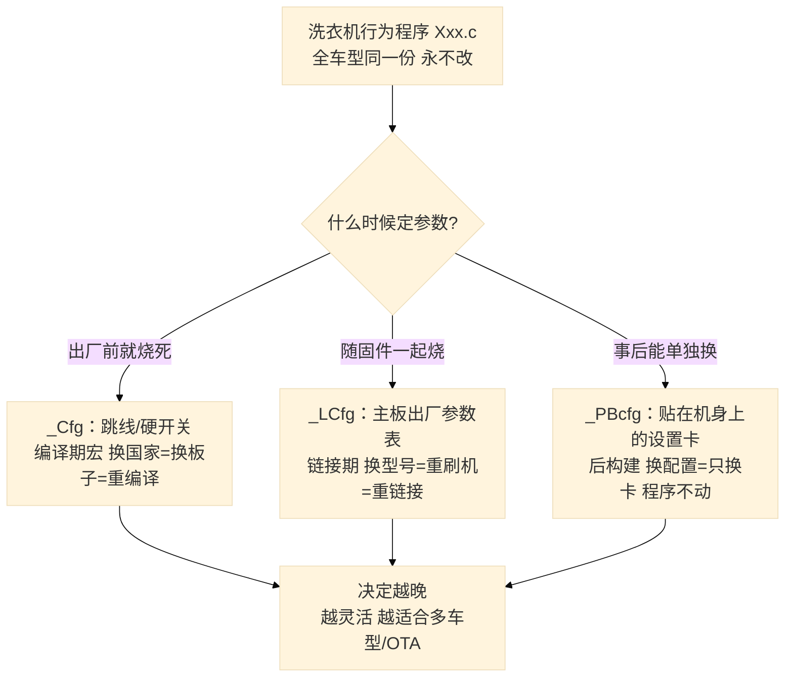
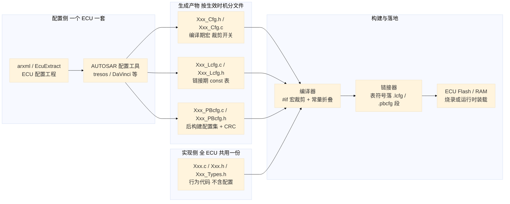
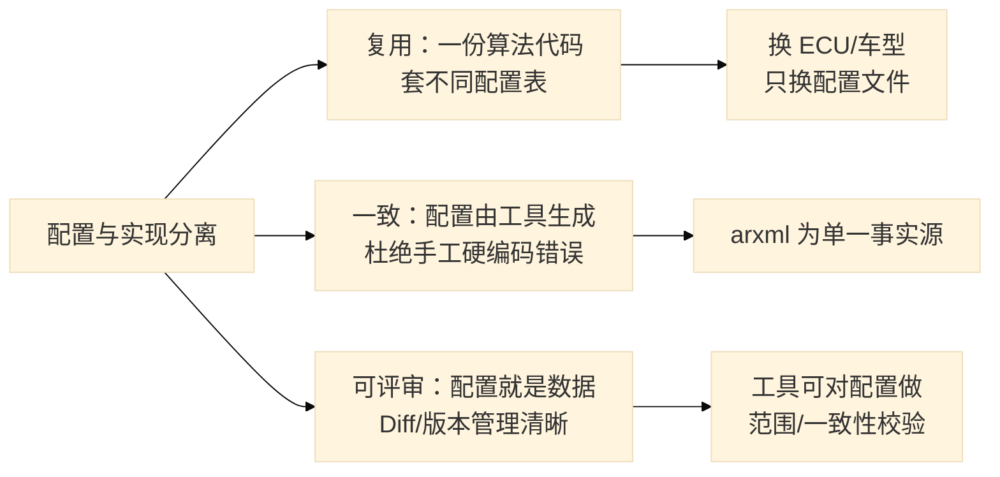
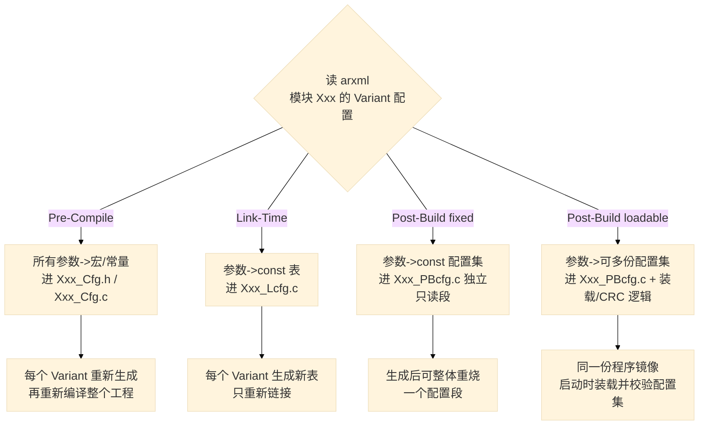
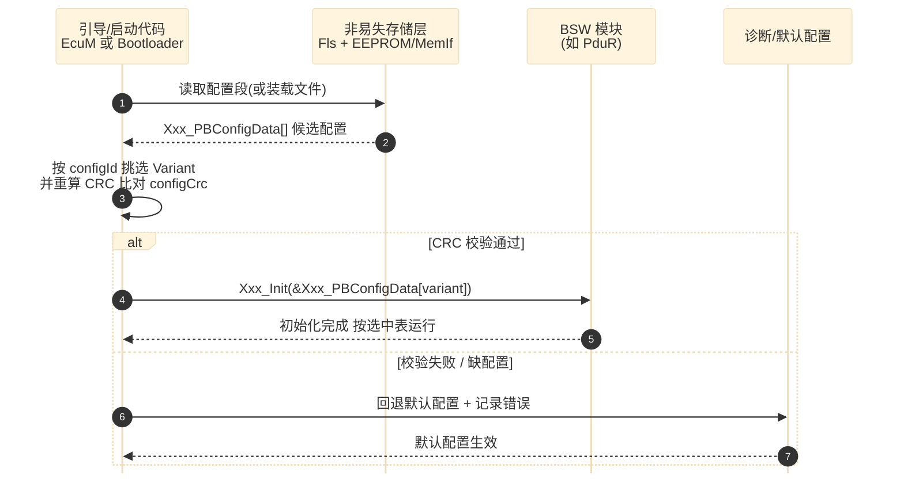
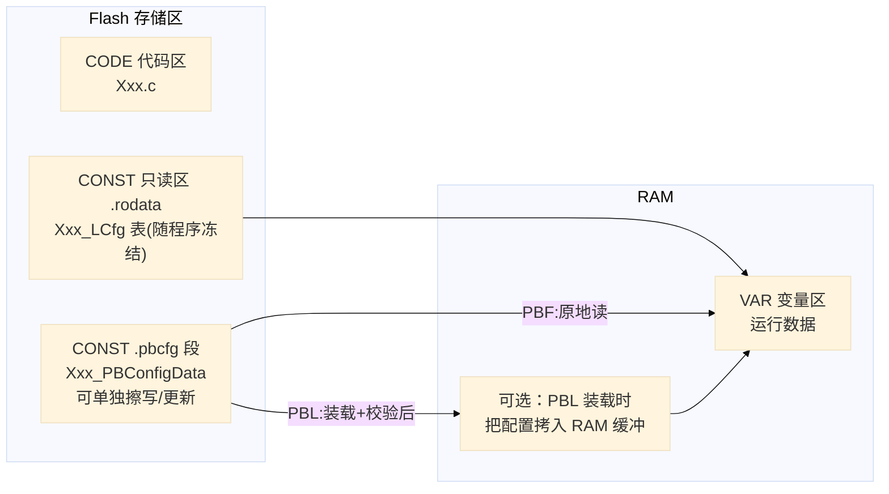
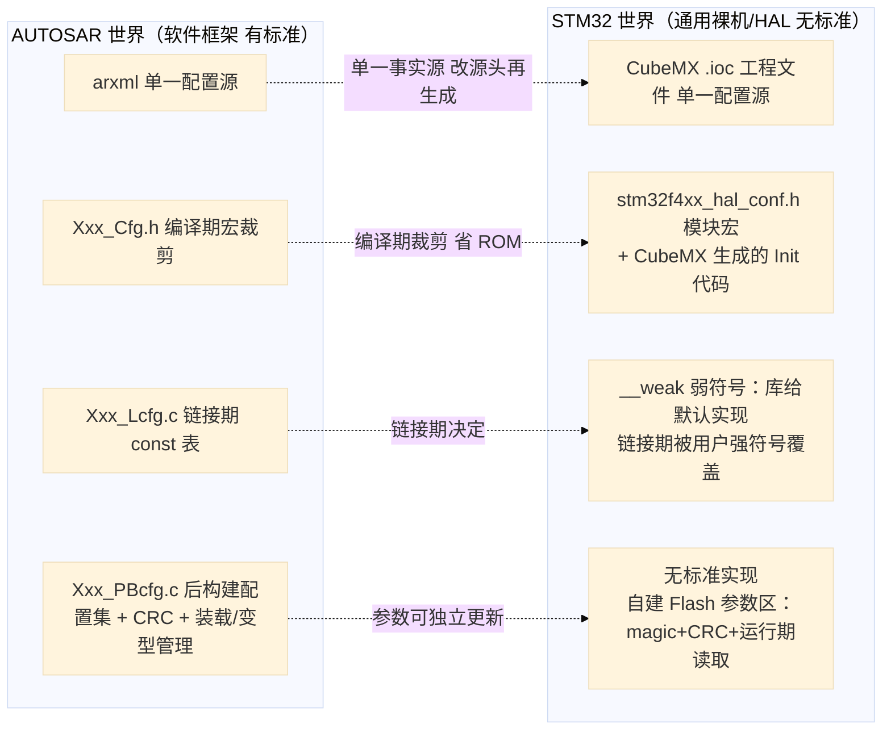
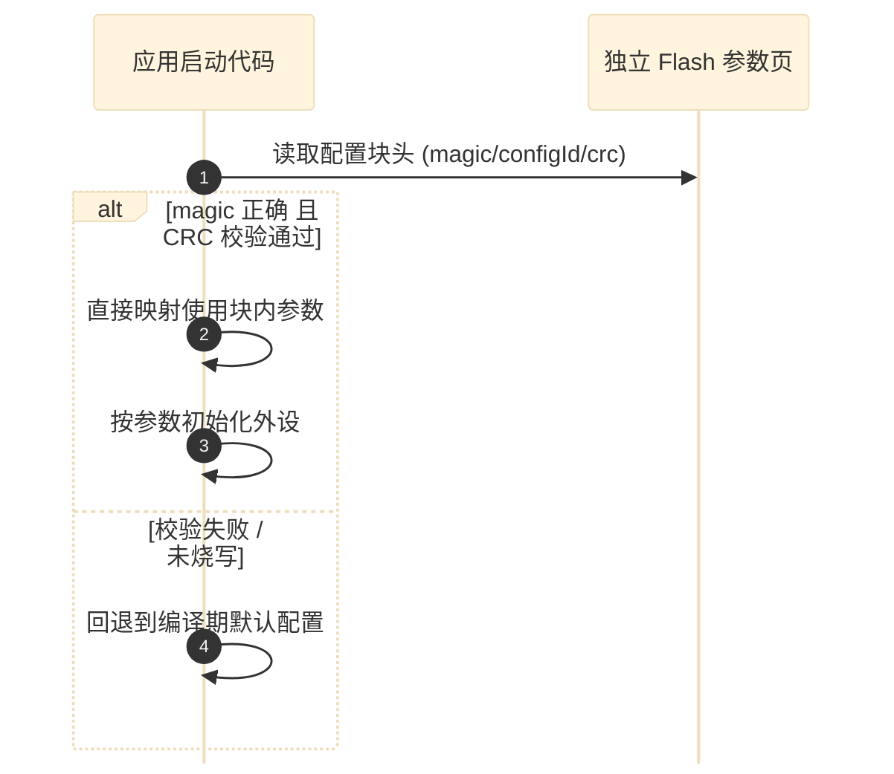

# AUTOSAR 配置生成代码命名规则：`_Cfg` / `_Lcfg` / `_PBcfg` 到底分别用于什么

> 适用范围：AUTOSAR 配置工具（EB tresos、Vector DaVinci、风河 WinCE 工具等）依据 ECU 配置（arxml / EcuExtract）为每个 BSW 模块生成的 C 源码。
> 阅读本文可先看 **① 一句话回答**，再看 **② 通俗理解**，需要工程落地细节时看 **③ 设计机制与思路** 与 **④ 深入原理**。

---

## 目录

1. [① 一句话回答](#-一句话回答)
2. [② 通俗理解：同一模块为什么会有三套"名字"](#-通俗理解)
3. [③ 全貌：一个典型模块会生成哪些文件](#-全貌一个典型模块会生成哪些文件)
4. [④ 设计机制与设计思路（重点）](#-设计机制与设计思路重点)
5. [⑤ 深入原理](#-深入原理)
6. [⑥ 常见误区与 FAQ](#-常见误区与-faq)

---

## ① 一句话回答

`xxx_Cfg`、`xxx_LCfg`、`xxx_PBcfg` 三类文件名，本质是按 **"配置生效的时机（binding time）"** 给 BSW 模块的"配置产物"分档。同一份 arxml 配置，工具会按你为模块选定的**配置变体（Variant）**，把数据/宏"展开"到不同后缀的文件里：

| 文件后缀 | 英文含义 | 配置生效时机 | 一句话职责 |
|---|---|---|---|
| `xxx_Cfg.c/.h` | **C**onfi**G**uration | 编译期（Pre-Compile / Compile-time） | 全部是 `#define` 宏 / 编译期常量 → 参与"代码裁剪"，在**编译前**定死 |
| `xxx_LCfg.c/.h` | **L**ink-time Con**f**i**g**uration | 链接期（Link-Time） | `const` 配置结构体数组 → 随程序一起烧死的只读表，换配置要**重新链接** |
| `xxx_PBcfg.c/.h` | **P**ost-**B**uild Con**f**i**g**uration | 后构建期（Post-Build） | `const` 配置集（可含多个 Variant，带 CRC/校验）→ 放在**独立内存段**，代码与链接都不动即可换配置，甚至**运行时/OTA 装载** |

> 一句话概括：**`_Cfg` = 烧死在编译里的开关，`_LCfg` = 烧死在程序里的常量表，`_PBcfg` = 可以"事后换掉"的配置块。** 换它们的代价依次是：重新编译 → 重新链接 → 什么都不改只换数据。

---

## ② 通俗理解

### 2.1 先看类比

把 BSW 模块想成 **"一台功能固定但参数可调的洗衣机"**：

- 洗衣机内部的程序逻辑（进水 → 洗涤 → 排水 → 脱水）是**行为代码** `xxx.c`，全车通用，谁都不改；
- 但"这款洗衣机销往哪个国家 / 哪种型号"，需要一套 **"铭牌参数"**（电压、程序表、限位……）——这就是**配置代码**。

问题来了：**什么时候决定用哪套参数？** 三种后缀恰好对应三种"决定时机"：



- **`_Cfg`（编译期）**：参数在**编译**时就写死在代码/宏里。改参数 → 改源码 → **整个工程重新编译**。最"硬"，但编译器能做常量折叠、把用不到的功能整个裁掉，代码最小、最快。
- **`_LCfg`（链接期）**：参数是一张 `const` **表**，代码已编好，最后**链接**时把表链进去。改参数只要重新生成这张表、重新链接，行为代码（`.c`）一个字节都不用动。
- **`_PBcfg`（后构建）**：参数也是表，但被放在**程序之外、可单独更新的段**里，甚至可以存到非易失存储（EEPROM/Flash），启动时由引导/装载逻辑校验后取用。改配置**既不重编译也不重链接**，只需烧/刷一份新配置——这就是**一个软件镜像支撑多车型、支持 OTA 升级参数**的关键。

### 2.2 名字为什么长这样

- `Cfg` = Configuration：工程配置阶段决定的产物；
- `L` 放在 Cfg 前 = **L**ink-time：强调"链接期才能替换"；也有资料口语化称为 "Link Config"；
- `PB` = **P**ost-**B**uild：强调"程序构建完成后仍可变"。

> ⚠️ 记忆锚点：**没有哪个后缀是"模块等级高低"或"加密与否"的意思，它们只回答一个问题——改这个配置，你要付出哪种代价（重编/重链/重烧配置块）。**

---

## ③ 全貌：一个典型模块会生成哪些文件

### 3.1 一次配置代码生成的整体流程



### 3.2 一张"文件后缀速查表"

> 表头含义：该文件在**行为代码之外**还承担什么、能否被工具反复重新生成、改配置的代价、典型内存去向。

| 生成文件 | 典型内容 | 配置变体 | 换配置的代价 | 内存/段 | 能否手改 |
|---|---|---|---|---|---|
| `Xxx.c` / `Xxx.h` | 模块算法、接口实现（厂商或基础软件供应商写） | ——（不含配置） | 改代码才动 | CODE | 是（属手写区） |
| `Xxx_Types.h` | 配置/实现共用的 `typedef` 结构体类型 | —— | —— | 类型，无实例 | 否（生成） |
| `Xxx_Version.h` | 模块版本、AR 版本、供应商宏 | —— | —— | —— | 否 |
| `Xxx_Internal.h` | 模块内部宏/私有函数声明 | —— | —— | —— | 视工具 |
| `Xxx_Cfg.h` | **编译期宏**：`#define Xxx_xxx_XXX`、裁剪开关、数量、地址 | Pre-Compile | 重新编译 | 不占运行内存（宏） | 否 |
| `Xxx_Cfg.c` | 编译期常量/数组（模块**不允许**后构建时，常量表也放这里） | Pre-Compile | 重新编译 | CONST（Flash） | 否 |
| `Xxx_Lcfg.c` | `const Xxx_ConfigType Xxx_ConfigData[]`（链接期配置表） | Link-Time | 重新链接 | CONST → `.lcfg` 段 | 否 |
| `Xxx_Lcfg.h` | 上表符号的 `extern` 声明、给行为代码引用 | Link-Time | —— | —— | 否 |
| `Xxx_PBcfg.c` | `const Xxx_PBConfigType Xxx_PBConfigData[]`（可含多配置集 + CRC） | Post-Build | 换配置块/OTA | CONST → `.pbcfg` 段 | 否 |
| `Xxx_PBcfg.h` | 同上表的声明；供装载逻辑与行为代码引用 | Post-Build | —— | —— | 否 |
| `Xxx_MemMap.h` | 内存段映射宏（把上面的表放进指定段） | —— | —— | —— | 否（模板） |

> 说明：不同模块/不同工具在**细分文件名**上会有差异（例如有的工具把纯常量表放 `Xxx_Cfg.c` 而**不**生成 `Xxx_Lcfg.c`，有的模块没有后构建能力故永无 `Xxx_PBcfg.c`）。但**"宏=编译期、常量表=链接期、可替换配置=PB" 的三大类分档是全体 AUTOSAR 模块一致的约定**，也是你读懂任何工具输出文件的钥匙。

### 3.3 真实世界的呼应

以公开 AUTOSAR 模块为例（细节以各 SWS 与所用工具为准）：

- **PduR（通信路由）**：Post-Build 时工具生成 `PduR_PBcfg.c`，内含 `const PduR_PBConfigType PduR_PBConfigData[]`，启动时 `PduR_Init(const PduR_PBConfigType* CfgPtr)` 传入其地址——这就是 `_PBcfg` 后缀最典型的体现；
- **Com / Can / CanIf 等大量 BSW**：都有 `Xxx_Cfg.h`（宏）+ 视变体出现的 `Xxx_Lcfg.c` 或 `Xxx_PBcfg.c`；
- **MCAL 驱动（如 DIO/Port/GPT）**：通常是 Pre-Compile 或 Link-Time，因而**只有 `_Cfg.h`/`_Lcfg.c`，很少见到 `_PBcfg`**——因为引脚/通道等硬绑定参数必须在编译/链接期定死。

---

## ④ 设计机制与设计思路（重点）

### 4.1 为什么 AUTOSAR 要"配置与代码分离"？

**设计动机**：同一套 BSW/MCAL 算法代码要复用到几十上百个 ECU 与车型上。如果每个项目把参数硬编码在 `.c` 里，那么：
- 改一个针脚、一路 CAN、一个报文周期，都要手工改算法源文件 → 无法维护；
- 同一个算法代码在多处被复制修改 → 版本漂移、验证成本爆炸。

于是 AUTOSAR 引入 **"实现代码（behavioral code）"与"配置代码（configuration）"彻底分离**：
- **行为代码** `Xxx.c`：由芯片/基础软件供应商交付，**不含任何设备参数**，通过"把配置指针传进 `Xxx_Init(ConfigPtr)`"的方式"注射"配置；
- **配置代码** `Xxx_Cfg / _Lcfg / _PBcfg`：由配置工具按 `arxml` **每次重新生成**，随项目变、随车型变。

这带来三个直接好处：



### 4.2 更深一层：三种"生效时机"其实是三种成本权衡

光分离还不够——**同一个参数（比如"有几路 CAN、每个报文多长"），你要在哪个阶段定死？** 这必须把选择权交给 OEM/集成方，于是 AUTOSAR 定义了 **配置变体（Variant）**，不同变体对应不同的**工程与运行成本**：

| 变体 | 程序何时确定该值 | 换配置成本 | 资源代价 | 典型用途 |
|---|---|---|---|---|
| **Pre-Compile（编译期）** | 编译器看到源码那一刻（宏/常量） | 改 arxml → 重新生成 → 全量重编译 | 极低：宏可裁剪代码、常量可折叠，不额外占 RAM | 引脚绑定、功能裁剪、数量固定的东西（大部分 MCAL） |
| **Link-Time（链接期）** | 链接器定符号那一刻（const 表） | 只重链接（代码已编好） | 低：只读表进 Flash，几乎不占 RAM | 上/下电前永不变的模块参数 |
| **Post-Build（后构建）** | 程序启动/装载那一刻 | 只换配置块，代码链接都不动 | 中高：需独立段 + CRC 校验 + 装载机制 | 多车型一个镜像、售后标定、OTA 改参数 |

> **设计思路总结**：AUTOSAR 认为"越早绑定 → 越省（性能/存储/成本）但越僵化；越晚绑定 → 越灵活（支持变型管理/OTA）但越贵（要校验、要装载、要防错配）"。`_Cfg/_Lcfg/_PBcfg` 正是把这条"绑定时间轴"落到了文件名上。

### 4.3 关键设计模式：行为代码 + 注入式配置（数据驱动）

无论走哪种变体，**行为代码的写法是一致的**——模块内部只保留一个"配置指针"，所有通道数、周期、缓冲都从指针指向的表读取：

```c
/* =====================================================================
 * Xxx.c —— 模块行为代码（示意：一段"读配置驱动"的代码）
 * 注意：这里没有任何设备参数！参数全来自 Init 时传入的配置指针。
 * 无论配置来自 _Lcfg 还是 _PBcfg，本文件一字不改。
 * ===================================================================== */
#include "Xxx.h"
#include "Xxx_Types.h"

static const Xxx_ConfigType* Xxx_ConfigPtr;   /* 模块私有的"配置视图" */

void Xxx_Init(const Xxx_ConfigType* ConfigPtr)
{
    Xxx_ConfigPtr = ConfigPtr;                /* 注入配置：Lcfg 或 PBcfg 表项 */
    Xxx_ResetPeripherals();
}

/* 周期轮询：通道数、超时全部来自配置表，而非 #define 或硬编码 */
void Xxx_MainFunction(void)
{
    uint8 i;

    for (i = 0u; i < Xxx_ConfigPtr->channelNum; i++)   /* 通道数由配置决定 */
    {
        if (Xxx_IsTimeout(Xxx_ConfigPtr->timeoutMs[i]))  /* 超时参数由配置决定 */
        {
            Xxx_HandleTimeout(i);
        }
    }
}
```

- 这段代码里没有 `#define CAN_CHANNEL 2`、没有 `if (channel == 0u)` 之类硬编码；
- 通道数量、超时值全部来自 **`Xxx_ConfigPtr->xxx`**；
- 上层/启动代码负责把 `Xxx_Lcfg.c` 或 `Xxx_PBcfg.c` 里生成的 `Xxx_ConfigData[]`（或其中某一 Variant 项）的地址塞给它。

> 这就是经典的 **数据驱动 / 依赖注入** 在嵌入式基础软件中的体现：算法稳定、数据可变，验证一份代码、变化只看数据 Diff。

### 4.4 工具视角：同一条配置，为什么能出现在不同后缀的文件里？

工具真正看的不是"名字"，而是**你给模块选的 Variant**。其内部大致按如下逻辑分发产物：



> 经验：你在工程里看到 `_Cfg.h`（几乎必有）说明有**编译期宏**；看到 `_Lcfg.c` 说明有**链接期只读表**；看到 `_PBcfg.c` 说明该模块**开了 Post-Build 能力**，配置被设计成"可事后替换"。

---

## ⑤ 深入原理

### 5.1 编译期（Pre-Compile）：宏就是"代码裁剪器"

生成文件示例（示意，符号风格遵循典型 AUTOSAR 工具输出）：

```c
/* =====================================================================
 * Xxx_Cfg.h —— 编译期配置（工具生成，禁止手改）
 * 特点：只有 #define；被 Xxx.c 直接 include；
 *       参与预处理、常量折叠、条件编译，不占运行内存。
 * ===================================================================== */
#ifndef XXX_CFG_H
#define XXX_CFG_H

/* ---- 0. 必备头（提供 STD_ON/STD_OFF 等） ---- */
#include "Std_Types.h"

/* ---- 1. 数值类宏：编译期常量，可被数组上界/循环使用 ---- */
#define XXX_CHANNEL_NUM                 (2u)   /* 通道数量 */
#define XXX_MAIN_FUNCTION_PERIOD_MS     (10u)  /* 周期函数调度周期 */

/* ---- 2. 裁剪类开关：决定某段代码“编不编进去” ---- */
#define XXX_DEV_ERROR_DETECT            (STD_ON)   /* 是否带 DET 报错代码 */
#define XXX_VERSION_INFO_API            (STD_OFF)  /* 是否生成版本查询接口 */

#endif /* XXX_CFG_H */
```

宏如何在行为代码里"剪裁"：

```c
/* Xxx.c（片段）：开关宏决定代码是否参与编译 */
#if (XXX_DEV_ERROR_DETECT == STD_ON)
static void Xxx_ReportError(uint16 ErrorId)
{
    /* 注意：这是纯 AUTOSAR 的 DET 上报，不含任何厂商寄存器写法 */
    Det_ReportError(MODULE_ID_XXX, 0u, ErrorId);
}
#endif
```

**为什么编译期最"省"（原理层面）**：
- 宏在**预处理**阶段就完成替换，`XXX_CHANNEL_NUM` 变成字面量 `2u`；
- 之后**常量折叠**让数组上界、循环边界在编译期已知，编译器可做循环展开、边界检查、静态越界报错；
- 条件编译 `#if` 让**用不到的功能的整段代码不进目标文件** → 代码体积最小、无运行时判断开销；
- 代价是**绑定最早**：任何宏变化都要触发一次全量重编译，且无法在出厂后改变。

### 5.2 链接期（Link-Time）：`const` 表就是"最后时刻链进去的数据"

生成文件示例：

```c
/* =====================================================================
 * Xxx_Lcfg.c —— 链接期配置（工具生成，示意）
 * 特点：全部 const，只读，放 Flash；代码已编好，重链接即换配置。
 * ===================================================================== */
/* ---- MemMap：把下方数据段放进 .lcfg 只读段（见 5.4） ---- */
#define XXX_START_SEC_CONST_LCFG
#include "Xxx_MemMap.h"

const Xxx_ConfigType Xxx_ConfigData[XXX_CONFIG_COUNT] =
{
    /* 控制器 0：直接引用 Cfg.h 的宏作为初值（生成器惯例） */
    {
        .baseAddr   = 0xF0000000u,     /* 外设基地址（示例值） */
        .channelNum = XXX_CHANNEL_NUM,
        .irqPrio    = 2u,
        .timeoutMs  = { 10u, 20u, 30u, 40u }
    }
};

#define XXX_STOP_SEC_CONST_LCFG
#include "Xxx_MemMap.h"
```

**为什么需要 `.h` 里的 `extern` 声明**（数据与使用分离）：
- `Xxx_Lcfg.c` **定义**表（分配存储）；
- `Xxx_Lcfg.h` **声明**表（`extern const Xxx_ConfigType Xxx_ConfigData[];`），供行为代码或启动代码引用；
- 链接器在**链接阶段**把"声明引用"解析到"定义符号"。只要表占用的 Flash 段可被替换，换一个 `Xxx_Lcfg.o` 重新链接就完成换配置。

```c
/* Xxx_Lcfg.h（示意）：只声明不定义，方便任何 .c 引用 */
extern const Xxx_ConfigType Xxx_ConfigData[];   /* 定义在 Xxx_Lcfg.c */
```

**为什么链接期比编译期灵活一点**：行为代码已经全部编成目标文件，只要不改代码，重链接即可；适合"代码冻结后再定部分参数"的集成场景。**为什么仍不如 PB 灵活**：每次换配置仍要出**一个新二进制**（重新链接 → 重新烧整包）。

### 5.3 后构建（Post-Build）：独立的配置世界

生成文件示例（示意，可含多个配置集，每份自带 CRC）：

```c
/* =====================================================================
 * Xxx_PBcfg.c —— 后构建配置（工具生成，示意）
 * 特点：可以存在多个“配置集”；放在独立段；启动时校验并选择其一。
 * ===================================================================== */
#define XXX_START_SEC_CONST_PBCFG
#include "Xxx_MemMap.h"   /* 放入 .pbcfg 段：可单独烧写 / 独立管理 */

const Xxx_PBConfigType Xxx_PBConfigData[XXX_NUM_OF_POSTBUILD_VARIANTS] =
{
    /* ---- Variant 0：高速车型配置集 ---- */
    {
        .configId   = 0x00u,             /* 配置集编号（变型管理用） */
        .configCrc  = 0x8A3Fu,           /* 工具算好，启动时校验 */
        .channelNum = 4u,
        .mainPeriod = 5u
    },
    /* ---- Variant 1：低速车型配置集 ---- */
    {
        .configId   = 0x01u,
        .configCrc  = 0x5C21u,
        .channelNum = 2u,
        .mainPeriod = 10u
    }
};

#define XXX_STOP_SEC_CONST_PBCFG
#include "Xxx_MemMap.h"
```

PBL（可装载）形态下，多了一份"把外部配置读进来再校验"的启动时序：



**PBF 与 PBL 的区别（一句话）**：
- **Post-Build fixed（PBF）**：配置仍是"随整机一起烧的独立段"，只是**代码冻结之后**才决定/生成该段，可整体重烧这段，但**出厂后不再运行时换**；
- **Post-Build loadable（PBL）**：配置可由 Bootloader/诊断**在运行时装载**（存于 EEPROM/外部 Flash），支持"同一个应用镜像、现场/OTA 换配置"，代价是必须加 CRC、安全、装载与地址搬运逻辑。

### 5.4 内存段映射（MemMap）：三种数据怎么落到不同的"地界"

配置数据是**只读表**，但仍要按"能不能被单独更新"区分放哪。AUTOSAR 用 **MemMap 宏**在**编译前**把 `const` 数据"指路"到不同 section：



典型生成写法（编译器无关地包裹 section 宏）：

```c
/* Xxx_MemMap.h（示意）：由工具链/编译器抽象实现 */
/* 例如 GCC 下可能展开为 __attribute__((section(".pbcfg"))) */
#define XXX_START_SEC_CONST_PBCFG   \
    /* 展开: 声明进入指定段 (工具/编译器相关实现) */
#define XXX_STOP_SEC_CONST_PBCFG    \
    /* 展开: 退出指定段 */
```

> 工程含义：**section 决定"能不能被单独刷写"。** `.rodata` 随应用一起烧写；`.pbcfg` 由链接脚本分配到可独立管理的 Flash 分区，Bootloader 可单独更新它而不碰应用 → 这是 OTA 只更参数的底层基础。

### 5.5 一个更深的视角：AUTOSAR 为什么要"规定"这些生成物

回到 AUTOSAR 的分层目标（复用、可集成、可验证）：

1. **可集成性**：每个 BSW 模块只要遵循"宏进 `_Cfg.h`、表进 `_Lcfg.c/_PBcfg.c`"的约定，集成方就能**不看代码**判断"这个配置要付出什么代价、能不能后改"；
2. **可验证性**：Post-Build 配置带 **CRC/一致性校验**，防止"装错了配置集"的车出问题；配置变更可被当作**纯数据 Diff** 走版本管理，而不是改代码评审；
3. **变型管理（Variant Handling）**：OEM 通过 `configId`/variant 编号在**同一镜像**里承载多车型差异，配合 BswM/EcuM 实现启动时的"按配置集初始化"；
4. **开发流程解耦**：SWC/BSW 供应商交付"行为代码"；OEM/集成方只维护"配置"。两者通过**同一份 arxml** 接缝对接。

---

## ⑥ 常见误区与 FAQ

### 6.1 常见误区

| 误区 | 澄清 |
|---|---|
| "`_LCfg` 是 Level/Local 配置" | 正解是 **Link-time**；强调"链接期才能替换的那张只读表" |
| "`_PBcfg` 的模块更高级/带安全" | 后缀只表示**后构建变体**，不代表加密或功能多寡 |
| "看到了 `_Cfg.h` 就没有后构建" | 不一定：很多模块**同时**有 `_Cfg.h`（编译期宏裁剪）+ `_PBcfg.c`（参数表） |
| "配置文件可以手改省事" | 生成文件头部通常标注 `Generated ... do not edit`；正确做法是改 arxml → 重跑工具 |
| "三种后缀必然同时出现" | 不一定：纯编译期模块只有 `_Cfg`；不允许后构建的模块只有 `_Cfg/_Lcfg`；只有开了 PB 能力才有 `_PBcfg` |

### 6.2 FAQ

- **Q：我该把哪些配置做成 Post-Build？**
  A：需要"一个镜像多车型/售后可调/OTA 可改"的参数（路由表、报文周期、总线配置等）。绑定到硬件的（引脚、时钟、外设基址）保持编译期即可。
- **Q：三种方式能混用吗？**
  A：能——宏裁剪与参数表本来就同时存在；但**同一个参数**通常只选一种变体，避免"两处定义、改一处漏一处"。
- **Q：PduR 的 `PduR_PBConfigData` 为什么不直接叫 `PduR_ConfigData`？**
  A：`PB` 前缀就是提醒你它**可后构建替换、需校验**；而把名字区隔开，也能让同一个二进制里同时存在"编译期默认表"与"后构建候选表"而符号不冲突。

---

### 附：如果配了 Post-Build，工具一般还会多给什么？

- 启动代码中一段**配置校验与选择**逻辑（CRC + variant 选择）；
- **`Xxx_PBcfg.h`** 的 `extern` 声明与配置集编号宏；
- 链接脚本/生成器配置文件里 **`.pbcfg` 段的地址规划**；
- （PBL）Bootloader 侧的**装载/校验驱动**（需 `Fls`/`MemIf` 与 EEPROM 抽象参与）。

---
---

## ⑦ 附录（STM32 视角）：STM32 有没有这样的配置机制？如果有，如何类比？

> 本章与前面章节的**主题不同**：前文属于"软件框架层"（AUTOSAR），本章属于"通用单片机生态"（STM32 + HAL/LL + CubeMX）。为回答该问题，本章会给出 STM32 侧示例代码，**只用于两类世界间的类比**，请勿把它们读成前文 AUTOSAR 内容的延续。

### 7.1 直接回答（先说结论）

**分两种情况，答案相反：**

1. **如果你说的"STM32"是普通裸机 / HAL / RTOS 工程（最常见）→ 没有。** STM32 生态**不存在 AUTOSAR 那套 `_Cfg / _Lcfg / _PBcfg` 命名与"配置变体（Pre-Compile / Link-Time / Post-Build）"标准机制**。你不会在 CubeMX 生成的工程里看到这些文件名。它"有"的只是几个**思想上很像**的朴素对应物（编译期宏、弱符号、自建 Flash 参数区），下面逐个类比。

2. **如果你说的"STM32"是它上面的真 AUTOSAR 栈 → 有，而且完全一样。** ST 汽车级方案（SPC5 / Stellar 等，以及带 AUTOSAR MCAL 的平台）通过 EB tresos 等工具生成 BSW/MCAL 时，同样会产出 `Xxx_Cfg.h`、`Xxx_Lcfg.c`、`Xxx_PBcfg.c`。**因为这些机制属于 AUTOSAR 软件框架，不属于单片机本身** —— 换到什么芯片上都一样。

一句话：**`_Cfg/_Lcfg/_PBcfg` 是"软件框架层"的产物；STM32 是"硬件/芯片层"。芯片上跑不跑这套机制，取决于你给它装了什么软件栈。**

### 7.2 通俗理解

AUTOSAR 像"整车厂的研发管理体系"：它规定"设计文档(arxml) → 零件配置 → 三档冻结时机 → 一套可复用的算法代码"，谁违反了文件分区规矩，整条产线就没法集成。

STM32 生态更像"个人/小团队工具箱"：没有统一管理规范，但工程师会**自发地用差不多的土办法**解决同样的问题：

- 想省代码 → 开/关宏（≈ 编译期 `_Cfg`）；
- 想让库留个"默认动作、用户随时覆盖" → 弱符号（≈ 链接期"二选一"）；
- 想不刷程序只改参数 → 在 Flash 划一页自己存参数 + CRC（≈ 自建 `_PBcfg`）。

这些"土办法"**各自解决某个点**，但不成体系、没有标准命名、没有校验/装载/多配置集管理。

### 7.3 两类世界的逐项对照



| AUTOSAR 机制 | STM32 侧对应物 | 相似度 | 说明 |
| --- | --- | --- | --- |
| `arxml` 单一配置源 | CubeMX 工程的 `.ioc` 文件 | ★★★ | 都在"源文件"里改配置，再一键生成代码 |
| 配置工具批量生成 | STM32CubeMX 代码生成器 | ★★★ | 都是"生成区 + 手工区"分离（AUTOSAR 用整文件生成、禁止手改；CubeMX 用 `USER CODE BEGIN/END` 保护区） |
| `_Cfg.h` 编译期宏 / 裁剪 | `stm32f4xx_hal_conf.h` 外设开关宏、`HSE_VALUE` 等常量 | ★★★ | 都是**编译期**裁剪，关了就不编进去 |
| `_Cfg` 换配置要重编译 | 改 `.ioc` → 重新生成 → 整包重编译 | ★★★ | 绑定最早、最省、最僵化 |
| `_Lcfg.c` 链接期 const 表 | 无直接对应；**弱符号覆盖**最接近 | ★☆ | AUTOSAR 换的是"参数表"，STM32 弱符号换的是"行为/回调"，维度不同 |
| `_PBcfg.c` 后构建 + CRC | 无标准；**自建 Flash 参数区 + CRC** 最接近 | ★ | 只解决"参数可单独更新"，无多配置集/装载规范 |
| 多配置集、变型管理、启动校验流程 | **没有** | — | STM32 是芯片不是软件框架，需要时靠 Bootloader + 自定义方案 DIY |

### 7.4 STM32 三个"近似物"示例（代码 + 说明）

#### ① 编译期裁剪 —— 对应 AUTOSAR `_Cfg.h` 的宏开关

```c
/* =====================================================================
 * stm32f4xx_hal_conf.h（CubeMX/HAL 工程自动生成）
 * 作用与 AUTOSAR *_Cfg.h 相同：编译期“开/关”外设驱动，裁剪代码体积。
 * 没被 #define 的模块，整个驱动不进工程 —— 编译期就省掉 ROM。
 * ===================================================================== */
#define HAL_MODULE_ENABLED            /* 总开关 */
#define HAL_UART_MODULE_ENABLED       /* 只开 UART 驱动 */
#define HSE_VALUE  ((uint32_t)8000000U)   /* 编译期时钟常量（类似 Cfg 数值宏） */
#define USE_HAL_UART_REGISTER_CALLBACKS 1u /* 是否支持“运行期注册回调” */
/* 注意：没有 #define HAL_CAN_MODULE_ENABLED，则 CAN 驱动整体不编译 */
```

#### ② 生成代码与手写代码的"接缝" —— 对应 AUTOSAR"生成文件禁止手改"

```c
/* =====================================================================
 * main.c 里由 CubeMX 生成的初始化函数（再生成会被整体覆盖，勿手改）
 * 与 AUTOSAR“配置产物由工具生成”同一思想：
 *   要改参数 → 改 .ioc → 重新生成；手写逻辑一律放 USER CODE 保护区。
 * ===================================================================== */
void MX_USART1_UART_Init(void)
{
    huart1.Instance              = USART1;
    huart1.Init.BaudRate         = 115200u;
    huart1.Init.WordLength       = UART_WORDLENGTH_8B;
    huart1.Init.StopBits         = UART_STOPBITS_1;
    huart1.Init.Parity           = UART_PARITY_NONE;

    if (HAL_UART_Init(&huart1) != HAL_OK)
    {
        Error_Handler();          /* 失败统一处理 */
    }
}
/* 用户自己的逻辑，必须写在 USER CODE BEGIN / USER CODE END 之间才不会被覆盖 */
```

#### ③ 链接期"二选一" —— 弱/强符号覆盖（最接近 `_Lcfg` 的"链接期决定"）

```c
/* =====================================================================
 * 库内“默认(弱)实现”—— 在 stm32f4xx_hal_uart.c 中
 * __weak 的含义：允许链接器在存在同名“强符号”时，放弃这个默认体。
 * 这就把“用谁”的决定推迟到了链接期。
 * ===================================================================== */
__weak void HAL_UART_RxCpltCallback(UART_HandleTypeDef *huart)
{
    /* 默认什么都不做：编译可通过；用户若不覆盖，就用这个空体 */
}

/* =====================================================================
 * 用户文件：提供一个“强符号”版本 → 链接时自动取代库内默认实现
 * 换个比喻：同一份二进制候选，链接器最终“链接”了用户这份。
 * ===================================================================== */
void HAL_UART_RxCpltCallback(UART_HandleTypeDef *huart)
{
    MyProtocol_OnFrame(huart);    /* 用户真正想做的收帧处理 */
}
```

> 区别提醒：AUTOSAR `_Lcfg` 链接期换的是**一张 const 参数表**；STM32 弱符号换的是**一段函数实现（行为）**。前者是"参数驱动"，后者是"代码覆盖"，思想同源、对象不同。

#### ④ 自建"近似 Post-Build" —— Flash 参数区 + CRC（STM32 没有标准实现，通常 DIY）

```c
/* =====================================================================
 * 自建的“近似 _PBcfg”思路：
 *   把业务参数放在一个独立 Flash 页（可被 Bootloader 单独擦写），
 *   启动时校验 magic + CRC 后使用；校验失败回退编译期默认值。
 * 它只复刻了“参数不重编译、可单独更新”这一半，
 * 没有 AUTOSAR 的多配置集 / 变型管理 / 装载规范。
 * ===================================================================== */
#pragma pack(push, 1)
typedef struct
{
    uint32_t magic;              /* 魔数：标识该区已被正确写入 */
    uint16_t configId;           /* 配置集编号（近似 variant） */
    uint16_t crc;                /* payload 的 CRC，启动时校验 */
    uint32_t payload[64];        /* 业务参数区 */
} AppConfigBlock;
#pragma pack(pop)

#define APP_CFG_MAGIC     0xA55AA55Au
#define CFG_BLOCK_ADDR    0x0801F800u      /* 独立的、可单独擦写的 Flash 页(示意) */

/* 用“映射”而非“拷贝”：直接从 Flash 只读地址取值 */
static const AppConfigBlock * const g_cfg = (const AppConfigBlock *)CFG_BLOCK_ADDR;

void App_LoadConfig(void)
{
    if ((g_cfg->magic == APP_CFG_MAGIC) && (App_CheckCrc(g_cfg) == 0u))
    {
        /* 校验通过 → 使用 Flash 里的运行参数 */
    }
    else
    {
        /* 校验失败 → 回退到编译期默认配置（近似默认 variant） */
    }
}
```



### 7.5 为什么会有这种差别？（思路层面）

- **AUTOSAR 的配置机制是"被规范逼出来"的**：几十家 Tier1/工具商/OEM 要复用同一套 BSW 代码、在工程上按车型做变型管理，所以必须有**统一的命名、统一的文件分区、统一的三种绑定时机**，否则无法跨公司集成与评审。
- **STM32 生态的配置是"被习惯/工具养出来"的**：CubeMX 解决"初始化代码怎么写"，HAL 宏解决"代码怎么裁剪"，`__weak` 解决"默认行为怎么被替换"，Flash 参数区解决"参数怎么存"——**每个问题单独有答案，但没有一个标准把它们串成一套体系**，因为通用 MCU 场景很少需要"一套二进制多车型 + 售后/OTA 改配置"这种整车级需求。
- **缺什么？** 缺的正是 `_PBcfg` 所代表的"**参数与程序解耦 + 校验 + 装载 + 变型管理**"。当你的产品开始需要"一个固件跑多个型号 / 售后不改固件只改参数 / OTA 只更配置"，你就得在 STM32 上**自己把这套机制补出来**——此时回看 AUTOSAR 的设计，会发现它正好给你一份"标准答案"可抄。

### 7.6 小结

| 问题 | 答案 |
| --- | --- |
| STM32（裸机/HAL）有 `_Cfg/_Lcfg/_PBcfg` 这套命名吗？ | **没有**，这些命名是 AUTOSAR 软件框架的约定 |
| STM32 有类似"配置与代码分离"的思想吗？ | 有：CubeMX `.ioc` + 生成代码 + `USER CODE` 保护区、`hal_conf.h` 宏裁剪 |
| STM32 有类似"链接期决定"的机制吗？ | 有一点：`__weak` 弱符号覆盖（换"行为"而非"参数表"） |
| STM32 有类似"Post-Build 参数可独立更新"吗？ | 无标准机制，需自建 Flash 参数区 + CRC + 装载（见 7.4 ④） |
| 在 STM32 相关芯片上跑真 AUTOSAR 会看到这些文件吗？ | 会（SPC5/Stellar 等平台的 AUTOSAR MCAL/BSW 经 EB tresos 等生成时，文件命名完全一致） |

> 经验法则：**看到 `_Cfg/_Lcfg/_PBcfg` 前缀，先判断"这是哪个软件栈生成的"**。若工程里只有 CubeMX/HAL，这些文件不可能出现；若出现了，说明里面跑的是真 AUTOSAR 栈——那就请用前文第 ①~⑥ 章的理解去读它，而不是用 STM32 裸机的思维去手改。
