# UDS 基本协议与使用详解（含 ISO-TP 流控帧）

> 本文系统讲解汽车电子诊断的核心协议 **UDS（Unified Diagnostic Services，ISO 14229）** 的基本协议、典型服务用法，并**重点深入 ISO-TP（ISO 15765-2）网络层与流控帧（Flow Control Frame）机制**，配合完整可运行的 C 代码与 Mermaid 图示。
> 全文遵循「**通俗易懂 → 设计机制/设计模式/设计思路 → 深入原理**」三段式，每一章、每一个子概念都按此展开。

---

## 目录

- [第 0 章 全局鸟瞰：UDS 是什么、跑在哪一层](#第-0-章-全局鸟瞰uds-是什么跑在哪一层)
- [第 1 章 诊断报文的基本形态（SID / 正响应 / 负响应 / 寻址）](#第-1-章-诊断报文的基本形态sid--正响应--负响应--寻址)
- [第 2 章 UDS 常用服务详解](#第-2-章-uds-常用服务详解)
- [第 3 章 网络层 ISO-TP（ISO 15765-2）与流控帧](#第-3-章-网络层-iso-tpiso-15765-2与流控帧)
- [第 4 章 时序管理：P2 / P2\* / S3 / 0x78](#第-4-章-时序管理p2--p2--s3--0x78)
- [第 5 章 在 AUTOSAR 中的映射（Dcm / CanTp / Dem）](#第-5-章-在-autosar-中的映射dcm--cantp--dem)
- [第 6 章 深度实战：安全访问 0x27 与刷写 0x34/0x36/0x37](#第-6-章-深度实战安全访问-027-与刷写-034036037)
- [第 7 章 常见故障排查与工程陷阱](#第-7-章-常见故障排查与工程陷阱)
- [附录](#附录)

---

## 第 0 章 全局鸟瞰：UDS 是什么、跑在哪一层

### 0.1 通俗易懂

**UDS 就是汽车 ECU 的"标准客服话术"。**

想象你去 4S 店，维修师傅要和车里的几十个 ECU 对话：读故障码、清故障码、读某个传感器数据、升级固件、做例程测试。如果每个 ECU 厂家都说自己的方言（私有协议），那诊断仪就得给每个车型做一套适配——不可维护。

于是行业统一了一套"普通话"：

| 场景 | 师傅说什么（业务语义） | UDS 里的"话术" |
|---|---|---|
| "你现在能说话吗？" | 保持在线 | `3E 00`（TesterPresent） |
| "进入维修模式" | 切换到扩展会话 | `10 03` |
| "把水温告诉我" | 读数据标识符 | `22 F4 0C` |
| "把氧传感器的故障码全报出来" | 读 DTC | `19 02 FF` |
| "把故障码清掉" | 清 DTC | `14 FF FF FF` |
| "我要给你刷程序，先验证身份" | 安全访问 | `27 01` / `27 02 xx xx` |
| "开始下载 1MB 的固件" | 请求下载 | `34 00 44 ...` |

**而流控帧是"快递员的分段投递握手"。**

UDS 一句话可能有几百字节（比如读一个 500 字节的标定数据），但 CAN 经典帧最多装 **8 字节**。于是网络层（ISO-TP）把它拆成很多段，收件方必须回一句："**你可以继续发，一次发 8 段，两段之间至少隔 10 ms**"——这句回复就是 **流控帧（FC）**。

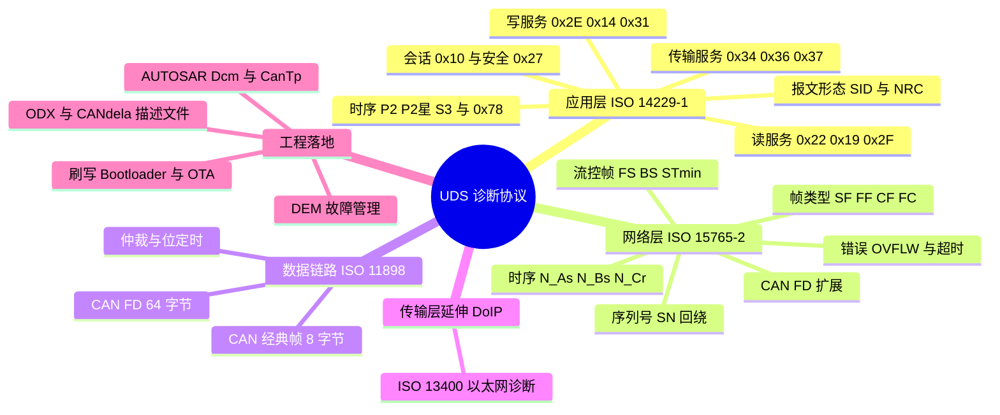

**图 0-1 解释**：这张图给出学习路径。核心是中间三块：**应用层（说什么话）→ 网络层（怎么把长话拆开送）→ 数据链路（物理上怎么发）**。绝大多数"诊断不通"的问题，90% 出在**网络层（帧类型、流控参数、序列号、超时）**，而不是应用层——所以第 3 章篇幅最大。

### 0.2 设计机制与设计思路

#### 0.2.1 分层：为什么诊断一定要"分层"

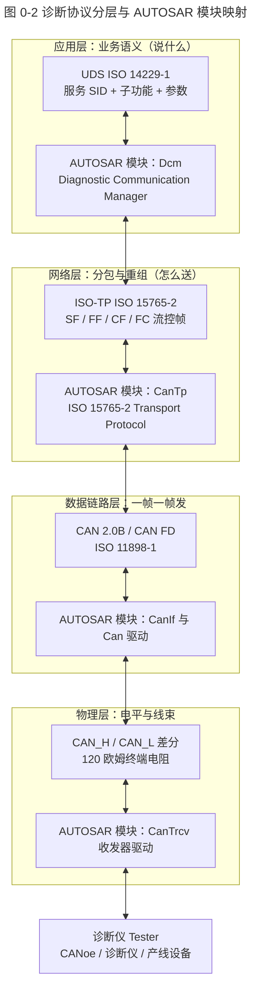

**图 0-2 解释**：分层带来三个关键收益，这正是设计意图：

1. **可替换**：换传输介质（CAN → CAN FD → 以太网 DoIP）时，**上层 UDS 服务一行代码都不用改**。这就是为什么今天同一份 UDS 服务既能跑在 CAN 上也能跑在 DoIP 上。
2. **职责单一**：Dcm 只关心"这个 SID 干什么、要不要安全检查、返回什么数据"；CanTp 只关心"怎么把 500 字节拆成 70 帧并保证对方收到了"。**应用层代码里永远看不到流控帧**。
3. **可测试**：可以用 CANoe 直接注入畸形 CF 帧测 CanTp 的健壮性，不必构造完整业务。

#### 0.2.2 设计模式：UDS 全局只用了三种"套路"

UDS 虽然服务几十个，但报文模式极其统一，只有三种：

| 模式 | 形态 | 例子 |
|---|---|---|
| **请求-响应（Request/Response）** | Tester 发请求，ECU 回正响应或负响应 | `22 F1 90` → `62 F1 90 ...` |
| **抑制正响应（Suppress Positive Response）** | 子功能字节最高位置 1，ECU 成功时不回话 | `3E 80`（只回负响应） |
| **长任务挂起（ResponsePending）** | ECU 先回 `7F xx 78`，处理完再回最终响应 | 刷写、例程控制 |

> 💡 **设计精髓**：UDS 把"**统一的外壳 + 可扩展的内核**"做到了极致。所有服务都是 `SID`（1 字节）+ `子功能/参数`（变长），正响应固定是 `SID + 0x40`，负响应固定是 `7F + SID + NRC`。这样诊断仪只要实现**一个通用解析器**就能处理所有服务，新增服务不需要改协议框架。这是典型的**"协议骨架固定、语义可扩展"**的设计。

### 0.3 深入原理：一次完整诊断的报文流

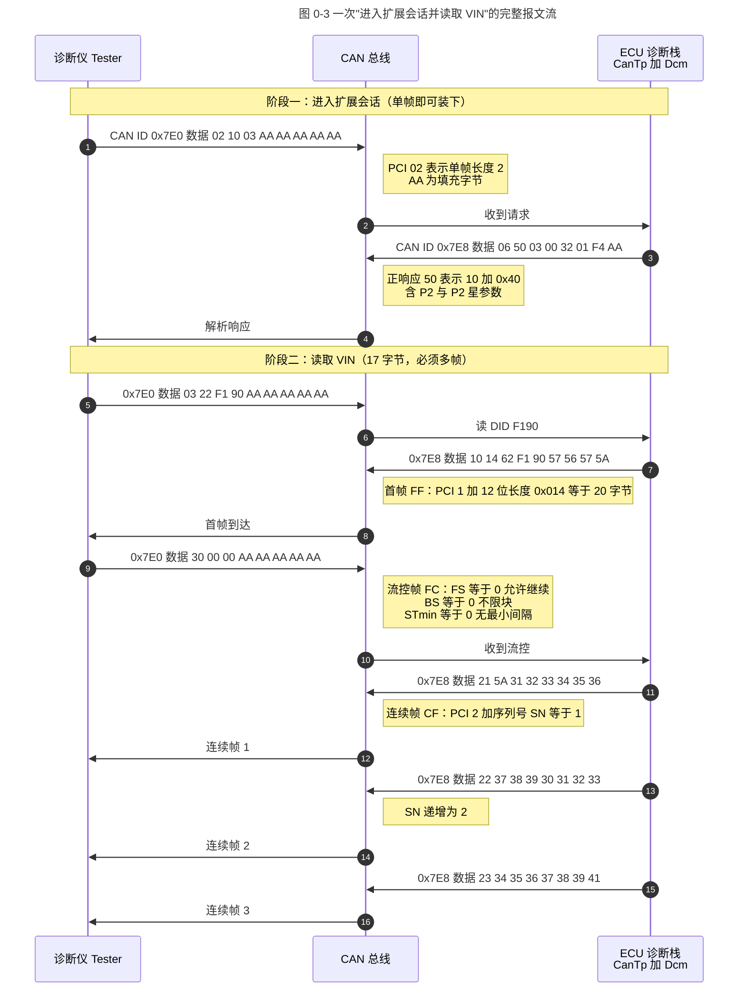

**图 0-3 解释**：注意三个关键细节，它们是新手最容易错的地方：

1. **单帧的 PCI 是 `0x0N`**，N 是"有效数据长度"，不是 CAN 帧的 8 字节长度（剩下的是填充 `AA`）。
2. **首帧（FF）里装的是"总长度"**（12 位，本例 `0x014` = 20 字节 = 1 字节 SID + 1 字节 DID + 1 字节 DID + 17 字节 VIN），不是数据长度。
3. **流控帧是"接收方发给发送方"的**。这里 Tester 是接收方（它收 VIN），所以是 **Tester 发 FC 给 ECU**。方向千万别搞反——这是理解流控的第一要点。

---

## 第 1 章 诊断报文的基本形态（SID / 正响应 / 负响应 / 寻址）

### 1.1 通俗易懂

UDS 报文就像快递单，只有三个字段有意义：

| 字段 | 通俗含义 | 长度 |
|---|---|---|
| **SID**（Service Identifier） | "你要办什么业务" —— 就像快递单上的"业务类型：寄件/退件/查询" | 1 字节 |
| **Sub-function / 参数** | "办这个业务的细节" —— 如"进入哪种会话""读哪个 DID" | 0~N 字节 |
| **NRC**（Negative Response Code） | "我为什么办不了" —— 拒绝理由编码 | 1 字节（仅负响应） |

举例：

- 请求：`22 F1 90` → "**读（0x22 = ReadDataByIdentifier）** 标识符为 **F190（VIN 码）** 的数据"
- 正响应：`62 F1 90 57 56 57...` → "**读的应答（0x22 + 0x40 = 0x62）**，DID 是 F190，数据是 VIN"
- 负响应：`7F 22 31` → "**负响应（0x7F）**，针对服务 **0x22**，原因是 **0x31 = requestOutOfRange（这个 DID 我不支持）**"

### 1.2 设计机制与设计思路

#### 1.2.1 为什么正响应是 `SID + 0x40`

因为 `0x40 = 0b0100_0000`，把 SID 的 bit6 置 1 即可。

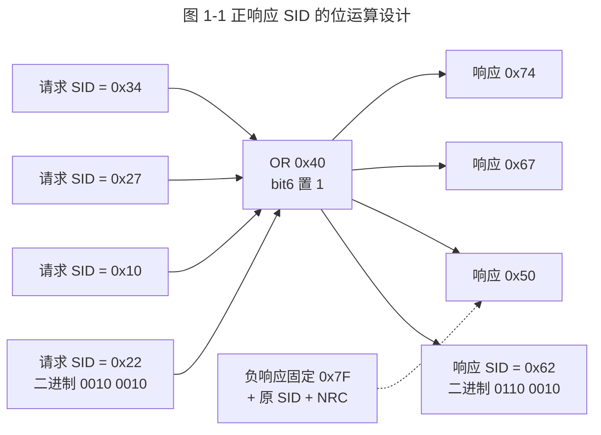

**图 1-1 解释**：这个设计的巧妙之处：

- **单字节即可区分请求/响应**：`SID < 0x40` 一定是请求，`SID >= 0x40 且 < 0x7F` 一定是正响应，`0x7F` 一定是负响应。解析器无需额外字段。
- **天然无冲突**：UDS 服务的 SID 全部落在 `0x10~0x3E` 与 `0x83~0x87` 等区间，正响应落在 `0x50~0x7E`，因此 `SID+0x40` 不会撞车。
- **负响应携带原 SID**：`7F 22 31` 里第二个字节是原请求的 SID，这样诊断仪能明确"是哪条请求失败了"——支持**流水线（pipelining）**场景下的一一对应。

#### 1.2.2 为什么要有"子功能抑制位"

子功能字节的 **bit7 = suppressPosRspMsgIndicationBit（抑制正响应指示位）**：

- `3E 00`：TesterPresent，正常回 `7E 00`
- `3E 80`：TesterPresent **且要求不要回正响应** → ECU 成功时**完全静默**，只有失败才回 `7F 3E xx`

**设计意图**：`3E 80` 是诊断仪每 2 秒发一次的"心跳"，如果每次都回一条，总线上会有大量无意义流量。抑制位让这类周期报文**零开销**（只在出错时才说话）。这是典型的**"成功静默、失败告警"（Silent Success）**模式，在日志系统、心跳系统中广泛使用。

> ⚠️ **注意**：抑制位只抑制**正响应**，永远不抑制负响应。且**并非所有服务的所有子功能都支持抑制**（标准中明确列出哪些支持）。

#### 1.2.3 物理寻址 vs 功能寻址

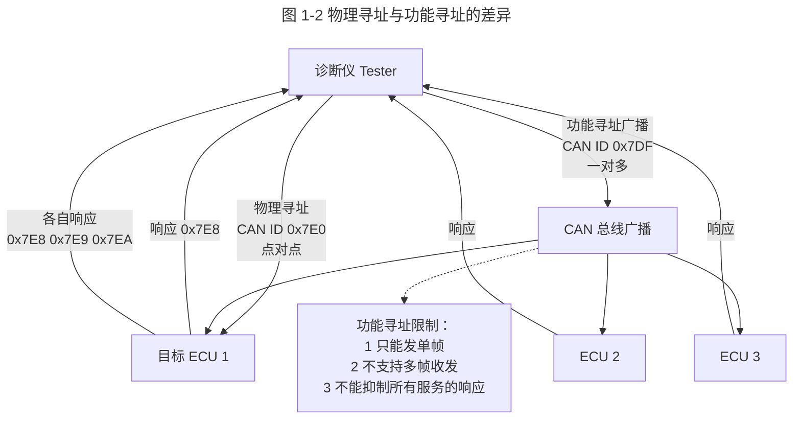

**图 1-2 解释**：

| 维度 | 物理寻址（Physical） | 功能寻址（Functional） |
|---|---|---|
| CAN ID（11 位标准示例） | `0x7E0` ~ `0x7E7`（请求），`0x7E8` ~ `0x7EF`（响应） | `0x7DF`（请求，全网广播） |
| 目标 | 单个 ECU | 总线上所有 ECU |
| 报文长度 | **支持多帧**（受 ISO-TP 管理） | **只允许单帧**（≤ 7 字节有效数据） |
| 典型用途 | 读数据、刷写、安全访问 | `3E 80`（保持在线）、`10 03`（全体进扩展会话）、`11 01`（全体复位） |
| 响应冲突 | 无 | 多个 ECU 同时响应会在总线上仲裁冲突，因此**功能寻址的响应必须错开或按需抑制** |

> 🚨 **最重要的工程规则**：**功能寻址的请求不能用 ISO-TP 多帧**。因为多个 ECU 同时收到 FF 并各自回 FC，总线会直接乱掉。标准明确规定：功能寻址只允许 SF。

### 1.3 深入原理

#### 1.3.1 报文字节级格式

**请求（Request）**：

```
字节 0        字节 1              字节 2 ... N
┌──────────┬──────────────────┬──────────────────┐
│   SID    │ 子功能 或 参数1  │   参数2 ... N    │
└──────────┴──────────────────┴──────────────────┘
```

**正响应（Positive Response）**：

```
字节 0              字节 1              字节 2 ... N
┌──────────────────┬──────────────────┬──────────────────┐
│  SID + 0x40      │ 子功能（回显）   │   数据 ...       │
└──────────────────┴──────────────────┴──────────────────┘
```

**负响应（Negative Response）**：

```
字节 0     字节 1        字节 2
┌─────────┬────────────┬──────────┐
│  0x7F   │  原请求SID │   NRC    │
└─────────┴────────────┴──────────┘
```

#### 1.3.2 NRC（负响应码）核心表

| NRC | 名称 | 通俗解释 | 典型成因 |
|---|---|---|---|
| `0x10` | generalReject | 通用拒绝 | 未定义原因，兜底 |
| `0x11` | serviceNotSupported | 不支持这个服务 | SID 未实现 |
| `0x12` | subFunctionNotSupported | 不支持这个子功能 | 子功能值非法 |
| `0x13` | incorrectMessageLengthOrInvalidFormat | 报文长度/格式错 | 参数少了、多了、格式不对 |
| `0x14` | responseTooLong | 响应太长 | 超出缓冲或超出网络层能力 |
| `0x21` | busyRepeatRequest | 忙，请重试 | ECU 正在处理别的请求 |
| `0x22` | conditionsNotCorrect | 条件不满足 | 车速不为 0、发动机在转 |
| `0x24` | requestSequenceError | 请求顺序错 | 没 `0x34` 就发 `0x36` |
| `0x25` | noResponseFromSubnetComponent | 子网无响应 | 网关转发目标节点离线 |
| `0x26` | failurePreventsExecutionOfRequestedAction | 故障阻止执行 | 有未清除的严重 DTC |
| `0x31` | requestOutOfRange | 参数越界 | DID/RID/地址不存在 |
| `0x33` | securityAccessDenied | 安全访问未通过 | 没做 `0x27` |
| `0x34` | authenticationRequired | 需要认证 | 新标准 0x29 认证未做 |
| `0x35` | invalidKey | 密钥错误 | 0x27 密钥算错 |
| `0x36` | exceedNumberOfAttempts | 尝试次数超限 | 连续输错密钥 |
| `0x37` | requiredTimeDelayNotExpired | 延时未到 | 输错后需等待 |
| `0x70` | uploadDownloadNotAccepted | 不接受上传下载 | 刷写条件不满足 |
| `0x71` | transferDataSuspended | 传输被挂起 | 刷写中断 |
| `0x72` | generalProgrammingFailure | 编程失败 | Flash 擦写失败 |
| `0x73` | wrongBlockSequenceCounter | 块序号错 | `0x36` 的 BSC 不连续 |
| `0x78` | requestCorrectlyReceivedResponsePending | 已收到，正在处理 | **长任务先回这个** |
| `0x7E` | subFunctionNotSupportedInActiveSession | 当前会话不支持该子功能 | 会话不对 |
| `0x7F` | serviceNotSupportedInActiveSession | 当前会话不支持该服务 | 会话不对 |

> 💡 **调试口诀**：看到 `0x7F`/`0x7E` → **会话问题**（该先 `10 03`）；看到 `0x33` → **安全访问问题**（该先 `27`）；看到 `0x13` → **长度问题**（检查 PCI 长度字段）；看到 `0x78` 反复出现 → **ECU 在忙/任务超时**。

#### 1.3.3 代码：UDS 报文的最小解析与组包

```c
/**
 * @file    uds_msg.c
 * @brief   UDS 报文基本形态的解析与组包（与网络层解耦）
 * @note    本文件只处理"应用层字节流"，不涉及 ISO-TP
 */

#include <stdint.h>
#include <string.h>

/* ============================================================
 * 一、协议常量
 * ============================================================ */
#define UDS_SID_POSITIVE_OFFSET     (0x40U)   /* 正响应 = 请求 SID + 0x40 */
#define UDS_SID_NEGATIVE_RESPONSE   (0x7FU)   /* 负响应固定 SID */
#define UDS_SUPPRESS_POS_RSP_MASK   (0x80U)   /* 子功能 bit7：抑制正响应 */

/* NRC 定义（节选） */
#define UDS_NRC_GENERAL_REJECT               (0x10U)
#define UDS_NRC_SERVICE_NOT_SUPPORTED        (0x11U)
#define UDS_NRC_SUB_FUNCTION_NOT_SUPPORTED   (0x12U)
#define UDS_NRC_INCORRECT_LENGTH             (0x13U)
#define UDS_NRC_RESPONSE_TOO_LONG            (0x14U)
#define UDS_NRC_BUSY_REPEAT_REQUEST          (0x21U)
#define UDS_NRC_CONDITIONS_NOT_CORRECT       (0x22U)
#define UDS_NRC_REQUEST_SEQUENCE_ERROR       (0x24U)
#define UDS_NRC_REQUEST_OUT_OF_RANGE         (0x31U)
#define UDS_NRC_SECURITY_ACCESS_DENIED       (0x33U)
#define UDS_NRC_INVALID_KEY                  (0x35U)
#define UDS_NRC_EXCEED_NUMBER_OF_ATTEMPTS    (0x36U)
#define UDS_NRC_REQUIRED_TIME_DELAY          (0x37U)
#define UDS_NRC_WRONG_BLOCK_SEQ_COUNTER      (0x73U)
#define UDS_NRC_RESPONSE_PENDING             (0x78U)
#define UDS_NRC_SERVICE_NOT_SUPPORTED_IN_SESSION (0x7FU)

/* ============================================================
 * 二、请求解析结果结构体
 * ============================================================ */
typedef struct {
    uint8_t        sid;             /* 服务标识符 */
    uint8_t        subFunction;     /* 子功能（若服务无子功能，为 0） */
    uint8_t        suppressPosRsp;  /* 1 = 请求抑制正响应 */
    const uint8_t *param;           /* 参数起始指针（不含 SID 与子功能） */
    uint16_t       paramLen;        /* 参数长度 */
    uint8_t        hasSubFunction;  /* 1 = 本服务带子功能字节 */
} Uds_RequestType;

/**
 * @brief  解析一条 UDS 请求
 * @param  data     请求原始字节流
 * @param  length   字节流长度
 * @param  req      输出：解析结果
 * @retval 0 成功；1 长度非法
 * @note   这里不做"服务是否支持"的判断，只做语法解析
 */
uint8_t Uds_ParseRequest(const uint8_t *data, uint16_t length, Uds_RequestType *req)
{
    if ((data == NULL) || (req == NULL) || (length < 1U)) {
        return 1U;
    }

    (void)memset(req, 0, sizeof(Uds_RequestType));
    req->sid = data[0];

    /* 按服务分类：哪些服务带子功能字节
     * 这里只列出常见带子功能的服务，实际应按 ISO 14229-1 完整表配置
     */
    switch (req->sid) {
        case 0x10U:   /* DiagnosticSessionControl       */
        case 0x11U:   /* ECUReset                       */
        case 0x19U:   /* ReadDTCInformation             */
        case 0x27U:   /* SecurityAccess                 */
        case 0x28U:   /* CommunicationControl           */
        case 0x31U:   /* RoutineControl                 */
        case 0x3EU:   /* TesterPresent                  */
        case 0x83U:   /* AccessTimingParameter          */
        case 0x85U:   /* ControlDTCSetting              */
        case 0x86U:   /* ResponseOnEvent                */
        case 0x87U:   /* LinkControl                    */
            req->hasSubFunction = 1U;
            if (length < 2U) {
                return 1U;              /* 缺子功能字节 → 上层回 NRC 0x13 */
            }
            /* 提取子功能并剥离抑制位 */
            req->subFunction    = (uint8_t)(data[1] & 0x7FU);
            req->suppressPosRsp = ((data[1] & UDS_SUPPRESS_POS_RSP_MASK) != 0U) ? 1U : 0U;
            req->param          = &data[2];
            req->paramLen       = (uint16_t)(length - 2U);
            break;

        default:
            req->hasSubFunction = 0U;
            req->param          = &data[1];
            req->paramLen       = (uint16_t)(length - 1U);
            break;
    }

    return 0U;
}

/* ============================================================
 * 三、响应组包
 * ============================================================ */

/**
 * @brief  组一条负响应：7F SID NRC
 * @param  buf      输出缓冲（至少 3 字节）
 * @param  bufSize  缓冲大小
 * @param  sid      原请求的 SID
 * @param  nrc      负响应码
 * @retval 实际写入长度；0 表示失败
 */
uint16_t Uds_BuildNegativeResponse(uint8_t *buf, uint16_t bufSize,
                                   uint8_t sid, uint8_t nrc)
{
    if ((buf == NULL) || (bufSize < 3U)) {
        return 0U;
    }
    buf[0] = UDS_SID_NEGATIVE_RESPONSE;
    buf[1] = sid;
    buf[2] = nrc;
    return 3U;
}

/**
 * @brief  组正响应的头部：SID+0x40，如有子功能则回显（保留原抑制位与否按标准）
 * @param  buf      输出缓冲
 * @param  bufSize  缓冲大小
 * @param  req      解析后的请求
 * @param  outLen   输出：头部长度
 * @retval 0 成功
 */
uint8_t Uds_BuildPositiveHeader(uint8_t *buf, uint16_t bufSize,
                                const Uds_RequestType *req, uint16_t *outLen)
{
    if ((buf == NULL) || (req == NULL) || (outLen == NULL)) {
        return 1U;
    }

    /* 正响应 SID */
    buf[0] = (uint8_t)(req->sid + UDS_SID_POSITIVE_OFFSET);

    /* 若服务带子功能，响应中也回显子功能（抑制位应清零） */
    if (req->hasSubFunction != 0U) {
        if (bufSize < 2U) {
            return 1U;
        }
        buf[1] = req->subFunction;
        *outLen = 2U;
    } else {
        *outLen = 1U;
    }
    return 0U;
}

/* ============================================================
 * 四、使用示例：处理 0x22 ReadDataByIdentifier 的语法层
 * ============================================================ */
/**
 * @brief  0x22 服务处理示例（只看报文层面）
 * @note   请求：22 DID_H DID_L
 *         正响应：62 DID_H DID_L data...
 */
uint16_t Uds_HandleReadDataByIdentifier(const uint8_t *reqData, uint16_t reqLen,
                                        uint8_t *rspBuf, uint16_t rspSize)
{
    Uds_RequestType req;
    uint16_t         did;
    const uint8_t   *dataPtr = NULL;
    uint16_t         dataLen = 0U;
    uint16_t         pos;

    /* 4.1 语法解析 */
    if (Uds_ParseRequest(reqData, reqLen, &req) != 0U) {
        return Uds_BuildNegativeResponse(rspBuf, rspSize, 0x22U, UDS_NRC_INCORRECT_LENGTH);
    }

    /* 4.2 长度校验：0x22 必须且只能带 2 字节 DID */
    if (req.paramLen != 2U) {
        return Uds_BuildNegativeResponse(rspBuf, rspSize, 0x22U, UDS_NRC_INCORRECT_LENGTH);
    }
    did = (uint16_t)(((uint16_t)req.param[0] << 8) | (uint16_t)req.param[1]);

    /* 4.3 查表取数据（真实实现见第 2 章 DID 表） */
    if (Did_Read(did, &dataPtr, &dataLen) != 0U) {
        /* DID 不存在 → 0x31 requestOutOfRange */
        return Uds_BuildNegativeResponse(rspBuf, rspSize, 0x22U, UDS_NRC_REQUEST_OUT_OF_RANGE);
    }

    /* 4.4 长度预检查，防止溢出 */
    if ((uint32_t)rspSize < (uint32_t)(3U + dataLen)) {
        return Uds_BuildNegativeResponse(rspBuf, rspSize, 0x22U, UDS_NRC_RESPONSE_TOO_LONG);
    }

    /* 4.5 组正响应 */
    rspBuf[0] = 0x62U;              /* 0x22 + 0x40 */
    rspBuf[1] = (uint8_t)(did >> 8);
    rspBuf[2] = (uint8_t)(did & 0xFFU);
    (void)memcpy(&rspBuf[3], dataPtr, dataLen);
    pos = (uint16_t)(3U + dataLen);

    return pos;
}
```

> 📎 **代码要点**
> - `Uds_ParseRequest()` **只做语法解析**，不判断"当前会话是否允许"——那是 Dcm 的职责。这种"解析与策略分离"是诊断栈可维护性的关键。
> - **长度校验必须在访问参数之前**，否则畸形报文（如 `22 F1`）会导致越界读。
> - **响应长度预检查**（`4.4`）是防止 `memcpy` 溢出的第一道防线，安全相关代码（ISO 26262）要求此类检查必须有。

---

## 第 2 章 UDS 常用服务详解

### 2.1 服务全景：UDS 到底有多少个服务

UDS（ISO 14229-1）定义的服务按 SID 分成 7 个功能组：

| SID 区间 | 功能组 | 代表作 |
|---|---|---|
| `0x10 ~ 0x1F` | 诊断与通信管理 | `10` 会话控制、`11` 复位、`14` 清 DTC、`19` 读 DTC |
| `0x20 ~ 0x2F` | 数据传输 | `22` 按 DID 读、`23` 按地址读、`28` 通信控制、`2E` 按 DID 写、`2F` IO 控制 |
| `0x30 ~ 0x3F` | 传输（上传下载） | `31` 例程控制、`34` 请求下载、`36` 传输数据、`37` 请求退出传输、`3E` 保持在线 |
| `0x80 ~ 0x8F` | 其他 | `83` 时序参数、`84` 安全数据传输、`85` DTC 设置控制、`86` 事件响应、`87` 链路控制 |
| `0x29` | 认证（2020 版新增） | 基于 PKI/挑战应答的现代安全访问 |
| `0x2A / 0x2C` | 周期读 / 动态定义 DID | 高性能数据采集 |
| `0x38 / 0x35` | 文件传输 | 文件上传下载 |

### 2.2 会话管理 `0x10 DiagnosticSessionControl`

#### 2.2.1 通俗易懂

ECU 就像银行柜台，**不同会话 = 不同权限的窗口**：

| 会话 | 子功能 | 通俗类比 | 允许做什么 |
|---|---|---|---|
| **默认会话** | `01` | 大堂普通窗口 | 读 DTC、读普通数据（上电默认） |
| **编程会话** | `02` | 金库操作间 | 刷写固件（`34/36/37`），通常要复位进入 |
| **扩展会话** | `03` | VIP 室 | 读写标定、例程控制、IO 控制 |
| **安全系统会话** | `04` | 安全气囊专修间 | 安全气囊相关特殊操作（部分厂商用） |

#### 2.2.2 设计机制与设计思路

**为什么必须分会话？**

1. **安全隔离**：不能让诊断仪在任何时刻都能刷写固件。刷写需要"进入编程会话 + 安全访问通过"双重门禁。
2. **状态确定性**：不同会话下 ECU 的"允许服务集合"不同，这让 ECU 的行为可穷举、可测试。
3. **故障隔离**：`10 02`（进编程会话）通常会让应用功能停机（关通信、停控制），避免刷写时电机乱转。

```mermaid
---
title: 图 2-1 UDS 会话状态机与超时回落
---
stateDiagram-v2
    [*] --> Default: 上电或复位
    Default --> Extended: 10 03 进入扩展会话
    Default --> Programming: 10 02 进入编程会话
    Default --> SafetySystem: 10 04 进入安全系统会话
    Extended --> Default: 10 01 或 S3 超时 5 秒
    Programming --> Default: 10 01 或 S3 超时 或 11 01 复位
    SafetySystem --> Default: 10 01 或 S3 超时
    Extended --> Programming: 10 02 允许直接跳转
    Programming --> Extended: 10 03 允许直接跳转
    Default --> Default: 3E 00 刷新 S3 定时器
    Extended --> Extended: 3E 00 刷新 S3 定时器
    note right of Default
        默认会话永远可进入
        任何会话超时都回落至此
    end note
    note right of Programming
        进入前通常要求
        安全访问已通过
        且车速为零
    end note
```

**图 2-1 解释**：三个关键机制：

- **`S3` 超时（S3Server = 5000 ms）**：任何非默认会话如果 5 秒内没收到任何诊断请求，**自动回落到默认会话**。这是防止"诊断仪掉线后 ECU 一直停在高权限状态"的安全设计。诊断仪必须每 ≤ 2 秒发一次 `3E 00` 来"续命"。
- **复位必然回默认会话**：`11 xx` 之后无论之前是什么会话，都回到 Default。因此"进编程会话刷写"的流程是：`10 02` → 刷写 → `11 01` 复位 → 回到默认会话。
- **会话切换会重置安全访问**：多数实现中切换会话会**清除已解锁的安全等级**，必须重新 `0x27`。

#### 2.2.3 深入原理：`10 03` 的响应携带什么

正响应：`50 03 00 32 01 F4`

| 字节 | 值 | 含义 |
|---|---|---|
| 0 | `50` | `0x10 + 0x40` |
| 1 | `03` | 回显子功能（会话类型） |
| 2~3 | `00 32` | **P2Server_max** = 50 ms（单位 ms，2 字节） |
| 4~5 | `01 F4` | **P2\*Server_max** = 500 × 10 = 5000 ms（单位 **10 ms**，2 字节） |

> ⚠️ **注意单位不同**：P2 是 **ms**，P2\* 是 **10 ms**。这是规范里最容易看错的一处。详见第 4 章。

### 2.3 保持在线 `0x3E TesterPresent`

#### 2.3.1 通俗易懂

`3E 00` = "我还在，别挂断"。用于刷新 S3 定时器，防止会话回落。

#### 2.3.2 设计思路

- 诊断仪通常**每 2000 ms** 发一次（S3 为 5000 ms，留 2.5 倍余量）。
- 用 `3E 80`（抑制正响应）避免无意义响应流量。
- 在刷写长流程中（如擦除 Flash 30 秒），**必须持续发送 `3E 80`**，否则会话超时导致刷写失败。这就是"TesterPresent 心跳线程"存在的原因。

```c
/**
 * @brief  TesterPresent 心跳线程（伪代码，10 ms 周期调度）
 * @note   核心：只要在非默认会话，就必须持续刷新 S3
 */
void Diag_TesterPresentTask(void)
{
    static uint32_t s_lastTick = 0U;
    const uint32_t  periodMs  = 2000U;      /* 建议值：S3 的 40% */

    if ((Diag_GetTick() - s_lastTick) < periodMs) {
        return;
    }
    s_lastTick = Diag_GetTick();

    /* 只在非默认会话发送，避免默认会话下的无谓流量 */
    if (Diag_GetActiveSession() == DIAG_SESSION_DEFAULT) {
        return;
    }

    {
        /* 3E 80：抑制正响应 */
        const uint8_t req[2] = { 0x3EU, 0x80U };
        (void)Diag_SendRequest(req, 2U);
    }
}
```

### 2.4 数据读写 `0x22 ReadDataByIdentifier` / `0x2E WriteDataByIdentifier`

#### 2.4.1 通俗易懂

**DID（Data Identifier，数据标识符）就是"数据项的门牌号"**。`0x22` 是"按门牌号取货"，`0x2E` 是"按门牌号放货"。

| DID 示例 | 含义 | 长度 |
|---|---|---|
| `F186` | ActiveDiagnosticSession | 1 字节 |
| `F187` | VehicleManufacturerSparePartNumber | 11 字节 |
| `F188` | VehicleManufacturerECUSoftwareNumber | 4 字节 |
| `F190` | VIN | 17 字节 |
| `F18C` | ECUSerialNumber | 16 字节 |
| `F191` | VehicleManufacturerECUHardwareNumber | 4 字节 |
| `0100` | 支持的 DID 列表（位图） | 4 字节 |
| `F4 0C`（厂商自定义） | 冷却液温度 | 1 字节 |

#### 2.4.2 设计机制与设计思路

**为什么用 DID 而不是直接给地址？**

- **抽象与安全**：诊断仪说"我要 VIN"，而不是"我要读 0x0801A000 这 17 个字节"。这样内存布局变了不影响诊断，也避免诊断仪任意读内存（那是 `0x23` 干的事，需要更高权限）。
- **长度自描述**：每个 DID 有固定长度定义（在 ODX/CDD 文件里），ECU 侧用表驱动实现。
- **可分组**：`0x22` 支持**一次请求多个 DID**：`22 F1 90 F1 8C` → `62 F1 90 <17 字节> F1 8C <16 字节>`，减少往返次数。

**`0x0100` 这个特殊 DID**（"支持的 DID 列表"）是一个精妙的**自描述设计**：ECU 用位图告诉诊断仪"我支持哪些 DID"，位图里 bit0 表示 `0x0100` 自身（必须为 1），bit1 表示 `0x0101`，依此类推，4 字节覆盖 `0x0100~0x011F`。若支持更多，用 `0101`、`0102`… 递增。这样诊断仪可以自动发现 ECU 能力，无需硬编码。

#### 2.4.3 深入原理：DID 表驱动实现（完整代码）

```c
/**
 * @file    did_table.c
 * @brief   DID 表的表驱动实现 —— 支持 0x22 读与 0x2E 写
 * @note    表驱动是 AUTOSAR Dcm 的核心思想：
 *          新增一个 DID 只需在表里加一行，不改任何逻辑代码
 */

#include <stdint.h>
#include <string.h>

/* ============================================================
 * 一、DID 访问权限描述
 * ============================================================ */
typedef enum {
    DID_SESSION_DEFAULT      = 0x01U,
    DID_SESSION_PROGRAMMING  = 0x02U,
    DID_SESSION_EXTENDED     = 0x04U,
    DID_SESSION_SAFETY       = 0x08U,
} Did_SessionMaskType;

#define DID_SEC_NONE            (0x00U)   /* 无需安全访问 */
#define DID_SEC_LEVEL_1         (0x01U)   /* 需要安全等级 1（0x27 01/02） */
#define DID_SEC_LEVEL_2         (0x02U)   /* 需要安全等级 2（0x27 03/04） */

/* 读写行为的回调类型 */
typedef uint8_t (*Did_ReadFn)(uint8_t *buf, uint16_t bufSize, uint16_t *outLen);
typedef uint8_t (*Did_WriteFn)(const uint8_t *data, uint16_t len);

/* ============================================================
 * 二、DID 表项定义
 * ============================================================ */
typedef struct {
    uint16_t          did;            /* 标识符 */
    uint8_t           dataSize;       /* 固定长度（0 = 变长，由回调决定） */
    Did_SessionMaskType readSessions; /* 允许读的会话掩码 */
    uint8_t           readSecLevel;   /* 读所需安全等级 */
    Did_SessionMaskType writeSessions;/* 允许写的会话掩码（0 = 只读） */
    uint8_t           writeSecLevel;  /* 写所需安全等级 */
    Did_ReadFn        readFn;         /* 读回调 */
    Did_WriteFn       writeFn;        /* 写回调（可为 NULL） */
} Did_EntryType;

/* ============================================================
 * 三、具体 DID 的读写实现
 * ============================================================ */

/* 3.1 VIN 码：只读，默认会话可读，无需安全访问 */
static const uint8_t g_vin[17] = {
    'L','S','V','A','A','2','A','0','8','N','2','1','0','0','0','0','1'
};

static uint8_t Did_Read_Vin(uint8_t *buf, uint16_t bufSize, uint16_t *outLen)
{
    if (bufSize < sizeof(g_vin)) {
        return 1U;                       /* 缓冲不足 */
    }
    (void)memcpy(buf, g_vin, sizeof(g_vin));
    *outLen = (uint16_t)sizeof(g_vin);
    return 0U;
}

/* 3.2 应用软件版本号：只读 */
static const uint8_t g_swVersion[4] = { 0x01U, 0x02U, 0x03U, 0x04U };

static uint8_t Did_Read_SwVersion(uint8_t *buf, uint16_t bufSize, uint16_t *outLen)
{
    if (bufSize < 4U) {
        return 1U;
    }
    (void)memcpy(buf, g_swVersion, 4U);
    *outLen = 4U;
    return 0U;
}

/* 3.3 可写标定参数：扩展会话 + 安全等级 1 才能写 */
static uint16_t g_calibIdleRpm = 800U;

static uint8_t Did_Read_CalibIdleRpm(uint8_t *buf, uint16_t bufSize, uint16_t *outLen)
{
    if (bufSize < 2U) {
        return 1U;
    }
    buf[0] = (uint8_t)(g_calibIdleRpm >> 8);
    buf[1] = (uint8_t)(g_calibIdleRpm & 0xFFU);
    *outLen = 2U;
    return 0U;
}

static uint8_t Did_Write_CalibIdleRpm(const uint8_t *data, uint16_t len)
{
    /* 写入前的合法性校验（安全相关必须做范围检查） */
    uint16_t value;

    if (len != 2U) {
        return 1U;
    }
    value = (uint16_t)(((uint16_t)data[0] << 8) | (uint16_t)data[1]);

    /* 标定值必须落在物理合理区间，防止误写导致发动机异常 */
    if ((value < 600U) || (value > 1200U)) {
        return 2U;                        /* 上层映射为 NRC 0x31 */
    }
    g_calibIdleRpm = value;
    return 0U;
}

/* ============================================================
 * 四、DID 表（新增 DID 只需在此加一行）
 * ============================================================ */
static const Did_EntryType g_didTable[] = {
    /* DID   长度 读会话掩码                                            读安全 写会话掩码  写安全 读回调              写回调 */
    { 0xF190U, 17U,
      (Did_SessionMaskType)(DID_SESSION_DEFAULT | DID_SESSION_EXTENDED | DID_SESSION_PROGRAMMING),
      DID_SEC_NONE, (Did_SessionMaskType)0, DID_SEC_NONE,
      Did_Read_Vin, NULL },

    { 0xF189U, 4U,
      (Did_SessionMaskType)(DID_SESSION_DEFAULT | DID_SESSION_EXTENDED),
      DID_SEC_NONE, (Did_SessionMaskType)0, DID_SEC_NONE,
      Did_Read_SwVersion, NULL },

    { 0x1234U, 2U,
      (Did_SessionMaskType)(DID_SESSION_EXTENDED),
      DID_SEC_NONE,
      (Did_SessionMaskType)(DID_SESSION_EXTENDED), DID_SEC_LEVEL_1,
      Did_Read_CalibIdleRpm, Did_Write_CalibIdleRpm },
};

#define DID_TABLE_SIZE  (sizeof(g_didTable) / sizeof(g_didTable[0]))

/* ============================================================
 * 五、查表与权限判定
 * ============================================================ */
static const Did_EntryType *Did_Lookup(uint16_t did)
{
    uint32_t i;
    for (i = 0U; i < DID_TABLE_SIZE; i++) {
        if (g_didTable[i].did == did) {
            return &g_didTable[i];
        }
    }
    return NULL;
}

/**
 * @brief  按 DID 读数据（供 0x22 服务调用）
 * @retval 0 成功；1 DID 不存在；2 会话不允许；3 安全访问不足；4 读回调失败
 */
uint8_t Did_Read(uint16_t did, const uint8_t **data, uint16_t *len,
                 uint8_t curSession, uint8_t curSecLevel)
{
    const Did_EntryType *e = Did_Lookup(did);
    static uint8_t       s_buf[64];       /* 注意：单线程诊断上下文，可静态 */
    uint16_t             outLen = 0U;

    if (e == NULL) {
        return 1U;                        /* → NRC 0x31 */
    }
    /* 会话检查 */
    if ((e->readSessions & curSession) == 0U) {
        return 2U;                        /* → NRC 0x7F serviceNotSupportedInActiveSession */
    }
    /* 安全等级检查 */
    if ((e->readSecLevel != DID_SEC_NONE) && (curSecLevel < e->readSecLevel)) {
        return 3U;                        /* → NRC 0x33 */
    }
    if ((e->readFn == NULL) || (e->readFn(s_buf, sizeof(s_buf), &outLen) != 0U)) {
        return 4U;                        /* → NRC 0x22 */
    }

    *data = s_buf;
    *len  = outLen;
    return 0U;
}

/**
 * @brief  按 DID 写数据（供 0x2E 服务调用）
 * @retval 0 成功；1 DID 不存在；2 只读；3 会话不允许；4 安全访问不足；5 写回调失败
 */
uint8_t Did_Write(uint16_t did, const uint8_t *data, uint16_t len,
                  uint8_t curSession, uint8_t curSecLevel)
{
    const Did_EntryType *e = Did_Lookup(did);

    if (e == NULL) {
        return 1U;
    }
    if (e->writeFn == NULL) {
        return 2U;                        /* 只读 DID → NRC 0x31 */
    }
    if ((e->writeSessions & curSession) == 0U) {
        return 3U;                        /* → NRC 0x7F */
    }
    if ((e->writeSecLevel != DID_SEC_NONE) && (curSecLevel < e->writeSecLevel)) {
        return 4U;                        /* → NRC 0x33 */
    }
    /* 长度校验：固定长度 DID 必须严格匹配 */
    if ((e->dataSize != 0U) && (len != (uint16_t)e->dataSize)) {
        return 5U;                        /* → NRC 0x13 */
    }
    if (e->writeFn(data, len) != 0U) {
        return 5U;
    }
    return 0U;
}
```

> 📎 **代码要点**
> - **表驱动的核心价值**：新增 100 个 DID 也只需在 `g_didTable[]` 里加 100 行，业务逻辑一行不改。AUTOSAR Dcm 的 `DcmDspData` 配置表就是同一思想的商业化实现。
> - **"会话 + 安全等级"双维权限**：这是 UDS 权限模型的基本单元。真实项目里应把它抽象成一张二维矩阵表。
> - **写入必须做范围校验**（`600~1200`）：诊断写入的值直接进入控制算法，缺少校验会导致车辆异常。ISO 26262 要求这类输入必须验证。

### 2.5 故障码 `0x19 ReadDTCInformation` / `0x14 ClearDiagnosticInformation`

#### 2.5.1 通俗易懂

- `0x19` = "把故障码报给我"（**DTC = Diagnostic Trouble Code，故障码**，如 `P0301` 表示 1 缸失火）
- `0x14` = "把故障码全清掉"

#### 2.5.2 设计机制与设计思路

**DTC 的三层结构**（这是 Dem 模块的核心模型）：

| 层 | 内容 | 通俗解释 |
|---|---|---|
| **DTC 编号** | 3 字节（`0xC1 0x23 0x45` 这种）+ 1 字节状态 | "什么故障" |
| **状态字节（StatusOfDTC）** | 8 个 bit，记录"何时、是否、多严重" | "现在有没有、以前有没有、确认了没" |
| **快照（Snapshot / FreezeFrame）** | 故障发生瞬间的关键数据（车速、水温、转速…） | "出事时的黑匣子" |
| **扩展数据（Extended Data）** | 发生次数、老化计数器、上次发生里程 | "出过几次、多久没出了" |

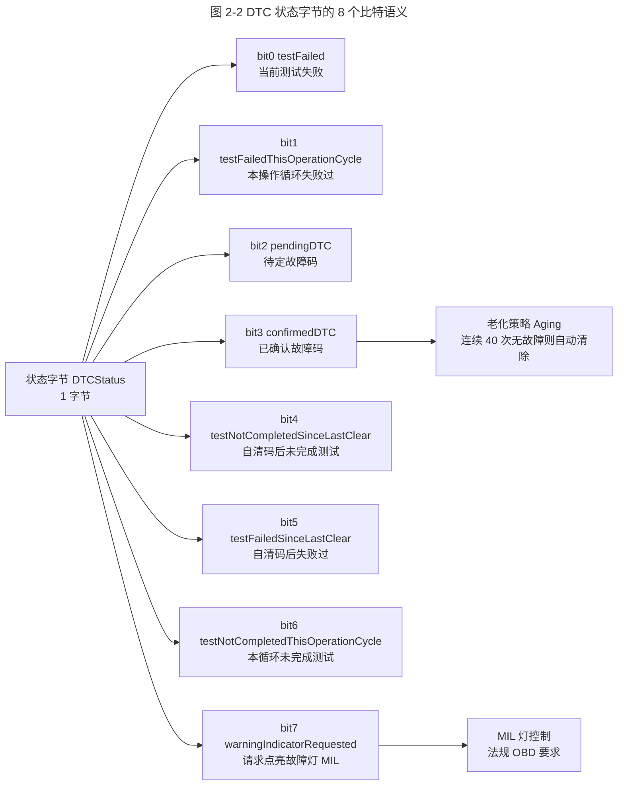

**图 2-2 解释**：状态字节是一套**"故障生命周期"状态机**的编码。

- **pending → confirmed**：这是**抖动抑制（Debounce）**的体现。一次偶发失败只置 `pendingDTC`；连续 N 次（或持续 T 时间）失败才升为 `confirmedDTC`。这样避免传感器瞬间干扰就点亮故障灯。
- **老化（Aging）**：`confirmedDTC` 置位后，若连续 40 个操作循环都没有再失败，自动清除。设计意图是**"故障自愈"**——偶发故障不该永久留在 ECU 里。
- **`testNotCompletedSinceLastClear` = 1 表示"还没测过"**，诊断仪据此判断"这个 DTC 结果是否可信"（上电初期的 DTC 状态是"未完成"，不能当成"通过"）。

#### 2.5.3 深入原理：`0x19` 的常用子功能

| 子功能 | 名称 | 用途 |
|---|---|---|
| `0x01` | reportNumberOfDTCByStatusMask | 只报**数量**（按状态掩码过滤）——先问数量再取内容，节省带宽 |
| `0x02` | reportDTCByStatusMask | 报**所有匹配状态的 DTC**（最常用） |
| `0x04` | reportDTCSnapshotRecordByDTCNumber | 读某个 DTC 的**快照记录** |
| `0x06` | reportDTCExtDataRecordByDTCNumber | 读某个 DTC 的**扩展数据** |
| `0x0A` | reportSupportedDTC | 报所有**支持的** DTC（不论状态） |
| `0x14` | reportDTCFaultDetectionCounter | 读**故障检测计数器**（调试用，能看到 debounce 进度） |
| `0x42` | reportWWHOBDDTCByMaskRecord | 法规 OBD 专用格式 |

请求示例：`19 02 FF` → "报所有至少有一个状态位为 1 的 DTC"（`FF` 是状态掩码）

响应示例：

```
59 02 FF
C1 23 45 2F      ← DTC 1：编号 C12345，状态 0x2F
C1 23 46 09      ← DTC 2：编号 C12346，状态 0x09
```

> 💡 **状态掩码的作用**：掩码 `FF` 表示"只要有任何状态位为 1 就报"。若只想查"已确认故障"，用掩码 `08`（bit3）。这让诊断仪可以精确筛选，例如"只报当前实际存在的故障"用 `01`（bit0 testFailed）。

### 2.6 例程控制 `0x31 RoutineControl`

#### 2.6.1 通俗易懂

"例程"就是 ECU 里预先写好的**一段功能流程**，诊断仪只能"启动/停止/查结果"，不能改内容。类似"洗衣机上的'筒清洁'按钮"——你只能按，程序是厂家写死的。

#### 2.6.2 设计思路

| 子功能 | 含义 |
|---|---|
| `0x01` | startRoutine —— 启动 |
| `0x02` | stopRoutine —— 停止 |
| `0x03` | requestRoutineResults —— 查询结果 |

典型用途：**传感器标定（如雷达零点标定）、执行器自检（如 EGR 阀全行程测试）、下线检测（EOL）、擦除内存**。

**为什么用 `0x31` 而不是直接读写寄存器？** 因为例程封装了**时序和安全约束**（比如"必须先断电再上电"），ECU 内部实现，诊断仪无法绕过。这是**"把安全逻辑放进 ECU"**的设计原则。

报文示例（请求结果）：

```
请求：31 03 02 03            ← 查询 RID 0x0203 的结果
响应：71 03 02 03 00 <data>  ← 00 = 例程成功完成
```

例程状态字节常见值：`00` 成功、`01` 进行中、`02` 条件不满足、`03` 失败。

### 2.7 其余高频服务速查

| 服务 | 用途 | 请求示例 | 响应示例 | 常见 NRC |
|---|---|---|---|---|
| `11` ECUReset | 复位 ECU | `11 01`（硬复位） | `51 01` | `0x22`（条件不满足） |
| `14` ClearDiagnosticInformation | 清 DTC | `14 FF FF FF` | `54` | `0x22`、`0x72` |
| `27` SecurityAccess | 安全解锁 | `27 01` / `27 02 <key>` | `67 01 <seed>` / `67 02` | `0x35`、`0x36`、`0x37` |
| `28` CommunicationControl | 关/开通信 | `28 03 01`（禁收禁发） | `68 03` | `0x22`、`0x31` |
| `2F` InputOutputControlByIdentifier | 强制 IO 输出 | `2F <DID> 03 <value>` | `6F <DID> 03 <value>` | `0x22`、`0x31` |
| `34` RequestDownload | 请求下载 | `34 00 44 <addr> <size>` | `74 20 <maxBlock>` | `0x70`、`0x22` |
| `36` TransferData | 传数据块 | `36 <BSC> <data...>` | `76 <BSC>` | `0x73`、`0x72` |
| `37` RequestTransferExit | 退出传输 | `37` | `77` | `0x24` |
| `85` ControlDTCSetting | 停/开 DTC 记录 | `85 02`（关闭记录） | `C5 02` | `0x22` |
| `23` ReadMemoryByAddress | 按地址读内存 | `23 14 <addr4> <len1>` | `63 <data>` | `0x31`（越界） |
| `3D` WriteMemoryByAddress | 按地址写内存 | `3D 14 <addr4> <len1> <data>` | `7D` | `0x31`、`0x33` |
| `2A` ReadDataByPeriodicIdentifier | 周期性读 | `2A 01 <PID>` | `6A ...` | `0x31` |
| `2C` DynamicallyDefineDataIdentifier | 动态组合 DID | `2C 01 <DID> 03 <srcDID> <pos> <len>` | `6C 01 <DID>` | `0x31` |
| `29` Authentication | 现代认证 | `29 01 <params>` | `69 01 <challenge>` | `0x34`、`0x35` |

> 🔎 **`2F` IOControl 的价值**：它让诊断仪可以**绕过应用逻辑直接驱动执行器**（例：强制风扇全速、强制油泵 50%）。这是产线与售后排障的利器，但也最危险——所以它通常要求**扩展会话 + 安全访问 + 车速为零**。

### 2.8 服务矩阵：会话 × 服务的权限表

这张表是诊断设计的**总纲**，所有 ECU 的诊断规范都会给出类似表格：

| 服务 | 默认会话 | 编程会话 | 扩展会话 | 安全访问要求 |
|---|---|---|---|---|
| `10` SessionControl | ✅ | ✅ | ✅ | 无 |
| `11` ECUReset | ✅ | ✅ | ✅ | 无（部分厂商要求扩展会话） |
| `14` ClearDTC | ✅ | ❌ | ✅ | 无 |
| `19` ReadDTC | ✅ | ✅ | ✅ | 无 |
| `22` ReadDataByIdentifier | ✅（部分 DID） | ✅ | ✅ | 视 DID 而定 |
| `2E` WriteDataByIdentifier | ❌ | ❌ | ✅ | 等级 1 |
| `27` SecurityAccess | ✅（请求种子） | ✅ | ✅ | 无 |
| `28` CommunicationControl | ❌ | ✅ | ✅ | 等级 1 |
| `2F` IOControl | ❌ | ❌ | ✅ | 等级 1 或 2 |
| `31` RoutineControl | 视例程 | ✅ | ✅ | 视例程 |
| `34/36/37` Download | ❌ | ✅ | ❌ | 等级 1 |
| `3E` TesterPresent | ✅ | ✅ | ✅ | 无 |
| `85` ControlDTCSetting | ❌ | ✅ | ✅ | 等级 1 |

#### 2.8.1 代码：统一的服务分发表（Dispatcher）

```c
/**
 * @file    uds_dispatch.c
 * @brief   UDS 服务分发器 —— 权限检查 + 分发 + 统一负响应
 * @note    这是 Dcm 模块"简化版"的核心：一张表搞定所有服务的准入控制
 */

#include <stdint.h>

/* 会话定义（与会话掩码位一一对应） */
#define SESSION_BIT_DEFAULT      (0x01U)
#define SESSION_BIT_PROGRAM      (0x02U)
#define SESSION_BIT_EXTENDED     (0x04U)
#define SESSION_BIT_SAFETY       (0x08U)

/* 服务处理函数原型 */
typedef uint16_t (*Uds_ServiceHandler)(const Uds_RequestType *req,
                                       uint8_t *rspBuf, uint16_t rspSize);

/* 服务表项 */
typedef struct {
    uint8_t           sid;               /* 服务号 */
    uint8_t           sessionMask;       /* 允许的会话掩码 */
    uint8_t           requiredSecLevel;  /* 所需安全等级，0 = 不需要 */
    Uds_ServiceHandler handler;          /* 处理函数 */
} Uds_ServiceEntryType;

/* 外部声明各服务处理函数（各自实现在独立文件） */
extern uint16_t Uds_Svc_DiagnosticSessionControl(const Uds_RequestType *, uint8_t *, uint16_t);
extern uint16_t Uds_Svc_EcuReset                 (const Uds_RequestType *, uint8_t *, uint16_t);
extern uint16_t Uds_Svc_ClearDTC                  (const Uds_RequestType *, uint8_t *, uint16_t);
extern uint16_t Uds_Svc_ReadDTCInformation        (const Uds_RequestType *, uint8_t *, uint16_t);
extern uint16_t Uds_Svc_ReadDataByIdentifier      (const Uds_RequestType *, uint8_t *, uint16_t);
extern uint16_t Uds_Svc_WriteDataByIdentifier     (const Uds_RequestType *, uint8_t *, uint16_t);
extern uint16_t Uds_Svc_SecurityAccess            (const Uds_RequestType *, uint8_t *, uint16_t);
extern uint16_t Uds_Svc_RoutineControl            (const Uds_RequestType *, uint8_t *, uint16_t);
extern uint16_t Uds_Svc_TesterPresent             (const Uds_RequestType *, uint8_t *, uint16_t);
extern uint16_t Uds_Svc_RequestDownload           (const Uds_RequestType *, uint8_t *, uint16_t);
extern uint16_t Uds_Svc_TransferData               (const Uds_RequestType *, uint8_t *, uint16_t);
extern uint16_t Uds_Svc_RequestTransferExit        (const Uds_RequestType *, uint8_t *, uint16_t);
extern uint16_t Uds_Svc_ControlDTCSetting          (const Uds_RequestType *, uint8_t *, uint16_t);
extern uint16_t Uds_Svc_IOControlByIdentifier      (const Uds_RequestType *, uint8_t *, uint16_t);

/* ============================================================
 * 服务分发表：诊断规范的"代码化"
 * ============================================================ */
static const Uds_ServiceEntryType g_serviceTable[] = {
    /* SID   会话掩码                                                                     安全等级  处理函数 */
    { 0x10U, (uint8_t)(SESSION_BIT_DEFAULT | SESSION_BIT_PROGRAM | SESSION_BIT_EXTENDED | SESSION_BIT_SAFETY), 0U, Uds_Svc_DiagnosticSessionControl },
    { 0x11U, (uint8_t)(SESSION_BIT_DEFAULT | SESSION_BIT_PROGRAM | SESSION_BIT_EXTENDED), 0U, Uds_Svc_EcuReset },
    { 0x14U, (uint8_t)(SESSION_BIT_DEFAULT | SESSION_BIT_EXTENDED), 0U, Uds_Svc_ClearDTC },
    { 0x19U, (uint8_t)(SESSION_BIT_DEFAULT | SESSION_BIT_PROGRAM | SESSION_BIT_EXTENDED), 0U, Uds_Svc_ReadDTCInformation },
    { 0x22U, (uint8_t)(SESSION_BIT_DEFAULT | SESSION_BIT_PROGRAM | SESSION_BIT_EXTENDED), 0U, Uds_Svc_ReadDataByIdentifier },
    { 0x27U, (uint8_t)(SESSION_BIT_DEFAULT | SESSION_BIT_PROGRAM | SESSION_BIT_EXTENDED), 0U, Uds_Svc_SecurityAccess },
    { 0x28U, (uint8_t)(SESSION_BIT_EXTENDED),                                              1U, NULL /* 示例略 */ },
    { 0x2EU, (uint8_t)(SESSION_BIT_EXTENDED),                                              1U, Uds_Svc_WriteDataByIdentifier },
    { 0x2FU, (uint8_t)(SESSION_BIT_EXTENDED),                                              1U, Uds_Svc_IOControlByIdentifier },
    { 0x31U, (uint8_t)(SESSION_BIT_PROGRAM | SESSION_BIT_EXTENDED),                        0U, Uds_Svc_RoutineControl },
    { 0x34U, (uint8_t)(SESSION_BIT_PROGRAM),                                               1U, Uds_Svc_RequestDownload },
    { 0x36U, (uint8_t)(SESSION_BIT_PROGRAM),                                               1U, Uds_Svc_TransferData },
    { 0x37U, (uint8_t)(SESSION_BIT_PROGRAM),                                               1U, Uds_Svc_RequestTransferExit },
    { 0x3EU, (uint8_t)(SESSION_BIT_DEFAULT | SESSION_BIT_PROGRAM | SESSION_BIT_EXTENDED | SESSION_BIT_SAFETY), 0U, Uds_Svc_TesterPresent },
    { 0x85U, (uint8_t)(SESSION_BIT_PROGRAM | SESSION_BIT_EXTENDED),                        1U, Uds_Svc_ControlDTCSetting },
};

#define SERVICE_TABLE_SIZE  (sizeof(g_serviceTable) / sizeof(g_serviceTable[0]))

/* ============================================================
 * 分发主函数：一条请求进来的统一入口
 * ============================================================ */
/**
 * @brief  UDS 请求分发
 * @param  reqData  请求字节流（已由 ISO-TP 重组完成）
 * @param  reqLen   长度
 * @param  rspBuf   响应缓冲
 * @param  rspSize  缓冲容量
 * @param  outLen   输出：响应长度；0 表示"不响应"（抑制正响应）
 * @retval 0 正常返回（含负响应）；1 内部错误
 */
uint8_t Uds_Dispatch(const uint8_t *reqData, uint16_t reqLen,
                     uint8_t *rspBuf, uint16_t rspSize, uint16_t *outLen)
{
    Uds_RequestType          req;
    const Uds_ServiceEntryType *entry = NULL;
    uint32_t                 i;
    uint8_t                  curSession;
    uint8_t                  curSecLevel;
    uint16_t                 respLen;

    /* 1. 语法解析 */
    if (Uds_ParseRequest(reqData, reqLen, &req) != 0U) {
        *outLen = Uds_BuildNegativeResponse(rspBuf, rspSize, (reqLen > 0U) ? reqData[0] : 0U,
                                           UDS_NRC_INCORRECT_LENGTH);
        return 0U;
    }

    /* 2. 查表：服务是否存在 */
    for (i = 0U; i < SERVICE_TABLE_SIZE; i++) {
        if (g_serviceTable[i].sid == req.sid) {
            entry = &g_serviceTable[i];
            break;
        }
    }
    if ((entry == NULL) || (entry->handler == NULL)) {
        *outLen = Uds_BuildNegativeResponse(rspBuf, rspSize, req.sid, UDS_NRC_SERVICE_NOT_SUPPORTED);
        return 0U;
    }

    /* 3. 会话准入检查 —— 注意与"服务不存在"用不同的 NRC */
    curSession = Diag_GetSessionBit();          /* 由会话管理模块提供 */
    if ((entry->sessionMask & curSession) == 0U) {
        *outLen = Uds_BuildNegativeResponse(rspBuf, rspSize, req.sid,
                                           UDS_NRC_SERVICE_NOT_SUPPORTED_IN_SESSION);
        return 0U;
    }

    /* 4. 安全准入检查 */
    curSecLevel = Diag_GetSecurityLevel();      /* 0 = 未解锁 */
    if ((entry->requiredSecLevel != 0U) && (curSecLevel < entry->requiredSecLevel)) {
        *outLen = Uds_BuildNegativeResponse(rspBuf, rspSize, req.sid, UDS_NRC_SECURITY_ACCESS_DENIED);
        return 0U;
    }

    /* 5. 调用具体服务处理 */
    respLen = entry->handler(&req, rspBuf, rspSize);

    /* 6. 抑制正响应处理：若请求要求抑制且结果是正响应，则不回话 */
    if ((req.suppressPosRsp != 0U) && (respLen > 0U) && (rspBuf[0] != 0x7FU)) {
        *outLen = 0U;
        return 0U;
    }

    *outLen = respLen;
    return 0U;
}
```

> 📎 **代码要点：为什么会话/安全用"表"而不是"if-else"**
> - **可审计**：一张表就是一份规范，测试人员可以逐行核对，`if-else` 嵌套则极易漏判。
> - **NRC 精确**：注意 `0x11`（服务不存在）与 `0x7F`（服务存在但当前会话不允许）是两个不同 NRC，诊断仪据此判断"是 ECU 不支持还是我忘了切会话"。用表驱动可以清晰区分。
> - **抑制位在最后处理**：因为要判断响应是正还是负——**负响应永不被抑制**。

---

## 第 3 章 网络层 ISO-TP（ISO 15765-2）与流控帧

> 本章是全文重点。**UDS 应用层本身完全没有流控概念**，所有的分包、重组、流控、超时都由 ISO-TP 负责。搞不清 ISO-TP，UDS 多帧服务一定调不通。

### 3.1 通俗易懂

#### 3.1.1 一个生活类比

你要给朋友寄一本 500 页的书，但快递公司只收"标准信封"（最多装 8 页）。

于是流程变成：

1. **你（发送方 ECU）**先寄一个"清单信封"（**首帧 FF**）："我要寄一本 20 页的书（这里写总长度），先给你 6 页"。
2. **朋友（接收方 Tester）**收到清单，回一张纸条（**流控帧 FC**）："**可以继续（FS=0），一次给我 8 页（BS=8），两批之间至少隔 10 ms（STmin=10）**"。
3. 你按约定连续寄（**连续帧 CF**），每封都编号（**序列号 SN**：1、2、3…15、0、1…循环），这样朋友能发现"漏信"或"重信"。
4. 如果朋友一时忙不过来，可以回 **FC(FS=1 WAIT)**："先等等"。
5. 如果朋友的信箱爆了（内存不够），回 **FC(FS=2 OVFLW)**："别发了，我收不下"。

**流控帧 = 接收方给发送方的"投递许可 + 节奏要求"。**

#### 3.1.2 四种帧一句话记忆

| 帧 | 名字 | 一句话 | PCI 高 4 位 |
|---|---|---|---|
| **SF** | Single Frame 单帧 | 内容一封就装得下 | `0x0` |
| **FF** | First Frame 首帧 | 多封的第一封，带总长度 | `0x1` |
| **CF** | Consecutive Frame 连续帧 | 后续的信，带序列号 | `0x2` |
| **FC** | Flow Control 流控帧 | 收件方说"继续/等等/别发了" | `0x3` |

> 🎯 **口诀：`0` 单、`1` 首、`2` 续、`3` 控**。这 4 个数字就是 ISO-TP 的全部。

### 3.2 设计机制与设计思路

#### 3.2.1 为什么必须要有网络层

| 矛盾 | 数据 |
|---|---|
| CAN 经典帧数据场 | **最多 8 字节** |
| UDS 报文的典型长度 | `0x22 F190` 读 VIN → 响应 20 字节；刷写时每块可达 4 KB；`0x19 02` 读 DTC 可能 100+ 字节 |
| 结论 | 必须**分包发送 + 重组接收**，且要有可靠性与节奏控制 |

**三个必须解决的问题：**

1. **边界问题**：怎么知道"一条 UDS 报文从哪开始、到哪结束"？→ 用 **PCI（Protocol Control Information）** 显式标注长度与序号。
2. **速率问题**：ECU 一次连发 500 帧，接收方 CPU 来不及处理会丢帧。→ 用 **流控帧的 BS/STmin** 让对方"按我节奏发"。
3. **异常问题**：丢帧、序号错、对方不响应怎么办？→ 用 **序列号 SN + 6 个超时参数（N_xx）**。

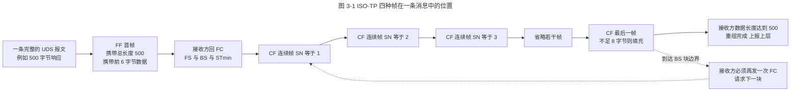

**图 3-1 解释**：注意图中虚线的回路——**每发满 `BS` 个 CF，发送方必须停下来等新的 FC**。如果 `BS = 0`，表示"不用再等，一次发完"。这就是"流控"的字面含义：控制数据流。

#### 3.2.2 设计模式一：接收方流控（Receiver-Driven Flow Control）

这是 ISO-TP 最重要的架构决策，值得单独讲清楚。

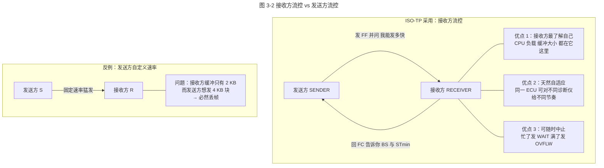

**图 3-2 解释**：为什么由**接收方**决定速率，而不是发送方？

> **"只有接收方知道自己还能吃多少。"**

这在软件架构上叫 **背压（Backpressure）** 模式，是流式数据传输（TCP 窗口、串口 XON/XOFF、消息队列）的通用解法。发送方盲目按固定速率发，在接收方负载抖动时必然溢出。

**副产品：`BS` 和 `STmin` 分别控制什么？**

| 参数 | 控制维度 | 类比 |
|---|---|---|
| **BS（BlockSize）** | **数量**：一次允许连续发几个 CF | "一次最多给你 8 封信" |
| **STmin（Separation Time minimum）** | **时间**：两个 CF 之间最小间隔 | "信与信之间至少隔 10 ms" |

两者结合达成：**限制瞬时突发（BS） + 限制平均带宽（STmin）**。这是经典的**令牌桶式流量整形（Traffic Shaping）**思想的两参数简化版。

#### 3.2.3 设计模式二：序列号回绕（Modulo Sequence Number）

`SN` 只有 **4 位（0~15）**，循环使用。设计意图：

- **成本极低**：只花 4 个 bit（PCI 剩下 4 bit 还能放长度/类型）。
- **足以发现丢帧/重帧**：连续两个 CF 的 SN 必须"加 1 mod 16"。若收到 SN=5 而期望 6，说明中间丢了帧（或总线重复）。检测到就**立即中止本次接收**并让上层超时重来。
- **不需要 ACK**：ISO-TP 没有逐帧确认，靠 SN 序列 + 超时来保证可靠性。这是**"弱确认 + 强校验"**的轻量可靠传输设计，非常适合 CAN 这种广播总线。

> 🚨 **最容易踩的坑**：**第一个 CF 的 SN 必须是 `1`**（不是 0）。因为 FF 相当于"第 0 个"，所以 CF 从 1 开始，到 15 后回绕到 0。

### 3.3 深入原理：帧格式逐字节剖析

#### 3.3.1 PCI 的四种位域布局（经典 CAN，8 字节）

```mermaid
---
title: 图 3-3 四种帧的字节级布局（经典 CAN）
---
flowchart TB
    subgraph SF["单帧 SF：数据长度 1 到 7"]
        S0["字节 0：0x0N<br/>高 4 位 0 表示单帧<br/>低 4 位 N 等于有效数据长度"]
        S1["字节 1 到 7：数据<br/>不足则填充 0xAA 或 0xCC"]
        S0 --> S1
    end
    subgraph FF["首帧 FF：长度大于 7"]
        F0["字节 0：0x1H<br/>高 4 位 1 表示首帧<br/>低 4 位为总长度高 4 位"]
        F1["字节 1：总长度低 8 位<br/>合起来是 12 位长度 最大 4095"]
        F2["字节 2 到 7：前 6 字节数据"]
        F0 --> F1 --> F2
    end
    subgraph CF["连续帧 CF"]
        C0["字节 0：0x2S<br/>高 4 位 2 表示连续帧<br/>低 4 位 S 为序列号 1 到 15 再回 0"]
        C1["字节 1 到 7：7 字节数据"]
        C0 --> C1
    end
    subgraph FCF["流控帧 FC"]
        K0["字节 0：0x3F<br/>高 4 位 3 表示流控帧<br/>低 4 位 F 为流状态 FS"]
        K1["字节 1：BS 块大小<br/>0 表示不限 一次发完"]
        K2["字节 2：STmin 最小间隔<br/>0 到 127 毫秒 或 微秒档"]
        K3["字节 3 到 7：保留 通常填 0 或填充字节"]
        K0 --> K1 --> K2 --> K3
    end
```

**图 3-3 解释**：四个帧类型**共用 1 个字节的"类型 + 参数"**，这就是 PCI 的精妙之处：

- **第一字节的高 4 位就是类型**，硬件/软件只需一次右移 4 位即可判型。
- **低 4 位被"复用"**为不同类型的参数：SF 是长度、FF 是长度高位、CF 是序列号、FC 是流状态。**同一比特在不同语义下表达不同含义**，这是紧凑协议的经典手法（类似的还有 IPv4 首部的 IHL、TCP 首部的 data offset）。

#### 3.3.2 单帧 SF 的两种形式

| 数据长度 | 格式 | 示例（数据 `22 F1 90`） |
|---|---|---|
| 1~7 字节 | `PCI = 0x0N`，N = 长度 | `03 22 F1 90 AA AA AA AA` |
| 8~62 字节（**CAN FD 专用**） | `PCI = 0x00`，`字节1 = 长度` | `00 20 62 F1 90 ...`（0x20 = 32 字节） |

> ⚠️ 经典 CAN 下 SF 最大 7 字节数据（1 字节 PCI + 7 字节数据 = 8 字节帧）。所以 UDS 请求超过 7 字节就必须用 FF/CF。

#### 3.3.3 流控帧 FC 三字段深度解析

**(1) FS（FlowStatus，流状态）—— 低 4 位**

| FS | 名称 | 含义 | 接收方应如何应对 |
|---|---|---|---|
| `0` | **ContinueToSend（CTS）** | "可以继续发" | 发送方按 BS/STmin 继续发 CF |
| `1` | **Wait（WT）** | "我还没准备好，等会儿" | 发送方**暂停**，等待下一个 FC；每次 WT 重置 `N_Bs` 计时 |
| `2` | **Overflow（OVFLW）** | "我装不下了，放弃" | 发送方**中止本次传输**，向应用层报错 |
| `3~15` | 保留 | — | 收到应按 **OVFLW** 处理（保守策略） |

> 💡 **WT 次数的限制**：标准用 **`N_WFTmax`** 限制连续 WAIT 的最大次数（常见配置 0 或 10）。若超过，发送方必须中止传输。这防止接收方"无限拖延"导致发送方永远阻塞。

**(2) BS（BlockSize）—— 字节 1**

| BS 值 | 含义 |
|---|---|
| `0x00` | **不再需要中间流控**：发送方可以连续发送剩余所有 CF |
| `0x01 ~ 0xFF` | 每发 N 个 CF 后，发送方必须**停下等待下一个 FC** |

示例：BS = 8 时，发送序列为：

```
FF → 等 FC → CF1..CF8 → 等 FC → CF9..CF16 → 等 FC → ...
```

**为什么需要 BS 而不是只靠 STmin？** 因为 `STmin` 只限制"帧间最小间隔"，**不限制总量**。如果接收方缓冲只有 2 KB（约 290 个 CF），而报文有 4 KB（约 580 个 CF），光靠 STmin 无法阻止溢出。BS 提供"分批 + 逐批确认"的机制，让接收方能在每批之间**决定是否继续**（可以回 OVFLW 中止）。这是**"滑动窗口"的退化形式（窗口 = BS，无回退重传）**。

**(3) STmin（SeparationTime minimum）—— 字节 2**

| 编码范围 | 表示的实际时间 | 说明 |
|---|---|---|
| `0x00 ~ 0x7F` | **0 ~ 127 ms** | 最常用。`0x0A` = 10 ms |
| `0x80 ~ 0xF0` | **保留（Reserved）** | 收到后**按 `0x7F`（127 ms）处理**（保守原则） |
| `0xF1 ~ 0xF9` | **100 ~ 900 µs** | `0xF1`=100µs, `0xF2`=200µs … `0xF9`=900µs（CAN FD 场景常用） |
| `0xFA ~ 0xFF` | **保留** | 同上，按 `0x7F` 处理 |

> 🔬 **STmin 是"最小值"不是"固定值"**：发送方必须保证 **相邻两个 CF 的"前一帧发送完成"到"后一帧开始发送"的间隔 ≥ STmin**。可以更长（例如发送方 CPU 忙），但**绝不能更短**。接收方靠 `N_Cr` 超时来兜住"太长"的情况。

> 🚨 **常见 Bug**：ECU 侧 `CanTpSTmin` 配了 0，但硬件发送 FIFO 一次塞满 3 帧，导致实际间隔"负值"（几乎同刻发出）。某些诊断仪（或网关）会因为帧间隔过小丢帧。**工程上建议 STmin 至少配 1~5 ms**，除非链路已充分验证。

#### 3.3.4 序列号 SN 的回绕规则

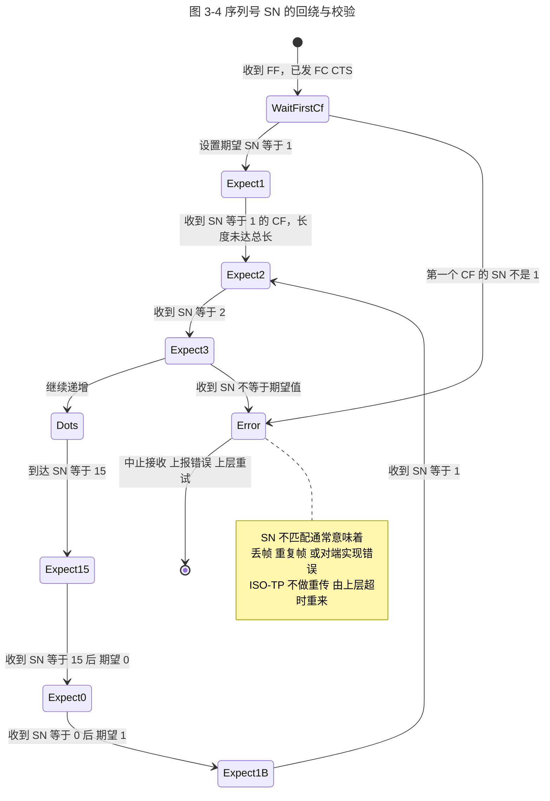

**图 3-4 解释**：SN 校验是**唯一的分片完整性检查手段**（没有 CRC、没有 ACK）。所以实现时**必须严格按"期望值"比较**，不能"取模后随便接受"。注意图中 `15 → 0 → 1` 的回绕路径。

#### 3.3.5 六个时序参数（N_xx）

| 参数 | 全称 | 方向 | 定义 | 典型值 |
|---|---|---|---|---|
| **N_As** | Acknowledge/Transmission time, sender | 发送方 | 从"请求发一帧"到"该帧发送成功"的最大时间 | 1000 ms |
| **N_Ar** | Transmission time, receiver | 接收方 | 接收方发出一帧（如 FC）的最大时间 | 1000 ms |
| **N_Bs** | Block time, sender | 发送方 | 从"发完 FF（或上一块最后一个 CF）"到"收到 FC"的最大等待 | 1000 ms |
| **N_Br** | Block time, receiver | 接收方 | 从"收到 FF（或上一块最后 CF）"到"发出 FC"的时间（性能要求，无超时） | 应满足 `N_Br + N_Ar < 0.9 × N_Bs` |
| **N_Cs** | Consecutive frame time, sender | 发送方 | 从"收到 FC"到"发出第一个 CF"的时间（性能要求） | 应满足 `N_Cs + N_As < 0.9 × N_Cr` |
| **N_Cr** | Consecutive frame time, receiver | 接收方 | 接收方等待下一个 CF 的最大时间 | 1000 ms |

> 📌 **工程实践**：`N_As/N_Ar/N_Bs/N_Cr` 四个超时在 AUTOSAR CanTp 里对应参数 `CanTpNas/CanTpNar/CanTpNbs/CanTpNcr`，**典型都配 1000 ms**。而 `N_Br/N_Cs` 是"性能要求"（不是超时），靠实现保证，AUTOSAR 里没有直接参数。

#### 3.3.6 CAN FD 下 ISO-TP 的扩展（ISO 15765-2:2016）

CAN FD 单帧可装 **64 字节**，所以 ISO-TP 增加了"大容量"格式：

| 项 | 经典 CAN | CAN FD |
|---|---|---|
| 单帧最大数据 | 7 字节 | **62 字节**（用 `00` + 长度字节的转义格式） |
| 首帧长度字段 | 12 位（最大 4095） | 12 位；**超过 4095 时用 32 位转义**：`字节0=0x10`、`字节1=0x00`、`字节2~5=FF_DL(32 位)`、数据从字节 6 开始 |
| 连续帧数据 | 7 字节 | **63 字节** |
| 流控帧 | 3 字节有效 + 5 字节填充 | 3 字节有效 + 填充到 DLC（通常 8 或 12 字节） |
| STmin 微秒档 | 少见 | **常用**（0xF1~0xF9） |
| 填充（Padding） | 必须填满 8 字节（很多 ECU 强制） | 可填到 8/12/16/20/24/32/48/64 |

> 💡 **CAN FD 的填充陷阱**：ISO-TP 规定"N_PDU 长度必须等于 DLC 对应长度"，但**不同厂商对"最后一帧是否填充"理解不同**。若 ECU 收到的最后一帧 CF 未填满而期望填满，某些实现会报"长度错误"。工程上建议：**CAN FD 的 ISO-TP 帧统一填充到固定长度**（如 64 字节，或用 `CanTpPaddingByte` 配置）。

#### 3.3.7 寻址模式（Addressing Format）

ISO-TP 支持 4 种寻址，决定"地址信息放在哪"：

| 模式 | 地址信息位置 | 适用 |
|---|---|---|
| **Normal**（普通） | 由 CAN ID 承载（`0x7E0`/`0x7E8`） | 11 位 ID 的常规 CAN，**最常用** |
| **Normal Fixed**（普通固定） | 由 29 位 ID 中的 `N_TAtype` + `N_SA` + `N_TA` 承载 | 29 位 ID 的商用车（J1939 风格） |
| **Extended**（扩展） | PCI 后多 1 字节 `N_TA`（目标地址） | 11 位 ID 但需要区分更多对端 |
| **Mixed**（混合） | 29 位 ID + 额外地址字节 | 特殊网关场景 |

> 📌 **AUTOSAR CanTp 对应配置**：`CanTpAddressingFormat`（`CANTP_STANDARD` / `CANTP_EXTENDED` / `CANTP_NORMALFIXED` / `CANTP_MIXED`），以及 `CanTpTxNSa/CanTpTxNTa/CanTpRxNSa/CanTpRxNTa` 等地址参数。

### 3.4 收发状态机（完整时序）

#### 3.4.1 发送方视角的完整时序

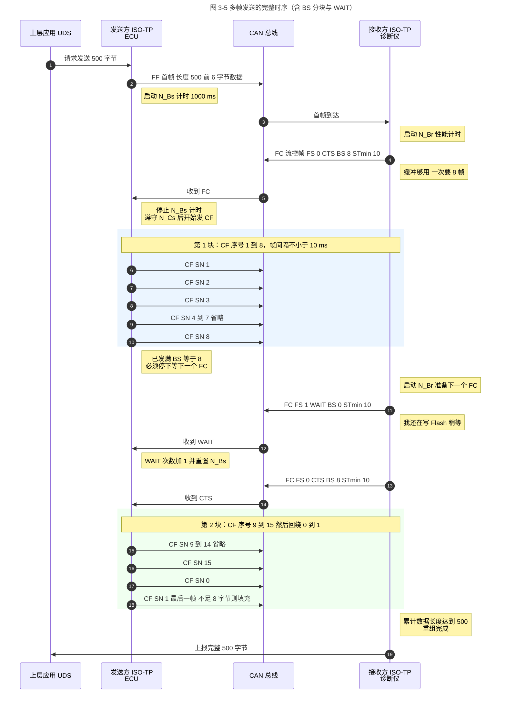

**图 3-5 解释**：这张图把流控的**三种 FS 状态**都用上了（CTS → WAIT → CTS），并且展示了三个关键工程点：

1. **每满 `BS` 帧就必须停下来等新 FC**（图中"已发满 BS 等于 8"处）。这是新手最容易漏实现的——很多简化实现干脆忽略 BS，只支持 BS=0。
2. **WAIT 不中止传输，只是暂停并重置 `N_Bs`**。实现时要把 `N_WFTmax` 计数加 1，超过上限才中止。
3. **SN 在跨块边界时继续递增**（不因新 FC 而重置）。图中第 2 块从 9 开始，回绕到 0、1。

#### 3.4.2 发送方状态机

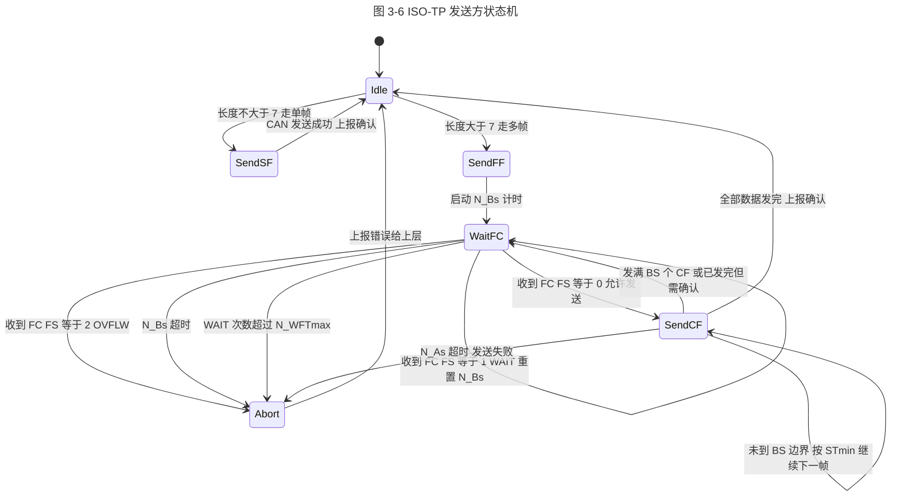

**图 3-6 解释**：状态机只有 6 个状态，但要注意两个"隐含逻辑"：

- **`SendCF` 的自环**：每发一帧都要检查三件事——① 是否已发完（→ Idle）；② 是否达到 BS 边界（→ WaitFC）；③ 否则按 `STmin` 排下一帧（继续自环）。**`STmin` 的计时基准是"上一帧发送完成"，不是"上一帧开始发送"**。
- **`Abort` 是唯一出口**：所有超时和异常都收敛到 Abort，再由上层（Dcm）决定是否重试。**ISO-TP 自身不做重传**——这是"网络层薄"的设计：可靠性由应用层的超时重试策略负责。

#### 3.4.3 接收方状态机

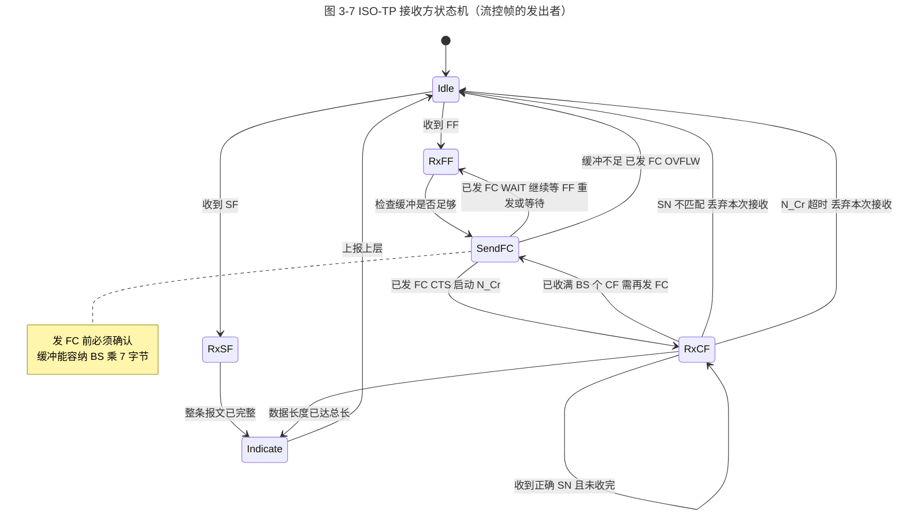

**图 3-7 解释**：接收方职责比发送方更重，因为它**必须做流控决策**：

- **`RxFF → SendFC`**：收到首帧后要**先判断缓冲是否够**（总长度 vs 剩余缓冲），够了回 CTS，不够回 OVFLW。这是**"先验容量检查"（Admission Control）**，避免收了一半才发现装不下。
- **`RxCF → SendFC`**：收满 BS 帧后要**主动再发 FC**。注意：**这次 FC 的 BS/STmin 可以与第一次不同**（接收方可以动态调整节奏）。这是一个常被忽略的灵活性。
- **`N_Cr` 超时**：如果发送方在 1000 ms 内没发下一帧 CF，接收方丢弃已收数据并回 Idle。**必须丢**，因为数据不完整无法使用，且必须释放缓冲。

> ⚠️ **实现要点**：`N_Cr` 的计时基准是"上一次收到 CF 的时刻"，且**每次收到 CF 都要重置**。

### 3.5 完整代码：ISO-TP 收发状态机（含流控）

> 下列代码是**可直接移植的 ISO-TP 实现骨架**，采用"非阻塞状态机 + 周期 MainFunction"的经典 AUTOSAR 风格，不占用任何阻塞延时。

#### 3.5.1 接口与配置

```c
/**
 * @file    isotp.h
 * @brief   ISO 15765-2 (ISO-TP) 网络层接口定义
 * @note    支持：SF / FF / CF / FC 全帧型，BS 分块，STmin 平滑，N_xx 超时
 */

#ifndef ISOTP_H
#define ISOTP_H

#include <stdint.h>

/* ============================================================
 * 常量定义
 * ============================================================ */
#define ISOTP_PCI_TYPE_SF           (0x00U)   /* 单帧       */
#define ISOTP_PCI_TYPE_FF           (0x10U)   /* 首帧       */
#define ISOTP_PCI_TYPE_CF           (0x20U)   /* 连续帧     */
#define ISOTP_PCI_TYPE_FC           (0x30U)   /* 流控帧     */

#define ISOTP_FS_CTS                (0x00U)   /* 继续发送   */
#define ISOTP_FS_WAIT               (0x01U)   /* 等待       */
#define ISOTP_FS_OVFLW              (0x02U)   /* 溢出/中止  */

#define ISOTP_MAX_SF_DATA_LEN       (7U)      /* 经典 CAN 单帧最大数据 */
#define ISOTP_MAX_FF_DATA_LEN       (6U)      /* 经典 CAN 首帧数据 */
#define ISOTP_CF_DATA_LEN           (7U)      /* 经典 CAN 连续帧数据 */
#define ISOTP_CAN_DL                (8U)      /* 经典 CAN 数据场长度 */
#define ISOTP_MAX_MSG_LEN           (4095U)   /* 12 位长度上限 */

/* STmin 保留值统一按 0x7F（127 ms）处理（规范要求） */
#define ISOTP_STMIN_RESERVED_MAX    (0x7FU)

/* 返回值 */
typedef enum {
    ISOTP_OK                = 0U,
    ISOTP_ERR_PARAM         = 1U,   /* 参数非法                 */
    ISOTP_ERR_BUSY          = 2U,   /* 通道忙，上一帧未完成     */
    ISOTP_ERR_OVFLW         = 3U,   /* 接收缓冲不足             */
    ISOTP_ERR_TIMEOUT       = 4U,   /* N_xx 超时                */
    ISOTP_ERR_SEQUENCE      = 5U,   /* 序列号不匹配             */
    ISOTP_ERR_ABORT         = 6U,   /* 对端请求中止（OVFLW）    */
} IsoTp_ReturnType;

/* 通道状态 */
typedef enum {
    ISOTP_STATE_IDLE = 0U,
    ISOTP_STATE_TX_WAIT_FC,      /* 已发 FF / 已满块，等 FC */
    ISOTP_STATE_TX_SEND_CF,      /* 正在按节奏发 CF         */
    ISOTP_STATE_RX_WAIT_CF,      /* 已收 FF，等 CF          */
} IsoTp_StateType;

/* ============================================================
 * 配置与运行时上下文
 * ============================================================ */
typedef struct {
    uint32_t txCanId;        /* 发送用 CAN ID，例如 0x7E8 */
    uint32_t rxCanId;        /* 接收用 CAN ID，例如 0x7E0 */
    uint8_t  bs;             /* 本端作为接收方时通告的 BlockSize  */
    uint8_t  stmin;          /* 本端作为接收方时通告的 STmin      */
    uint8_t  padByte;        /* 填充字节，典型 0xAA 或 0xCC       */
    uint16_t nAsMs;          /* N_As 超时                         */
    uint16_t nBsMs;          /* N_Bs 超时                         */
    uint16_t nCrMs;          /* N_Cr 超时                         */
    uint8_t  nWftMax;        /* 连续 WAIT 上限，0 表示不允许 WAIT */
    uint16_t rxBufSize;      /* 接收缓冲大小                      */
} IsoTp_ConfigType;

typedef struct {
    IsoTp_ConfigType cfg;
    IsoTp_StateType  state;

    /* ---- 发送上下文 ---- */
    const uint8_t   *txData;         /* 待发数据指针（调用者保证生命周期） */
    uint16_t         txLen;          /* 总长度                            */
    uint16_t         txOffset;       /* 已发送字节数                      */
    uint8_t          txSN;           /* 下一个 CF 的序列号                */
    uint8_t          txBlockCnt;     /* 本块已发 CF 数                    */
    uint8_t          txWaitCnt;      /* 连续收到 WAIT 的次数              */
    uint8_t          txStminPending; /* 已解析的 STmin（原始编码）        */
    uint32_t         txTimerMs;      /* 当前活动超时计时起点              */
    uint32_t         txLastCfMs;     /* 上一帧 CF 发送完成时刻            */
    uint8_t          txPendConfirm;  /* 1 = 等 CAN 发送确认               */

    /* ---- 接收上下文 ---- */
    uint8_t         *rxBuf;          /* 接收缓冲                          */
    uint16_t         rxTotal;        /* 本帧总长度（FF 中取得）           */
    uint16_t         rxReceived;     /* 已接收字节数                      */
    uint8_t          rxSN;           /* 期望的下一个 CF 序列号            */
    uint8_t          rxBlockCnt;     /* 本块已收 CF 数                    */
    uint32_t         rxTimerMs;      /* N_Cr 计时起点                     */
} IsoTp_ChannelType;

/* ============================================================
 * API
 * ============================================================ */
void     IsoTp_Init(IsoTp_ChannelType *ch, const IsoTp_ConfigType *cfg, uint8_t *rxBuffer);
IsoTp_ReturnType IsoTp_Transmit(IsoTp_ChannelType *ch, const uint8_t *data, uint16_t len);
void     IsoTp_MainFunction(IsoTp_ChannelType *ch);     /* 周期调用，建议 1 ms */
void     IsoTp_RxIndication(IsoTp_ChannelType *ch, uint32_t canId,
                            const uint8_t *data, uint8_t dlc);
void     IsoTp_TxConfirmation(IsoTp_ChannelType *ch);

/* 由上层（Dcm）提供的回调 */
extern void Dcm_RxIndication(uint8_t channel, const uint8_t *data, uint16_t len);
extern void Dcm_TxConfirmation(uint8_t channel, IsoTp_ReturnType result);

#endif /* ISOTP_H */
```

#### 3.5.2 实现：发送状态机与流控解析

```c
/**
 * @file    isotp.c
 * @brief   ISO-TP 实现：流控帧的发送与解析、BS 分块、STmin 节奏、N_xx 超时
 */

#include "isotp.h"
#include <string.h>

/* 平台适配：毫秒时基（生产环境用 OS 计数或硬件定时器） */
extern uint32_t Bsp_GetTickMs(void);

/* 平台适配：向 CAN 驱动提交一帧（返回 0 表示已受理，将产生 TxConfirmation） */
extern uint8_t Can_Write(uint32_t canId, const uint8_t *data, uint8_t dlc);

/* ============================================================
 * 一、工具函数
 * ============================================================ */

/**
 * @brief  把 STmin 编码转换为实际等待时间（单位：微秒）
 * @param  stminRaw  流控帧里的 STmin 原始字节
 * @return 微秒数
 * @note   0x00~0x7F 为毫秒；0xF1~0xF9 为 100~900 微秒；其余保留值按 0x7F 处理
 */
static uint32_t IsoTp_DecodeStminUs(uint8_t stminRaw)
{
    if (stminRaw <= 0x7FU) {
        /* 毫秒档：0 ~ 127 ms */
        return (uint32_t)stminRaw * 1000U;
    }
    if ((stminRaw >= 0xF1U) && (stminRaw <= 0xF9U)) {
        /* 微秒档：0xF1 = 100 us, 0xF2 = 200 us, ... 0xF9 = 900 us */
        return ((uint32_t)(stminRaw - 0xF0U)) * 100U;
    }
    /* 保留值：规范要求发送方按最大值 0x7F（127 ms）处理，避免过快 */
    return (uint32_t)ISOTP_STMIN_RESERVED_MAX * 1000U;
}

/**
 * @brief  组一帧并交给 CAN 驱动（自动做填充）
 */
static uint8_t IsoTp_SendFrame(IsoTp_ChannelType *ch, const uint8_t *frame8)
{
    uint8_t buf[ISOTP_CAN_DL];
    uint8_t i;

    (void)memcpy(buf, frame8, ISOTP_CAN_DL);
    /* 说明：填充在组帧时已完成，此处仅统一入口，便于后续加 CAN FD 适配 */
    for (i = 0U; i < ISOTP_CAN_DL; i++) {
        (void)buf[i];
    }
    return Can_Write(ch->cfg.txCanId, buf, ISOTP_CAN_DL);
}

/* ============================================================
 * 二、初始化
 * ============================================================ */
void IsoTp_Init(IsoTp_ChannelType *ch, const IsoTp_ConfigType *cfg, uint8_t *rxBuffer)
{
    if ((ch == NULL) || (cfg == NULL)) {
        return;
    }
    (void)memset(ch, 0, sizeof(IsoTp_ChannelType));
    ch->cfg  = *cfg;
    ch->rxBuf = rxBuffer;
    ch->state = ISOTP_STATE_IDLE;
}

/* ============================================================
 * 三、发送请求入口
 * ============================================================ */
IsoTp_ReturnType IsoTp_Transmit(IsoTp_ChannelType *ch, const uint8_t *data, uint16_t len)
{
    uint8_t frame[ISOTP_CAN_DL];

    if ((ch == NULL) || (data == NULL) || (len == 0U)) {
        return ISOTP_ERR_PARAM;
    }
    if (ch->state != ISOTP_STATE_IDLE) {
        return ISOTP_ERR_BUSY;                  /* 通道忙，拒绝新请求 */
    }
    if (len > ISOTP_MAX_MSG_LEN) {
        return ISOTP_ERR_PARAM;                 /* 超过 12 位长度上限 */
    }

    ch->txData    = data;
    ch->txLen     = len;
    ch->txOffset  = 0U;
    ch->txSN      = 1U;                         /* 关键：首个 CF 的 SN 必须是 1 */
    ch->txBlockCnt = 0U;
    ch->txWaitCnt  = 0U;
    ch->txPendConfirm = 0U;

    (void)memset(frame, ch->cfg.padByte, ISOTP_CAN_DL);

    if (len <= ISOTP_MAX_SF_DATA_LEN) {
        /* ---------- 单帧 SF：PCI = 0x0N ---------- */
        frame[0] = (uint8_t)(ISOTP_PCI_TYPE_SF | (uint8_t)len);
        (void)memcpy(&frame[1], data, len);
        ch->state = ISOTP_STATE_IDLE;           /* 单帧发完即回空闲 */
        ch->txOffset = len;
        ch->txPendConfirm = 1U;
        (void)IsoTp_SendFrame(ch, frame);
    } else {
        /* ---------- 首帧 FF：PCI = 0x1H，12 位长度 ---------- */
        frame[0] = (uint8_t)(ISOTP_PCI_TYPE_FF | (uint8_t)(len >> 8));
        frame[1] = (uint8_t)(len & 0xFFU);
        (void)memcpy(&frame[2], data, ISOTP_MAX_FF_DATA_LEN);
        ch->txOffset = ISOTP_MAX_FF_DATA_LEN;
        ch->txPendConfirm = 1U;

        /* 发出 FF 后启动 N_Bs 计时，等待接收方的 FC */
        ch->txTimerMs = Bsp_GetTickMs();
        ch->state     = ISOTP_STATE_TX_WAIT_FC;
        (void)IsoTp_SendFrame(ch, frame);
    }

    return ISOTP_OK;
}

/* ============================================================
 * 四、周期任务：超时检查 + 按节奏发 CF
 * ============================================================ */
void IsoTp_MainFunction(IsoTp_ChannelType *ch)
{
    uint32_t now;

    if (ch == NULL) {
        return;
    }
    now = Bsp_GetTickMs();

    switch (ch->state) {
        case ISOTP_STATE_TX_WAIT_FC:
            /* N_Bs 超时：发出 FF（或满块）后迟迟收不到 FC */
            if ((now - ch->txTimerMs) > (uint32_t)ch->cfg.nBsMs) {
                ch->state = ISOTP_STATE_IDLE;
                Dcm_TxConfirmation(0U, ISOTP_ERR_TIMEOUT);
            }
            break;

        case ISOTP_STATE_TX_SEND_CF:
        {
            uint8_t  frame[ISOTP_CAN_DL];
            uint16_t remain;
            uint32_t stminUs;
            uint32_t elapsedUs;

            /* 4.1 若上一帧还未得到发送确认，不推进（防止 FIFO 溢出） */
            if (ch->txPendConfirm != 0U) {
                break;
            }

            /* 4.2 STmin 节奏控制：距上一帧发送完成的间隔不足则等待 */
            stminUs   = IsoTp_DecodeStminUs(ch->txStminPending);
            elapsedUs = (now - ch->txLastCfMs) * 1000U;
            if (elapsedUs < stminUs) {
                break;
            }

            /* 4.3 准备下一帧 CF */
            (void)memset(frame, ch->cfg.padByte, ISOTP_CAN_DL);
            frame[0] = (uint8_t)(ISOTP_PCI_TYPE_CF | (uint8_t)(ch->txSN & 0x0FU));

            remain = (uint16_t)(ch->txLen - ch->txOffset);
            if (remain > ISOTP_CF_DATA_LEN) {
                remain = ISOTP_CF_DATA_LEN;
            }
            (void)memcpy(&frame[1], &ch->txData[ch->txOffset], remain);

            /* 4.4 更新状态 */
            ch->txOffset     = (uint16_t)(ch->txOffset + remain);
            ch->txSN         = (uint8_t)((ch->txSN + 1U) & 0x0FU);   /* 15 之后回绕到 0 */
            ch->txBlockCnt   = (uint8_t)(ch->txBlockCnt + 1U);
            ch->txPendConfirm = 1U;
            ch->txLastCfMs   = now;
            (void)IsoTp_SendFrame(ch, frame);

            /* 4.5 是否已发完 */
            if (ch->txOffset >= ch->txLen) {
                ch->state = ISOTP_STATE_IDLE;
                /* 注意：此处立即上报成功——真实项目应在最后一帧 TxConfirmation 后上报 */
                Dcm_TxConfirmation(0U, ISOTP_OK);
                break;
            }

            /* 4.6 是否达到 BS 块边界（BS == 0 表示不限，不进入此分支） */
            if ((ch->cfg.bs != 0U) && (ch->txBlockCnt >= ch->cfg.bs)) {
                ch->txBlockCnt = 0U;
                ch->txTimerMs  = now;          /* 重启 N_Bs：等新的 FC */
                ch->state      = ISOTP_STATE_TX_WAIT_FC;
            }
            break;
        }

        case ISOTP_STATE_RX_WAIT_CF:
            /* N_Cr 超时：等不到下一帧 CF */
            if ((now - ch->rxTimerMs) > (uint32_t)ch->cfg.nCrMs) {
                ch->state = ISOTP_STATE_IDLE;
                Dcm_TxConfirmation(0U, ISOTP_ERR_TIMEOUT);
            }
            break;

        case ISOTP_STATE_IDLE:
        default:
            break;
    }
}

/* ============================================================
 * 五、CAN 发送完成确认
 * ============================================================ */
void IsoTp_TxConfirmation(IsoTp_ChannelType *ch)
{
    if (ch == NULL) {
        return;
    }
    ch->txPendConfirm = 0U;
    if (ch->state == ISOTP_STATE_TX_WAIT_FC) {
        /* FF 已真正发上线，从这里开始计 N_Bs（也可在提交时计时，二者皆可，
         * 规范建议从"发送成功"开始计，更贴近实际链路行为）
         */
        ch->txTimerMs = Bsp_GetTickMs();
    }
}

/* ============================================================
 * 六、发送流控帧 FC —— 本端作为接收方时的核心动作
 * ============================================================ */
/**
 * @brief  发送流控帧
 * @param  ch     通道
 * @param  fs     流状态：CTS / WAIT / OVFLW
 * @note   FC 的三要素：FS（低 4 位）+ BS（字节1）+ STmin（字节2）
 *         WAIT/OVFLW 时 BS 与 STmin 通常填 0，不影响语义
 */
static void IsoTp_SendFlowControl(IsoTp_ChannelType *ch, uint8_t fs)
{
    uint8_t frame[ISOTP_CAN_DL];

    (void)memset(frame, ch->cfg.padByte, ISOTP_CAN_DL);

    frame[0] = (uint8_t)(ISOTP_PCI_TYPE_FC | (uint8_t)(fs & 0x0FU));  /* 0x3F */
    frame[1] = (fs == ISOTP_FS_CTS) ? ch->cfg.bs    : 0U;             /* BS    */
    frame[2] = (fs == ISOTP_FS_CTS) ? ch->cfg.stmin : 0U;             /* STmin */
    /* 字节 3~7 保留，填填充字节 */

    (void)IsoTp_SendFrame(ch, frame);
}

/* ============================================================
 * 七、接收指示：解析 SF / FF / CF / FC
 * ============================================================ */
void IsoTp_RxIndication(IsoTp_ChannelType *ch, uint32_t canId,
                        const uint8_t *data, uint8_t dlc)
{
    uint8_t pciType;
    uint8_t buf[ISOTP_CAN_DL];

    if ((ch == NULL) || (data == NULL) || (dlc < 1U)) {
        return;
    }
    /* 7.0 方向过滤：本通道只处理配置的接收 CAN ID */
    if (canId != ch->cfg.rxCanId) {
        return;
    }
    (void)memcpy(buf, data, (dlc > ISOTP_CAN_DL) ? ISOTP_CAN_DL : dlc);

    pciType = (uint8_t)(buf[0] & 0xF0U);        /* 高 4 位判型 */

    switch (pciType) {
        /* ---------------- 单帧 SF ---------------- */
        case ISOTP_PCI_TYPE_SF:
        {
            uint8_t sfDl = (uint8_t)(buf[0] & 0x0FU);
            if ((sfDl == 0U) || (sfDl > ISOTP_MAX_SF_DATA_LEN) || ((uint8_t)(sfDl + 1U) > dlc)) {
                return;                          /* 长度非法，直接丢弃 */
            }
            Dcm_RxIndication(0U, &buf[1], sfDl); /* 直接上报上层 */
            break;
        }

        /* ---------------- 首帧 FF ---------------- */
        case ISOTP_PCI_TYPE_FF:
        {
            uint16_t total = (uint16_t)(((uint16_t)(buf[0] & 0x0FU) << 8) | (uint16_t)buf[1]);

            if ((total < 8U) || (total > ch->cfg.rxBufSize)) {
                /* 7.1 总长度不合理或缓冲不足 → 立即回 OVFLW 并放弃 */
                IsoTp_SendFlowControl(ch, ISOTP_FS_OVFLW);
                ch->state = ISOTP_STATE_IDLE;
                return;
            }

            /* 7.2 保存前 6 字节 */
            ch->rxTotal    = total;
            ch->rxReceived = ISOTP_MAX_FF_DATA_LEN;
            (void)memcpy(ch->rxBuf, &buf[2], ISOTP_MAX_FF_DATA_LEN);

            /* 7.3 状态初始化 */
            ch->rxSN       = 1U;                  /* 关键：首个 CF 期望 SN = 1 */
            ch->rxBlockCnt = 0U;
            ch->rxTimerMs  = Bsp_GetTickMs();
            ch->state      = ISOTP_STATE_RX_WAIT_CF;

            /* 7.4 回 FC —— 此刻就是"流控帧诞生"的时刻 */
            IsoTp_SendFlowControl(ch, ISOTP_FS_CTS);
            break;
        }

        /* ---------------- 连续帧 CF ---------------- */
        case ISOTP_PCI_TYPE_CF:
        {
            uint8_t sn;
            uint16_t copyLen;
            uint16_t remain;

            if (ch->state != ISOTP_STATE_RX_WAIT_CF) {
                return;                          /* 无上下文，丢弃孤立 CF */
            }

            sn = (uint8_t)(buf[0] & 0x0FU);

            /* 7.5 序列号校验：必须严格等于期望值 */
            if (sn != ch->rxSN) {
                ch->state = ISOTP_STATE_IDLE;    /* 序列错 → 丢弃整帧 */
                return;
            }
            ch->rxSN = (uint8_t)((ch->rxSN + 1U) & 0x0FU);   /* 15 → 0 回绕 */

            /* 7.6 拷贝数据：注意最后一帧可能不足 7 字节 */
            remain  = (uint16_t)(ch->rxTotal - ch->rxReceived);
            copyLen = (remain < ISOTP_CF_DATA_LEN) ? remain : ISOTP_CF_DATA_LEN;
            (void)memcpy(&ch->rxBuf[ch->rxReceived], &buf[1], copyLen);
            ch->rxReceived = (uint16_t)(ch->rxReceived + copyLen);

            /* 7.7 收完则上报 */
            if (ch->rxReceived >= ch->rxTotal) {
                ch->state = ISOTP_STATE_IDLE;
                Dcm_RxIndication(0U, ch->rxBuf, ch->rxTotal);
                break;
            }

            /* 7.8 收满 BS 个 CF → 主动再发一次 FC 请求下一块 */
            ch->rxBlockCnt = (uint8_t)(ch->rxBlockCnt + 1U);
            ch->rxTimerMs  = Bsp_GetTickMs();     /* 重置 N_Cr */
            if ((ch->cfg.bs != 0U) && (ch->rxBlockCnt >= ch->cfg.bs)) {
                ch->rxBlockCnt = 0U;
                IsoTp_SendFlowControl(ch, ISOTP_FS_CTS);
            }
            break;
        }

        /* ---------------- 流控帧 FC（本端为发送方时收到） ---------------- */
        case ISOTP_PCI_TYPE_FC:
        {
            uint8_t fs    = (uint8_t)(buf[0] & 0x0FU);
            uint8_t bs    = buf[1];
            uint8_t stmin = buf[2];

            if (ch->state != ISOTP_STATE_TX_WAIT_FC) {
                return;                          /* 非预期 FC，忽略 */
            }

            switch (fs) {
                case ISOTP_FS_CTS:
                    /* 7.9 接受流控参数并开始发 CF */
                    ch->txWaitCnt     = 0U;
                    ch->txBlockCnt    = 0U;
                    ch->txStminPending = stmin;
                    ch->txLastCfMs    = Bsp_GetTickMs();
                    ch->state         = ISOTP_STATE_TX_SEND_CF;
                    break;

                case ISOTP_FS_WAIT:
                    /* 7.10 WAIT：暂停并重置 N_Bs，计数超限则中止 */
                    ch->txWaitCnt++;
                    if ((ch->cfg.nWftMax == 0U) || (ch->txWaitCnt > ch->cfg.nWftMax)) {
                        ch->state = ISOTP_STATE_IDLE;
                        Dcm_TxConfirmation(0U, ISOTP_ERR_ABORT);
                    } else {
                        ch->txTimerMs = Bsp_GetTickMs();
                    }
                    break;

                case ISOTP_FS_OVFLW:
                default:
                    /* 7.11 OVFLW 或保留值：中止传输 */
                    ch->state = ISOTP_STATE_IDLE;
                    Dcm_TxConfirmation(0U, ISOTP_ERR_OVFLW);
                    break;
            }
            break;
        }

        default:
            break;                                /* 保留类型，忽略 */
    }
}
```

> 📎 **代码要点逐条说明**
> 1. **`txSN` 初值为 1**（`IsoTp_Transmit` 中）：这是 ISO-TP 的硬性规定，写成 0 会导致所有对端在第二个 CF 就报序列错误。
> 2. **`IsoTp_SendFlowControl()` 只在 `FS_CTS` 时填 BS/STmin**：WAIT/OVFLW 时这两字节无意义，填 0 最兼容。
> 3. **`BS` 的检查点有两处**：发送方在 `MainFunction` 里检查"满块则转入等 FC"；接收方在 `RxIndication` 里检查"满块则主动再发 FC"。**两边必须对称实现**，否则会死锁（一方等、另一方不发）。
> 4. **`STmin` 用"上一帧发送完成时刻"作基准**：代码里 `txLastCfMs = now` 是在提交发送前赋值，简化实现；严格做法应在 `IsoTp_TxConfirmation()` 里记录。若 STmin 需要微秒精度（0xF1~0xF9），必须把时基换成微秒计数器。
> 5. **`OVFLW` 的双向性**：本端作为接收方发 OVFLW（`7.1`），本端作为发送方收 OVFLW（`7.11`），两条路径都要实现。
> 6. **`rxBufSize` 检查在 FF 阶段就做**（`7.1`）：这叫"准入控制"，避免收了一半才发现装不下——这是所有流式协议该有的设计。

### 3.6 抓包实战：读 VIN 的完整报文逐字节解析

场景：诊断仪（`0x7E0` 发 / `0x7E8` 收）读 ECU 的 VIN（DID `F190`，17 字节）。

**第一步：请求（单帧，3 字节数据）**

| CAN ID | D0 | D1 | D2 | D3 | D4 | D5 | D6 | D7 | 解析 |
|---|---|---|---|---|---|---|---|---|---|
| `0x7E0` | `03` | `22` | `F1` | `90` | `AA` | `AA` | `AA` | `AA` | `03` = SF 长度 3；`22` = ReadDataByIdentifier；`F190` = VIN |

**第二步：ECU 响应首帧（总长 20 字节）**

| CAN ID | D0 | D1 | D2 | D3 | D4 | D5 | D6 | D7 | 解析 |
|---|---|---|---|---|---|---|---|---|---|
| `0x7E8` | `10` | `14` | `62` | `F1` | `90` | `4C` | `53` | `56` | `10 14` = FF，总长 `0x014` = 20 字节；数据前 6 字节 `62 F1 90 4C 53 56`（`4C 53 56` = "LSV"） |

**第三步：诊断仪回流控帧（这里用 BS=8、STmin=10 ms）**

| CAN ID | D0 | D1 | D2 | D3~D7 | 解析 |
|---|---|---|---|---|---|
| `0x7E0` | `30` | `08` | `0A` | `00...` | `30` = FC，`FS=0`（CTS）；`BS=0x08`（每 8 帧要一次 FC）；`STmin=0x0A`（≥10 ms） |

**第四步：ECU 发连续帧（注意 SN 从 1 开始，17 字节 VIN 余下 14 字节 → 2 帧）**

| 序号 | CAN ID | D0 | D1..D7 | 解析 |
|---|---|---|---|---|
| CF1 | `0x7E8` | `21` | `41 41 32 41 30 38 4E` | `21` = CF，SN=`1`；数据 "AA2A08N" |
| CF2 | `0x7E8` | `22` | `32 31 30 30 30 30 31` | `22` = CF，SN=`2`；数据 "2100001" |

**重组结果**：

```
62 F1 90 | 4C 53 56 41 41 32 41 30 38 4E 32 31 30 30 30 30 31
  头 3 字节 = 62 (响应) F1 90 (DID)        17 字节 = "LSVAA2A08N2100001"
                                        ↑ VIN 共 20 字节，与 FF 的总长 0x14 一致
```

**再看一个"ECU 作为接收方发 FC"的例子**（诊断仪向 ECU 写 100 字节标定数据）：

| 方向 | CAN ID | D0 | D1 | D2 | D3~D7 | 解析 |
|---|---|---|---|---|---|---|
| Tester→ECU | `0x7E0` | `10` | `64` | `2E` | `12 34 01 ...` | FF，总长 `0x064` = 100 字节 |
| **ECU→Tester** | `0x7E8` | `30` | `00` | `00` | `AA...` | **ECU 回 FC：FS=0 CTS，BS=0（不限块），STmin=0（无间隔）** |
| Tester→ECU | `0x7E0` | `21` … `2F` | … | | | CF 序列 1~15 |
| Tester→ECU | `0x7E0` | `20` … | … | | | SN 回绕到 0 |
| ECU→Tester | `0x7E8` | `6E 12 34` | | | | 数据收完后回 UDS 正响应 `6E`（0x2E+0x40） |

**再看三个"异常 FC"的真实形态**：

| 场景 | FC 报文字节 | 含义与对端行为 |
|---|---|---|
| ECU 忙（正在写 Flash） | `31 00 00 AA...` | `FS=1` WAIT → 发送方暂停并重置 N_Bs；连续超过 `N_WFTmax` 次则中止 |
| ECU 缓冲不足 | `32 00 00 AA...` | `FS=2` OVFLW → 发送方立即中止，Dcm 回 `7F 2E 78` 或让上层超时 |
| 要求慢速发送 | `30 04 F1 AA...` | `BS=4`、`STmin=0xF1` = **100 µs**（CAN FD 场景高吞吐配置） |

> 🔍 **抓包排查的三个黄金判断**
> 1. **看不到 FC**：ECU 收到了 FF 但没回 FC → 检查 ECU 的 `rxBufSize` 是否小于 FF 里的总长度（很多实现此时**静默丢弃**，不报任何错，最难查）。
> 2. **CF 发到第 N 帧后停止**：ECU 的 FC 里 `BS` 配成了 8，但诊断仪没实现"满块后再等 FC"，它发完 8 帧就停了 → 看时序上是否两边都在等对方。
> 3. **报 `N_Cr` 超时**：ECU 通告的 `STmin` 太大（如 `0x7F` = 127 ms），而诊断仪的 `N_Cr` 配得较小（如 50 ms）→ 典型的两端参数不匹配。

---

## 第 4 章 时序管理：P2 / P2\* / S3 / 0x78

### 4.1 通俗易懂

诊断仪很"没耐心"，它给 ECU 设了几个**死线**：

| 定时器 | 通俗含义 | 默认值 |
|---|---|---|
| **P2**（P2Server_max） | "我问了你，**50 ms 内**必须开口（哪怕是说'稍等'）" | 50 ms |
| **P2\***（P2\*Server_max） | "你说了'稍等'之后，**5 秒内**必须给我最终答案" | 5000 ms |
| **S3**（S3Server） | "你（ECU）**5 秒**没听到我说话，就把权限收回、退回默认会话" | 5000 ms |

**`0x78`（responsePending）就是 ECU 说的"稍等，我还在算"。**

### 4.2 设计机制与设计思路

#### 4.2.1 为什么需要 `0x78`

有些服务天生慢：

| 服务 | 典型耗时 | 原因 |
|---|---|---|
| `31 01` 例程启动（如 EGR 全行程自检） | 200 ms ~ 3 s | 物理执行器动作需要时间 |
| `36` 传输数据（写 Flash） | 每块 10 ~ 50 ms | Flash 编程慢，且期间 CPU 无法取指 |
| `11 01` ECU 复位前处理 | 数十 ms | 需保存数据、关执行器 |
| `2E` 写 EEPROM 标定 | 10 ~ 100 ms | EEPROM 写入周期 |

如果 ECU 硬要在 50 ms 内给出最终答案，只有两条路：① 阻塞等待（破坏实时性）；② 返回失败（功能不可用）。**都不行。**

于是 UDS 提供了**"异步应答"**：先回 `7F <SID> 78`（"我收到了，正在做"），把死线从 P2 换成 P2\*（50 ms → 5000 ms），做完再发最终响应。

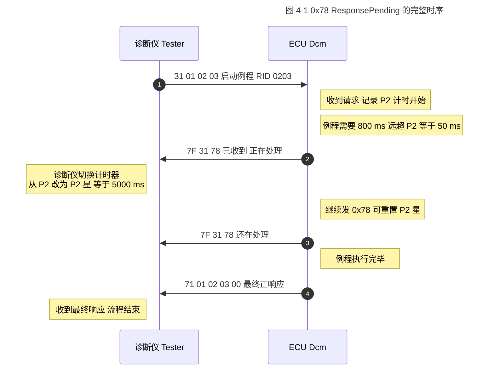

**图 4-1 解释**：三个关键规则：

1. **`0x78` 必须在 P2 超时前发出**（本例 50 ms 内），否则诊断仪直接判定"ECU 无响应"。
2. **`0x78` 可以发多次**，每次重置 P2\* 计时。但**不能滥用**——有些诊断仪限制 `0x78` 的最大次数或总时长。
3. **`0x78` 之后必须发最终响应**（正或负）。**只发 `0x78` 不发最终响应 = 诊断仪一直等到 P2\* 超时**，这是最常见的实现 bug。

#### 4.2.2 设计思路：这是"异步任务 + 心跳"模式的协议化

UDS 的 `0x78` 本质是把操作系统里的 **"长任务 + 心跳保活"** 模式写进了协议：

| 软件工程概念 | UDS 对应 |
|---|---|
| 异步任务提交 | 收到 `31 01` / `36` 请求 |
| 任务未完成时保持连接 | 周期性发 `7F xx 78` |
| 任务完成回调 | 发最终正响应 |
| 任务超时/失败 | 发最终负响应（如 `7F 31 72`） |
| 客户端超时 | P2\* |

**为什么用"心跳"而不是"一个超长超时"？** 因为**心跳能区分"慢"和"死"**：如果 ECU 每 2 秒发一次 `0x78`，说明它活着只是在忙；如果连 `0x78` 都没了，诊断仪立刻知道是"ECU 挂了或总线断了"。这是**"活性检测（Liveness Detection）"**的经典设计，与 TCP keepalive、gRPC 长连接心跳同理。

### 4.3 深入原理

#### 4.3.1 三个定时器的精确定义

| 定时器 | 起点 | 终点 | 典型值 | 谁监控 |
|---|---|---|---|---|
| **P2Server_max** | ECU 收到请求的**最后一个字节** | ECU 发出响应的**第一个字节** | 50 ms | 诊断仪（P2Client_max 通常同为 50 ms） |
| **P2\*Server_max** | ECU 发出 `7F xx 78` 的**最后一个字节** | ECU 发出下一个响应的**第一个字节** | 5000 ms | 诊断仪（P2\*Client_max 通常 5000 ms） |
| **S3Server** | ECU 收到**任何**诊断请求（或发出响应） | 会话超时回落 | 5000 ms | ECU 自己 |

> ⚠️ **注意 P2 的"50 ms"从哪里来**：它**不是**固定值，而是 `10 xx` 正响应中返回的（`50 03 00 32 01 F4` 里 `00 32` = 50 ms）。诊断仪会**用 ECU 声明的值**作为自己的超时（并加余量）。所以 `10 03` 的响应必须如实填写。

#### 4.3.2 代码：`0x78` 的发送与长任务集成

```c
/**
 * @file    uds_pending.c
 * @brief   0x78 responsePending 的实现模板
 * @note    设计要点：把"长任务"拆成 提交 / 心跳 / 完成 三段
 */

#include <stdint.h>

/* 时间常量（可从 10 xx 响应中协商，这里用默认值） */
#define DIAG_P2_MS          (50U)
#define DIAG_P2_STAR_MS     (5000U)
#define DIAG_PENDING_MARGIN (200U)   /* 提前 200 ms 发下一个 0x78，防抖动 */

/* 长任务状态 */
typedef enum {
    TASK_IDLE = 0U,
    TASK_RUNNING,
    TASK_DONE,
    TASK_FAILED,
} LongTaskStateType;

static LongTaskStateType s_taskState = TASK_IDLE;
static uint8_t           s_taskSid   = 0U;      /* 记住原请求 SID，用于组 7F xx 78 */
static uint32_t          s_nextPendingMs = 0U;

/**
 * @brief  在服务处理函数里"提交"一个长任务
 * @param  sid  当前请求的 SID
 * @retval 1 表示已提交（本次不返回最终响应）；0 表示可立即返回
 * @note   调用者必须立即返回 0 长度响应，由 Dcm 框架负责发 0x78
 */
uint8_t Diag_SubmitLongTask(uint8_t sid)
{
    if (s_taskState == TASK_RUNNING) {
        return 0U;                    /* 已有任务在执行 → 上层应回 NRC 0x21 busy */
    }
    s_taskSid        = sid;
    s_taskState      = TASK_RUNNING;
    s_nextPendingMs  = Diag_GetTick() + (DIAG_P2_STAR_MS - DIAG_PENDING_MARGIN);

    /* 启动真正的业务动作（例如启动 Flash 擦除、启动例程） */
    App_StartLongOperation();

    return 1U;
}

/**
 * @brief  周期任务（10 ms）：负责发 0x78 心跳与收尾
 * @note   必须在 Dcm 主函数上下文运行，且不能被其他诊断请求打断
 */
void Diag_PendingTask(void)
{
    uint32_t now = Diag_GetTick();

    if (s_taskState != TASK_RUNNING) {
        return;
    }

    /* 4.1 查询业务任务是否完成 */
    switch (App_GetLongOperationState()) {
        case APP_OP_DONE:
            s_taskState = TASK_DONE;
            /* 发最终正响应（由业务模块提供数据） */
            Diag_SendFinalResponse(s_taskSid);
            s_taskState = TASK_IDLE;
            return;

        case APP_OP_FAILED:
            s_taskState = TASK_IDLE;
            /* 发最终负响应，例如 0x72 generalProgrammingFailure */
            Diag_SendNegativeResponse(s_taskSid, 0x72U);
            return;

        case APP_OP_RUNNING:
        default:
            break;
    }

    /* 4.2 快到 P2 星 死线了 → 发一个 0x78 续命 */
    if (now >= s_nextPendingMs) {
        Diag_SendResponsePending(s_taskSid);        /* 组包 7F SID 78 */
        s_nextPendingMs = now + (DIAG_P2_STAR_MS - DIAG_PENDING_MARGIN);
    }
}

/**
 * @brief  组包并发送 0x78
 */
void Diag_SendResponsePending(uint8_t sid)
{
    uint8_t rsp[3];
    rsp[0] = 0x7FU;
    rsp[1] = sid;
    rsp[2] = 0x78U;
    (void)IsoTp_Transmit(&g_diagChannel, rsp, 3U);
}
```

> 📎 **代码要点**
> - **心跳间隔取 `P2* - 200ms`**：不要卡着死线发，总线负载和调度抖动会导致偶发超时。
> - **`s_taskSid` 必须记住**：`7F xx 78` 中的 `xx` 是**原请求 SID**，丢了就组不出正确的 `0x78`。
> - **长任务期间拒绝新请求**：若诊断仪在长任务执行中又发新请求，ECU 应回 `7F xx 21`（busyRepeatRequest）或 `0x24`（requestSequenceError），不能并行处理。

#### 4.3.3 S3 超时与会话回落的时序

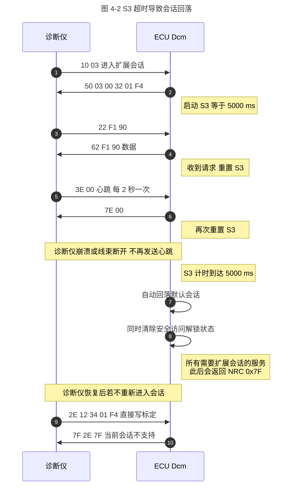

**图 4-2 解释**：这张图解释了**为什么"诊断仪明明发对了报文却收到 `0x7F`"** —— 90% 的情况是**中间停了超过 5 秒**，会话已经悄悄退回默认会话了。排查方法：抓包看最后一次 `3E` 或业务请求与当前请求的时间差。

> 💡 **S3 的安全意义**：想象一辆车在 4S 店做标定，诊断仪拔掉后 ECU 仍停在"扩展会话 + 已解锁"状态——任何人插上诊断仪就能写标定，这是巨大的安全漏洞。**S3 让权限"自动过期"**，这是所有权限系统该有的设计（类似 token 过期）。

---

## 第 5 章 在 AUTOSAR 中的映射（Dcm / CanTp / Dem）

### 5.1 通俗易懂

在 AUTOSAR 里，前面讲的 UDS 和 ISO-TP **不是自己手写的**，而是由标准化模块提供：

| 你在第 2、3 章学到的东西 | AUTOSAR 里对应的模块 |
|---|---|
| UDS 服务（`10`/`22`/`27`/`2E`/`31`…） | **Dcm**（Diagnostic Communication Manager） |
| ISO-TP（SF/FF/CF/**FC**） | **CanTp**（CAN Transport Protocol） |
| DTC 存储与状态管理 | **Dem**（Diagnostic Event Manager） |
| 诊断报文路由 | **PduR** |
| CAN 帧收发 | **CanIf** + **Can** 驱动 |

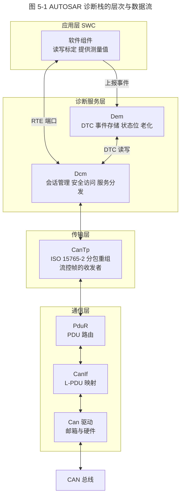

**图 5-1 解释**：

- **Dcm 完全不接触流控帧**：它只看到"一条完整的 UDS 请求"（`Dcm_StartOfReception`/`Dcm_CopyRxData`/`Dcm_TpRxIndication` 三个上层 API）。**流控全在 CanTp 里**。
- **Dem 与 Dcm 双向交互**：`0x19` 读 DTC 时 Dcm 向 Dem 查询；`0x14` 清 DTC 时 Dcm 调 Dem 清除；SWC 通过 `Dem_ReportErrorStatus()` 上报故障。
- **RTE 是隔离带**：Dcm 读写数据不直接访问应用变量，而是通过 RTE 端口（`Rte_Call_...` / `Rte_Read_...`），从而支持多核与内存保护。

### 5.2 设计机制：Dcm 的三大子模块

| 子模块 | 全称 | 职责 | 配置容器 |
|---|---|---|---|
| **DcmDsl** | Diagnostic Session Layer | 会话、安全等级、S3/P2 定时器、协议（UDS/OBD）选择 | `DcmDslProtocol`, `DcmDslSession`, `DcmDslSecurityAccess` |
| **DcmDsd** | Diagnostic Service Dispatcher | 服务表：SID → 是否支持、在哪些会话、调用哪个处理 | `DcmDsdServiceTable`, `DcmDsdService` |
| **DcmDsp** | Diagnostic Service Processing | 具体数据：DID 表、RID 表、DTC 组、IO 控制 | `DcmDspDid`, `DcmDspRoutine`, `DcmDspData` |

> 🔎 **你会发现这就是第 2 章两张表的结构化版本**：`g_serviceTable[]` 对应 `DcmDsdServiceTable`，`g_didTable[]` 对应 `DcmDspDid`。**手写实现与 AUTOSAR 实现在思想上是同一套**——理解了手写版，读 AUTOSAR 配置就毫无难度。

### 5.3 深入原理：CanTp 的关键配置参数

CanTp 是"流控帧的主人"，它的配置直接决定多帧通信能否成功：

| CanTp 参数 | 对应 ISO-TP 概念 | 说明 | 典型值 |
|---|---|---|---|
| `CanTpAddressingFormat` | 寻址模式 | `CANTP_STANDARD`（普通 11 位 ID） | STANDARD |
| `CanTpNas` | **N_As** | 发送方帧发送超时 | 1000 ms |
| `CanTpNar` | **N_Ar** | 接收方帧发送超时 | 1000 ms |
| `CanTpNbs` | **N_Bs** | 等 FC 的超时 | 1000 ms |
| `CanTpNbr` | **N_Br** | 发出 FC 的性能要求（通常不直接配） | 20 ms |
| `CanTpNcs` | **N_Cs** | 发出首个 CF 的性能要求 | 0 ms |
| `CanTpNcr` | **N_Cr** | 等下一帧 CF 的超时 | 1000 ms |
| `CanTpBs` | **BS** | 本端作为接收方通告的块大小 | 8（或 0） |
| `CanTpSTmin` | **STmin** | 本端通告的最小间隔 | 0~10 ms |
| `CanTpPaddingByte` | 填充字节 | 不足 8 字节时的填充值 | `0xAA` / `0xCC` |
| `CanTpRxBufferSize` | 接收缓冲 | 单条诊断报文最大长度 | ≥ 最大响应长度 |
| `CanTpMaxWft` | **N_WFTmax** | 允许的连续 WAIT 次数 | 0 或 10 |

> ⚠️ **最常见配置错误表**
>
> | 症状 | 大概率原因 |
> |---|---|
> | 长响应（如 VIN、DTC 列表）发不出去，短响应正常 | `CanTpRxBufferSize` 太小 或 `Dcm` 响应缓冲太小 |
> | 偶发 `N_Cr` 超时 | `CanTpSTmin` 配得比诊断仪的 `N_Cr` 大 |
> | 偶发 `N_Bs` 超时 | ECU 的 `CanTpNbs` 太小，或诊断仪回 FC 慢（USB 转 CAN 设备延迟大） |
> | 诊断仪报"长度错误" | `CanTpPaddingByte` 没配（有些诊断仪强制要求 8 字节填充） |
> | 单帧能收、多帧收不到 | 接收 ID 配错（FF/CF 走的是同一个 ID，但可能漏配 RxPdu） |

### 5.4 代码：Dcm 风格的 DID 读取回调

```c
/**
 * @file    dcm_did_callbacks.c
 * @brief   AUTOSAR Dcm 中 DID 读/写回调的写法（示意，基于通用 API 形态）
 * @note    真实工程中这些函数由配置工具生成骨架，工程师只填实现
 */

#include "Dcm.h"
#include "Rte_Dcm.h"

/* ============================================================
 * 一、DID 读取回调
 *    Dcm 框架调用约定（简化）：
 *      - 传入 DataContext 与要读的数据项
 *      - 用 Dcm_SetReadData 把数据放到响应缓冲
 * ============================================================ */

/**
 * @brief  读 DID 0xF190（VIN）
 * @note   对应配置：DcmDspDid = F190, DcmDspDidRead = 本函数
 */
Std_ReturnType Dcm_ReadVin(Dcm_OpStatusType OpStatus,
                           uint8_t *Data,
                           Dcm_NegativeResponseCodeType *ErrorCode)
{
    Std_ReturnType ret;
    uint8_t        vin[17];

    (void)OpStatus;                     /* OpStatus 用于区分首次调用/重复调用 */

    /* 1. 通过 RTE 从应用 SWC 取 VIN（不直接访问全局变量！） */
    ret = Rte_Call_VinProvider_GetVin(vin);
    if (ret != E_OK) {
        *ErrorCode = DCM_E_CONDITIONSNOTCORRECT;   /* → NRC 0x22 */
        return E_NOT_OK;
    }

    /* 2. 拷贝到 Dcm 提供的输出缓冲 */
    (void)memcpy(Data, vin, sizeof(vin));

    return E_OK;
}

/**
 * @brief  读 DID 0x1234（标定参数：怠速转速）
 * @note   需要扩展会话 + 安全等级 1，权限由 Dcm 配置项保证，
 *         回调里不必再判断会话（职责分离原则）
 */
Std_ReturnType Dcm_ReadCalibIdleRpm(Dcm_OpStatusType OpStatus,
                                    uint8_t *Data,
                                    Dcm_NegativeResponseCodeType *ErrorCode)
{
    uint16_t rpm = 0U;

    (void)OpStatus;

    if (Rte_Call_Calib_GetIdleRpm(&rpm) != E_OK) {
        *ErrorCode = DCM_E_CONDITIONSNOTCORRECT;
        return E_NOT_OK;
    }
    Data[0] = (uint8_t)(rpm >> 8);
    Data[1] = (uint8_t)(rpm & 0xFFU);

    return E_OK;
}

/* ============================================================
 * 二、DID 写入回调
 * ============================================================ */
Std_ReturnType Dcm_WriteCalibIdleRpm(const uint8_t *Data,
                                     Dcm_OpStatusType OpStatus,
                                     Dcm_NegativeResponseCodeType *ErrorCode)
{
    uint16_t rpm;

    (void)OpStatus;

    rpm = (uint16_t)(((uint16_t)Data[0] << 8) | (uint16_t)Data[1]);

    /* 2.1 物理范围校验 —— 诊断写入必须验证，防止误操作 */
    if ((rpm < 600U) || (rpm > 1200U)) {
        *ErrorCode = DCM_E_REQUESTOUTOFRANGE;      /* → NRC 0x31 */
        return E_NOT_OK;
    }

    /* 2.2 通过 RTE 写入应用 */
    if (Rte_Call_Calib_SetIdleRpm(rpm) != E_OK) {
        *ErrorCode = DCM_E_CONDITIONSNOTCORRECT;
        return E_NOT_OK;
    }

    /* 2.3 需要持久化时，交由 NvM 异步写（不要在诊断上下文里同步写 Flash！） */
    (void)Rte_Call_NvM_WriteBlock(NVM_BLOCK_CALIB, &rpm);

    return E_OK;
}

/* ============================================================
 * 三、例程控制回调（0x31）
 * ============================================================ */
Std_ReturnType Dcm_StartEgrSelfTest(uint8_t *Data,
                                    Dcm_OpStatusType OpStatus,
                                    Dcm_NegativeResponseCodeType *ErrorCode)
{
    Std_ReturnType ret;

    (void)Data;

    if (OpStatus == DCM_INITIAL) {
        /* 3.1 首次调用：启动异步例程，然后返回 PENDING */
        ret = App_StartEgrSelfTest();
        if (ret != E_OK) {
            *ErrorCode = DCM_E_CONDITIONSNOTCORRECT;
            return E_NOT_OK;
        }
        /* 关键：返回 PENDING 后 Dcm 会自动发 7F 31 78 */
        return E_PENDING;
    }

    /* 3.2 重复调用：查询是否完成 */
    switch (App_GetEgrSelfTestState()) {
        case APP_OP_DONE:
            Data[0] = 0x00U;              /* 例程状态：成功 */
            return E_OK;
        case APP_OP_FAILED:
            Data[0] = 0x03U;
            return E_OK;
        default:
            return E_PENDING;             /* Dcm 继续发 0x78 */
    }
}
```

> 📎 **代码要点**
> - **`E_PENDING` 就是 AUTOSAR 的 `0x78` 开关**：Dcm 收到 `E_PENDING` 会自动发送 `7F xx 78` 并在下一个 `Dcm_MainFunction` 里**再次调用同一个回调**（此时 `OpStatus == DCM_REPEAT`）。这比手写心跳更安全——**框架帮你管 P2\* 定时器**。
> - **回调里绝不阻塞**：`Dcm_StartEgrSelfTest` 只"启动"，不"等待"。这是 AUTOSAR 的普遍约束（BSW 不得长时间占用 CPU）。
> - **写 Flash/EEPROM 必须异步**（`Rte_Call_NvM_WriteBlock`）：在诊断上下文同步写 Flash 会导致中断延迟爆炸，甚至触发看门狗复位。

---

## 第 6 章 深度实战：安全访问 `0x27` 与刷写 `0x34/0x36/0x37`

### 6.1 安全访问 `0x27 SecurityAccess`

#### 6.1.1 通俗易懂

`0x27` 就是 **"银行 U 盾验证"**：

1. 你说"我要取钱"（请求种子 `27 01`）
2. 银行给你一个随机数（**Seed**，例如 `12 34 56 78`）
3. 你用只有你和银行知道的算法算出应答（**Key**），发回去（`27 02 <key>`）
4. 银行用同样算法验证，通过则"解锁"（此后可执行高权限操作）

**关键点：Seed 每次都不一样（随机），所以录制重放攻击无效。**

#### 6.1.2 设计机制与设计思路

**子功能编号规则（必须在考试/面试里答对的细节）：**

| 子功能 | 含义 |
|---|---|
| **奇数**（`01`, `03`, `05`…） | `requestSeed` —— 请求种子，即"申请解锁等级 N" |
| **偶数**（`02`, `04`, `06`…） | `sendKey` —— 发送密钥，即"提交等级 N 的答案" |

`01/02` 是一对（安全等级 1），`03/04` 是一对（等级 2），依此类推。

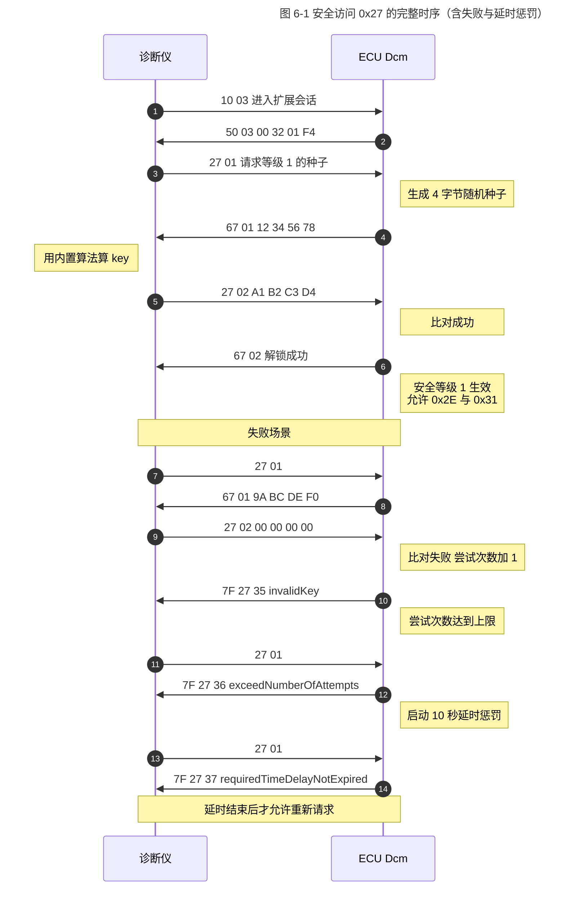

**图 6-1 解释**：图中包含三道防线，这是安全访问设计的核心：

| 防线 | 机制 | 防什么 |
|---|---|---|
| **随机 Seed** | 每次请求产生新随机数 | **重放攻击**（录下 key 重复发送） |
| **尝试次数限制** | 连续失败 N 次（典型 3 次）后锁死 | **暴力枚举**（key 空间 2^32 太大，但弱算法可能被穷举） |
| **延时惩罚** | 超限后强制等待（典型 10~1000 s） | **高频暴力**（把攻击速率降到不可行） |

> 🚨 **重要细节：`seed = 00 00 00 00` 的特殊含义**
> 若 ECU 返回全 0 的种子，表示 **"已经解锁，无需再验证"**。诊断仪此时应**跳过 sendKey 直接认为成功**。实现时如果忽略这一条，会出现"重复请求 `27 01` 后诊断仪死等"的问题。

> 🔬 **"安全等级"与"会话"的关系**
> 通常 `0x27` 在**默认会话与扩展会话都可用**，但解锁状态在**切换会话、ECU 复位、S3 超时**时会被清除。所以刷写流程必须是：`10 02` → `27 01/02` → `34/36/37`，**顺序不能颠倒**。

#### 6.1.3 深入原理：密钥算法的位置与强度

**算法在哪里？** 在 ECU 固件里（保密）与诊断仪/产线工具里（也保密）。常见实现：

| 算法类型 | 典型做法 | 安全强度 | 使用场景 |
|---|---|---|---|
| 固定异或/加法 | `key = seed XOR 0x5A5A5A5A` | 极低（可被逆向） | 老车型、非安全件 |
| 查表 + 移位 | 自定义混淆表 | 低 | 传统车身控制器 |
| **XTEA/XXTEA** | 用固定密钥加密 seed | 中 | 大量 Tier1 采用 |
| **AES-CMAC** | 基于共享密钥做 MAC | 高 | 新平台、法规要求 |
| **0x29 Authentication** | 非对称（PKI/证书） | 最高 | 智能网联、OTA |

> ⚠️ **现实提醒**：`0x27` 的保护强度**完全取决于算法保密性**（security by obscurity），一旦算法泄露就等于没有。所以 ISO 14229-1:2020 新增了 `0x29 Authentication`，用非对称密码学替代——这是行业趋势。

#### 6.1.4 代码：完整的 `0x27` 服务端实现

```c
/**
 * @file    uds_security.c
 * @brief   0x27 SecurityAccess 服务端实现（含尝试次数与延时惩罚）
 */

#include <stdint.h>
#include <string.h>

/* ---- 安全策略参数 ---- */
#define SEC_MAX_ATTEMPTS        (3U)        /* 最多连续失败次数          */
#define SEC_DELAY_MS            (10000U)    /* 超限后延时惩罚 10 秒      */
#define SEC_SEED_LEN            (4U)        /* 种子长度                  */
#define SEC_KEY_LEN             (4U)        /* 密钥长度                  */
#define SEC_LEVEL_1             (0x01U)     /* 安全等级 1（子功能 01/02）*/
#define SEC_LEVEL_2             (0x02U)     /* 安全等级 2（子功能 03/04）*/

/* ---- 运行时状态（每个安全等级独立） ---- */
typedef struct {
    uint8_t  seed[SEC_SEED_LEN];     /* 当前下发的种子   */
    uint8_t  seedValid;              /* 1 = 种子待验证   */
    uint8_t  unlocked;               /* 1 = 已解锁       */
    uint8_t  failCount;              /* 连续失败次数     */
    uint32_t lockUntilMs;            /* 惩罚结束时刻     */
} Sec_ContextType;

static Sec_ContextType s_secCtx[2];  /* index 0 = 等级1, 1 = 等级2 */

extern uint32_t Bsp_GetTickMs(void);
extern void     Bsp_GetRandom(uint8_t *buf, uint16_t len);   /* 硬件 RNG 或 TRNG */

/* ============================================================
 * 一、密钥算法（示例用 XTEA 变体，真实项目应使用 AES-CMAC）
 *    注意：此处仅示意"结构"，实际算法必须与诊断仪端保持一致
 * ============================================================ */
static void Sec_ComputeKey(const uint8_t *seed, uint8_t level, uint8_t *keyOut)
{
    /* 示例算法：种子与等级密钥做多轮混淆
     * 真实实现建议：AES-128-CMAC(seed, secretKeyPerLevel)
     */
    const uint8_t secret1[4] = { 0x5AU, 0xA5U, 0x12U, 0x34U };
    const uint8_t secret2[4] = { 0x3CU, 0xC3U, 0x56U, 0x78U };
    const uint8_t *secret = (level == SEC_LEVEL_1) ? secret1 : secret2;
    uint32_t v0;
    uint32_t v1;

    v0 = ((uint32_t)seed[0] << 24) | ((uint32_t)seed[1] << 16) |
         ((uint32_t)seed[2] << 8)  |  (uint32_t)seed[3];
    v1 = ((uint32_t)secret[0] << 24) | ((uint32_t)secret[1] << 16) |
         ((uint32_t)secret[2] << 8)  |  (uint32_t)secret[3];

    /* 32 轮 Feistel 式混淆（示意） */
    for (uint8_t i = 0U; i < 32U; i++) {
        uint32_t t = v0;
        v0 = v1 ^ (((v0 << 4) ^ (v0 >> 5)) + v0 ^ ((uint32_t)i * 0x9E3779B9UL));
        v1 = t;
    }

    keyOut[0] = (uint8_t)(v0 >> 24);
    keyOut[1] = (uint8_t)(v0 >> 16);
    keyOut[2] = (uint8_t)(v0 >> 8);
    keyOut[3] = (uint8_t)(v0);
}

/* ============================================================
 * 二、0x27 服务入口
 * ============================================================ */
/**
 * @brief  处理 0x27 SecurityAccess
 * @param  req      请求（subFunction 已剥离抑制位）
 * @param  rspBuf   响应缓冲
 * @param  rspSize  缓冲容量
 * @return 响应长度
 */
uint16_t Uds_Svc_SecurityAccess(const Uds_RequestType *req,
                                uint8_t *rspBuf, uint16_t rspSize)
{
    uint8_t  sub     = req->subFunction;
    uint8_t  level;
    uint8_t  idx;
    uint32_t now;
    uint8_t  expectedKey[SEC_KEY_LEN];

    /* 2.1 子功能合法性：1~0x42 之内，且必须成对（奇=求种子，偶=送密钥） */
    if ((sub == 0U) || (sub > 0x42U)) {
        return Uds_BuildNegativeResponse(rspBuf, rspSize, 0x27U, UDS_NRC_SUB_FUNCTION_NOT_SUPPORTED);
    }

    level = (uint8_t)((sub + 1U) / 2U);        /* 01/02 → 等级1；03/04 → 等级2 */
    idx   = (uint8_t)(level - 1U);
    if (idx >= 2U) {
        return Uds_BuildNegativeResponse(rspBuf, rspSize, 0x27U, UDS_NRC_SUB_FUNCTION_NOT_SUPPORTED);
    }

    now = Bsp_GetTickMs();

    /* 2.2 延时惩罚检查（优先于一切） */
    if ((s_secCtx[idx].lockUntilMs != 0U) && (now < s_secCtx[idx].lockUntilMs)) {
        return Uds_BuildNegativeResponse(rspBuf, rspSize, 0x27U, UDS_NRC_REQUIRED_TIME_DELAY);
    }

    /* ---------------- 奇数子功能：requestSeed ---------------- */
    if ((sub & 0x01U) != 0U) {
        if (s_secCtx[idx].unlocked != 0U) {
            /* 已解锁：返回全 0 种子，表示无需再验证 */
            if (rspSize < (uint16_t)(2U + SEC_SEED_LEN)) {
                return Uds_BuildNegativeResponse(rspBuf, rspSize, 0x27U, UDS_NRC_RESPONSE_TOO_LONG);
            }
            rspBuf[0] = 0x67U;
            rspBuf[1] = sub;
            (void)memset(&rspBuf[2], 0, SEC_SEED_LEN);
            return (uint16_t)(2U + SEC_SEED_LEN);
        }

        /* 生成新种子（每次请求都不同，防止重放） */
        Bsp_GetRandom(s_secCtx[idx].seed, SEC_SEED_LEN);
        s_secCtx[idx].seedValid = 1U;

        if (rspSize < (uint16_t)(2U + SEC_SEED_LEN)) {
            return Uds_BuildNegativeResponse(rspBuf, rspSize, 0x27U, UDS_NRC_RESPONSE_TOO_LONG);
        }
        rspBuf[0] = 0x67U;
        rspBuf[1] = sub;
        (void)memcpy(&rspBuf[2], s_secCtx[idx].seed, SEC_SEED_LEN);
        return (uint16_t)(2U + SEC_SEED_LEN);
    }

    /* ---------------- 偶数子功能：sendKey ---------------- */
    {
        const uint8_t *keyIn = req->param;

        /* 3.1 必须先请求过种子（顺序错误 → 0x24） */
        if (s_secCtx[idx].seedValid == 0U) {
            return Uds_BuildNegativeResponse(rspBuf, rspSize, 0x27U, UDS_NRC_REQUEST_SEQUENCE_ERROR);
        }
        /* 3.2 长度校验 */
        if (req->paramLen != SEC_KEY_LEN) {
            return Uds_BuildNegativeResponse(rspBuf, rspSize, 0x27U, UDS_NRC_INCORRECT_LENGTH);
        }

        /* 3.3 计算并比对（使用定长比较，避免时序侧信道） */
        Sec_ComputeKey(s_secCtx[idx].seed, level, expectedKey);

        {
            uint8_t diff = 0U;
            for (uint8_t i = 0U; i < SEC_KEY_LEN; i++) {
                diff |= (uint8_t)(expectedKey[i] ^ keyIn[i]);
            }

            if (diff != 0U) {
                /* 3.4 密钥错误：失败计数 + 可能进入惩罚 */
                s_secCtx[idx].seedValid = 0U;      /* 种子一次性，用完即废 */
                s_secCtx[idx].failCount++;

                if (s_secCtx[idx].failCount >= SEC_MAX_ATTEMPTS) {
                    s_secCtx[idx].failCount  = 0U;
                    s_secCtx[idx].lockUntilMs = now + SEC_DELAY_MS;
                    return Uds_BuildNegativeResponse(rspBuf, rspSize, 0x27U,
                                                     UDS_NRC_EXCEED_NUMBER_OF_ATTEMPTS);
                }
                return Uds_BuildNegativeResponse(rspBuf, rspSize, 0x27U, UDS_NRC_INVALID_KEY);
            }
        }

        /* 3.5 成功 */
        s_secCtx[idx].unlocked  = 1U;
        s_secCtx[idx].seedValid = 0U;
        s_secCtx[idx].failCount = 0U;

        rspBuf[0] = 0x67U;
        rspBuf[1] = sub;
        return 2U;
    }
}

/* ============================================================
 * 三、会话切换 / 复位时清除解锁状态（必须调用！）
 * ============================================================ */
void Uds_Security_ResetOnSessionChange(void)
{
    (void)memset(s_secCtx, 0, sizeof(s_secCtx));
}
```

> 📎 **代码要点**
> - **`seedValid` 让种子"一次性"**：验证完立即失效，防止同一个种子被重复使用（否则攻击者可以离线爆破）。
> - **`diff |= expected ^ input` 的定长比较**：这是**抗时序侧信道攻击**的标准写法。用 `memcmp` 提前 return 会泄露"前几字节匹配"的信息，理论上可被逐字节破解。
> - **`lockUntilMs` 用绝对时刻而非倒计时**：避免多处修改导致计时漂移，也让"读剩余时间"变得简单。
> - **`Uds_Security_ResetOnSessionChange()` 必须在 `10 xx` 与 `11 xx` 处理里调用**——这是最常见的功能安全遗漏（忘记清解锁状态 = 权限永久泄露）。

### 6.2 刷写三部曲 `0x34 / 0x36 / 0x37`

#### 6.2.1 通俗易懂

| 服务 | 通俗含义 | 类比 |
|---|---|---|
| `0x34` RequestDownload | "我要给你写 64 KB 数据，从地址 0x08010000 开始" | 快递预约："我要寄 64 公斤，寄到某地址" |
| `0x36` TransferData | "这是第 1 块数据（2 KB）" | 一箱一箱地送 |
| `0x37` RequestTransferExit | "寄完了，你检查一下" | 签收、核对 |

#### 6.2.2 设计机制：为什么分成三步

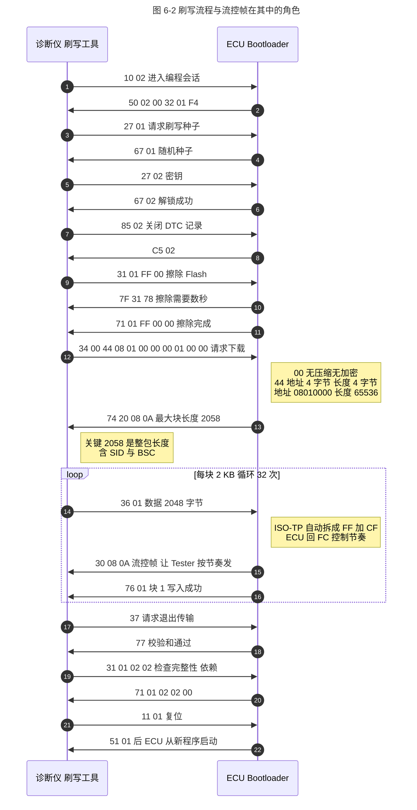

**图 6-2 解释**：这张图把第 3 章的流控帧自然地嵌进了刷写流程，注意两点：

1. **`0x36` 的请求通常是 2~4 KB，必然是多帧**（FF + 若干 CF）。此时 **ECU 是接收方，它发 FC**；而 ECU 的响应 `76 01` 只有 2 字节，是单帧。**方向决定了谁是流控方**。
2. **擦除 `31 01 FF 00` 需要数秒**，所以先回 `7F 31 78`（图中省略了重复的 0x78 心跳）。这是 `0x78` 最典型的应用场景。

**为什么必须"先声明再传"（`0x34` 先告知总长度）？**

| 设计考量 | 说明 |
|---|---|
| **空间预检** | Bootloader 可先检查"目标地址区间是否合法、是否越界到应用区/标定区" |
| **算法选择** | `dataFormatIdentifier` 声明压缩/加密方式，ECU 提前准备解压解密 |
| **块长协商** | ECU 通过 `maxNumberOfBlockLength` 告诉诊断仪"我一次最多吃多少"，**避免诊断仪发太大导致 ECU 缓冲溢出** |
| **擦除时机** | 可以在 `0x34` 后才擦除，或在 `0x31` 擦除，取决于策略（A/B 分区可免擦除） |

#### 6.2.3 深入原理：报文格式逐字段解析

**`0x34` 请求：** `34 <dataFormatIdentifier> <addressAndLengthFormatIdentifier> <memoryAddress> <memorySize>`

| 字段 | 长度 | 说明 |
|---|---|---|
| `dataFormatIdentifier` | 1 | 高 4 位 = 压缩方法，低 4 位 = 加密方法；`0x00` = 无压缩无加密 |
| `addressAndLengthFormatIdentifier` | 1 | **高 4 位 = memorySize 的字节数**，**低 4 位 = memoryAddress 的字节数** |
| `memoryAddress` | 变长 | 目标起始地址（大端） |
| `memorySize` | 变长 | 未压缩的数据总字节数（大端） |

示例：`34 00 44 08 01 00 00 00 01 00 00`
- `00`：无压缩、无加密
- `44`：地址 4 字节、长度 4 字节
- `08 01 00 00` = `0x08010000`（目标地址）
- `00 01 00 00` = `0x00010000` = 65536 字节

**`0x34` 正响应：** `74 <lengthFormatIdentifier> <maxNumberOfBlockLength>`

| 字段 | 说明 |
|---|---|
| `lengthFormatIdentifier` | **高 4 位 = maxNumberOfBlockLength 的字节数**（低 4 位保留为 0） |
| `maxNumberOfBlockLength` | **一次 `0x36` 请求的"整包长度"**，包含 `SID(1) + BSC(1) + 数据` |

> 🚨 **最容易错的一处**：`maxNumberOfBlockLength` **包含 SID 和 blockSequenceCounter**！
> 例如响应 `74 20 08 0A`：`0x080A` = 2058 = 1 (SID) + 1 (BSC) + **2056 字节数据**。
> 如果实现者误以为"2058 是数据长度"，就会多发 2 字节，导致 ECU 侧长度校验失败 → `NRC 0x13`。

**`0x36` 请求：** `36 <blockSequenceCounter> <transferRequestParameterRecord...>`

| 字段 | 说明 |
|---|---|
| `blockSequenceCounter`（BSC） | **从 `0x01` 开始**，每块 +1，到 `0xFF` 后**回绕到 `0x00`**（注意：0x00 是合法值） |
| 数据 | 最大 `maxNumberOfBlockLength - 2` 字节 |

> 🚨 **BSC 的坑**：`0x36` 的 BSC 从 `0x01` 开始，`0xFF` 之后是 `0x00`（不像 ISO-TP 的 SN 从 1 到 15 再到 0）。若 ECU 收到的 BSC 与期望不符，必须回 **`NRC 0x73`（wrongBlockSequenceCounter）**，且**不得写入 Flash**。

**`0x37` 请求/响应：** `37 [可选参数]` → `77 [可选参数]`

典型用法：`0x37` 之后 Bootloader 计算整体 CRC/签名并校验，若不匹配回 `NRC 0x72`（generalProgrammingFailure）。

#### 6.2.4 代码：`0x34/0x36/0x37` 服务端实现

```c
/**
 * @file    uds_download.c
 * @brief   0x34 RequestDownload / 0x36 TransferData / 0x37 RequestTransferExit
 * @note    面向 Bootloader 场景的最小可靠实现
 */

#include <stdint.h>

/* ---- 下载上下文 ---- */
typedef struct {
    uint8_t  active;                /* 1 = 已接受 0x34，处于下载中 */
    uint32_t startAddress;          /* 目标起始地址              */
    uint32_t totalSize;             /* 声明的总长度              */
    uint32_t writtenSize;           /* 已写入长度                */
    uint8_t  expectedBsc;           /* 期望的下一个块序号        */
    uint8_t  compression;           /* 压缩方法（0 = 无）        */
    uint8_t  encryption;            /* 加密方法（0 = 无）        */
} Flash_DownloadCtxType;

static Flash_DownloadCtxType s_dl;

/* 最大块长：可配，注意它包含 SID + BSC 共 2 字节 */
#define FLASH_MAX_BLOCK_LEN     (0x080AU)   /* 2058 = 2 + 2056 */

/* 平台接口 */
extern uint8_t Flash_IsRangeWritable(uint32_t addr, uint32_t size);
extern uint8_t Flash_EraseRange(uint32_t addr, uint32_t size);
extern uint8_t Flash_WriteBlock(uint32_t addr, const uint8_t *data, uint32_t len);
extern uint32_t Crc_Calculate(const uint8_t *data, uint32_t len);   /* 示意 */

/* ============================================================
 * 一、0x34 RequestDownload
 * ============================================================ */
uint16_t Uds_Svc_RequestDownload(const Uds_RequestType *req,
                                 uint8_t *rspBuf, uint16_t rspSize)
{
    uint8_t  dataFormatId;
    uint8_t  alfid;
    uint8_t  addrLen;
    uint8_t  sizeLen;
    uint32_t addr = 0U;
    uint32_t size = 0U;
    uint16_t i;

    /* 1.1 长度下限：至少 4 字节（format + alfid + 地址 + 长度 各至少 1） */
    if (req->paramLen < 4U) {
        return Uds_BuildNegativeResponse(rspBuf, rspSize, 0x34U, UDS_NRC_INCORRECT_LENGTH);
    }

    dataFormatId = req->param[0];
    alfid        = req->param[1];
    addrLen      = (uint8_t)(alfid & 0x0FU);          /* 低 4 位 = 地址字节数 */
    sizeLen      = (uint8_t)((alfid >> 4) & 0x0FU);   /* 高 4 位 = 长度字节数 */

    /* 1.2 地址/长度字节数合法性：只能是 1~4 */
    if ((addrLen == 0U) || (addrLen > 4U) || (sizeLen == 0U) || (sizeLen > 4U)) {
        return Uds_BuildNegativeResponse(rspBuf, rspSize, 0x34U, UDS_NRC_REQUEST_OUT_OF_RANGE);
    }
    /* 1.3 参数总长度必须严格匹配 */
    if (req->paramLen != (uint16_t)(2U + addrLen + sizeLen)) {
        return Uds_BuildNegativeResponse(rspBuf, rspSize, 0x34U, UDS_NRC_INCORRECT_LENGTH);
    }
    /* 1.4 不支持压缩/加密（这里明确拒绝，而非静默忽略） */
    if (dataFormatId != 0U) {
        return Uds_BuildNegativeResponse(rspBuf, rspSize, 0x34U, UDS_NRC_REQUEST_OUT_OF_RANGE);
    }

    /* 1.5 解析大端地址与长度 */
    for (i = 0U; i < addrLen; i++) {
        addr = (addr << 8) | (uint32_t)req->param[2U + i];
    }
    for (i = 0U; i < sizeLen; i++) {
        size = (size << 8) | (uint32_t)req->param[2U + addrLen + i];
    }

    /* 1.6 地址区间合法性检查（最关键的安全检查：防止写到 Bootloader 自身） */
    if (Flash_IsRangeWritable(addr, size) == 0U) {
        return Uds_BuildNegativeResponse(rspBuf, rspSize, 0x34U, UDS_NRC_REQUEST_OUT_OF_RANGE);
    }

    /* 1.7 初始化下载上下文 */
    s_dl.active      = 1U;
    s_dl.startAddress = addr;
    s_dl.totalSize   = size;
    s_dl.writtenSize = 0U;
    s_dl.expectedBsc = 1U;                /* BSC 从 1 开始 */
    s_dl.compression = 0U;
    s_dl.encryption  = 0U;

    /* 1.8 组正响应：74 <lengthFormatIdentifier> <maxNumberOfBlockLength> */
    rspBuf[0] = 0x74U;
    rspBuf[1] = 0x20U;                    /* 高 4 位 = 2 表示后续 2 字节长度字段 */
    rspBuf[2] = (uint8_t)(FLASH_MAX_BLOCK_LEN >> 8);
    rspBuf[3] = (uint8_t)(FLASH_MAX_BLOCK_LEN & 0xFFU);
    return 4U;
}

/* ============================================================
 * 二、0x36 TransferData
 * ============================================================ */
uint16_t Uds_Svc_TransferData(const Uds_RequestType *req,
                              uint8_t *rspBuf, uint16_t rspSize)
{
    uint8_t  bsc;
    uint16_t dataLen;
    uint8_t  ret;

    /* 2.1 顺序检查：必须先有 0x34 */
    if (s_dl.active == 0U) {
        return Uds_BuildNegativeResponse(rspBuf, rspSize, 0x36U, UDS_NRC_REQUEST_SEQUENCE_ERROR);
    }
    if (req->paramLen < 1U) {
        return Uds_BuildNegativeResponse(rspBuf, rspSize, 0x36U, UDS_NRC_INCORRECT_LENGTH);
    }

    bsc     = req->param[0];
    dataLen = (uint16_t)(req->paramLen - 1U);

    /* 2.2 块序号校验 */
    if (bsc != s_dl.expectedBsc) {
        /* 注意：不写入任何数据！ */
        return Uds_BuildNegativeResponse(rspBuf, rspSize, 0x36U, UDS_NRC_WRONG_BLOCK_SEQ_COUNTER);
    }

    /* 2.3 块长校验（不得超过 0x34 中通告的能力） */
    if ((uint32_t)dataLen > (uint32_t)(FLASH_MAX_BLOCK_LEN - 2U)) {
        return Uds_BuildNegativeResponse(rspBuf, rspSize, 0x36U, UDS_NRC_INCORRECT_LENGTH);
    }
    /* 2.4 总长度不得超过声明值（防止越界写入） */
    if ((s_dl.writtenSize + dataLen) > s_dl.totalSize) {
        return Uds_BuildNegativeResponse(rspBuf, rspSize, 0x36U, UDS_NRC_REQUEST_OUT_OF_RANGE);
    }

    /* 2.5 真正的写入 */
    ret = Flash_WriteBlock(s_dl.startAddress + s_dl.writtenSize, &req->param[1], dataLen);
    if (ret != 0U) {
        /* 编程失败：中止整个下载，防止半写状态继续 */
        s_dl.active = 0U;
        return Uds_BuildNegativeResponse(rspBuf, rspSize, 0x36U, UDS_NRC_GENERAL_PROGRAMMING_FAILURE);
    }

    /* 2.6 更新上下文（BSC 到 0xFF 后回绕 0x00） */
    s_dl.writtenSize += dataLen;
    s_dl.expectedBsc  = (uint8_t)(s_dl.expectedBsc + 1U);

    /* 2.7 正响应：76 <bsc> */
    rspBuf[0] = 0x76U;
    rspBuf[1] = bsc;
    return 2U;
}

/* ============================================================
 * 三、0x37 RequestTransferExit
 * ============================================================ */
uint16_t Uds_Svc_RequestTransferExit(const Uds_RequestType *req,
                                     uint8_t *rspBuf, uint16_t rspSize)
{
    (void)req;

    /* 3.1 必须处于下载状态 */
    if (s_dl.active == 0U) {
        return Uds_BuildNegativeResponse(rspBuf, rspSize, 0x37U, UDS_NRC_REQUEST_SEQUENCE_ERROR);
    }
    /* 3.2 长度必须完整（少收数据 → 拒绝） */
    if (s_dl.writtenSize != s_dl.totalSize) {
        s_dl.active = 0U;
        return Uds_BuildNegativeResponse(rspBuf, rspSize, 0x37U, UDS_NRC_GENERAL_PROGRAMMING_FAILURE);
    }

    s_dl.active = 0U;

    /* 3.3 正响应：77（真实项目应在此校验整体 CRC 或数字签名） */
    rspBuf[0] = 0x77U;
    return 1U;
}
```

> 📎 **代码要点**
> - **`Flash_IsRangeWritable()` 是最重要的安全检查**：必须拒绝写到 Bootloader 自身、标定区、非法地址（如 `0x00000000`）。缺少这一步就是"刷写变砖"的直接原因。
> - **BSC 错误时绝不能写入**（`2.2` 中提前 return）：否则重复块会导致数据错位，最终固件损坏。
> - **`0x36` 失败后立即 `active = 0`**：进入"失败即终止"状态，逼诊断仪重新走 `0x34`，避免在不确定状态下继续写。
> - **`0x37` 是最后一道闸门**：真实项目在这里做**整包 CRC32 / SHA-256 / 签名验证**，验证失败必须回 `NRC 0x72`，并且让新程序**不被标记为有效**（配合 A/B 分区与"启动尝试计数器"）。

### 6.3 刷写与流控的联动关系（很关键的工程认知）

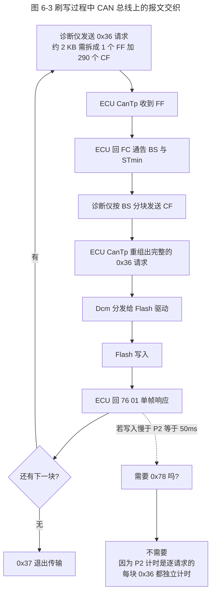

**图 6-3 解释**：这里有一个**容易误解的点**——

> **刷写时一般不需要 `0x78`**，因为每一块 `0x36` 只写 ~2 KB（Flash 编程约 10~30 ms，在 P2=50 ms 内）。真正需要 `0x78` 的是：**`0x31` 擦除**（数秒）、**`0x37` 的整包校验**（可能几百 ms）。

这也解释了为什么刷写工具会**逐块等待 `76 xx` 响应**再发下一块（同步块传输），而不是"一口气灌完"——**每块一个响应，本身就是天然的流控与错误恢复点**。ISO-TP 的 FC 只解决"单条报文的传输节奏"，UDS 的"逐块应答"才解决"整体刷写的可靠性"。

---

## 第 7 章 常见故障排查与工程陷阱

### 7.1 陷阱清单（按现象查原因）

| # | 现象 | 根因 | 修复 |
|---|---|---|---|
| 1 | 短响应正常，长响应（VIN/DTC 列表）无响应 | ECU 接收/发送缓冲太小，FF 里的总长超过 `CanTpRxBufferSize`，实现静默丢弃 | 加大缓冲；FF 阶段超限时回 **FC OVFLW**（不要静默丢） |
| 2 | 诊断仪报"ECU 无响应"，但 ECU 明明回了 | ECU 回的 `0x7E8` 与诊断仪监听的 ID 不一致（CAN ID 配错/网关过滤） | 抓包确认响应 ID；检查网关路由 |
| 3 | 多帧只发出第一帧（FF）就停 | ECU 的 FC 里 `BS` 配了非 0，但**发送方没实现"满块等 FC"** | 发送方实现 BS 计数与等 FC（见 3.5.2 `4.6`） |
| 4 | 收到 `NRC 0x13`（长度错） | 把 `maxNumberOfBlockLength` 当成"纯数据长度"（应含 SID+BSC） | 数据长度 = `maxNumberOfBlockLength - 2` |
| 5 | 收到 `NRC 0x73`（块序号错） | BSC 起点用 0（应为 1）或丢块后继续发 | BSC 从 1 开始，`0xFF` 后回绕 `0x00` |
| 6 | 偶发 `N_Cr` 超时 | ECU 通告的 `STmin` 太大，诊断仪 `N_Cr` 太小 | 两端参数对齐；`STmin` ≤ 10 ms 通常安全 |
| 7 | 偶发 `N_Bs` 超时 | 诊断仪回 FC 慢（USB-CAN 延迟）；ECU `N_Bs` 太小 | `N_Bs` 用 1000 ms；诊断仪侧确认 FC 及时 |
| 8 | 首帧之后收到 `NRC 0x7F` | 中途停顿超 5 s，会话已回落默认会话 | 诊断仪持续发 `3E 80`（≤2 s 一次） |
| 9 | `27 02` 永远返回 `0x35` | Seed/Key 算法两端不一致；**或 Seed 的字节序不同** | 用同一组固定 seed 对拍算法输出 |
| 10 | `27 01` 返回全 0 种子，诊断仪卡住 | 已解锁状态；诊断仪未处理"全 0 即已解锁" | 诊断仪侧按规范处理 |
| 11 | `0x78` 之后再无下文 | 实现只发 `0x78` 忘记发最终响应 | 用 `E_PENDING` 机制（见 5.4）或显式状态机 |
| 12 | 诊断仪在 `0x78` 之后报 P2\* 超时 | 长任务总耗时超过 5000 ms 且 `0x78` 未周期重发 | 每 `P2*-200ms` 重发一次 `0x78` |
| 13 | 功能寻址 `10 03` 后多个 ECU 响应冲突 | 功能寻址应使用抑制正响应 `10 83` | 功能寻址用 `10 83` |
| 14 | 功能寻址发了 FF/CF | 违反规范，多 ECU 同时回 FC 导致总线冲突 | 功能寻址只允许单帧 |
| 15 | 刷写后 ECU 变砖 | `0x34` 未校验目标地址区间，覆盖了 Bootloader | 地址白名单 + A/B 分区 + 启动尝试计数 |
| 16 | 刷写偶发失败且 DTC 增多 | 刷写时未 `85 02` 关闭 DTC 记录，产生大量"通信丢失"故障 | 刷写前 `85 02`，结束后 `85 01` |
| 17 | 响应被截断（末尾少几字节） | 最后一帧 CF 未填充到 8 字节，某些实现按"帧数 × 7"计算长度 | 统一填充；或严格按"剩余长度"拷贝（见 3.5.2 `7.6`） |
| 18 | 诊断仪收到重复响应 | ECU 在 `TxConfirmation` 失败时重发，但上层也重发 | 明确重传责任归属（只在一层做） |
| 19 | `0x22` 一次读多个 DID 时部分丢失 | 实现只处理第一个 DID | 循环解析直到参数耗尽（见下例） |
| 20 | CAN FD 下诊断不通 | 未处理"SF 转义格式"（`0x00` + 长度字节）与 DLC 填充 | 按 ISO 15765-2:2016 实现 FD 分支 |

#### 7.1.1 陷阱 19 的正确实现（一次读多个 DID）

```c
/**
 * @brief  0x22 支持一次请求多个 DID（规范要求）
 * @note   请求：22 DID1 DID2 DID3 ...
 *         响应：62 DID1 data1 DID2 data2 ...
 */
uint16_t Uds_Svc_ReadDataByIdentifier(const Uds_RequestType *req,
                                      uint8_t *rspBuf, uint16_t rspSize)
{
    uint16_t pos    = 0U;
    uint16_t idx    = 0U;

    /* 1. 参数必须是偶数个字节（每 2 字节一个 DID） */
    if ((req->paramLen == 0U) || ((req->paramLen % 2U) != 0U)) {
        return Uds_BuildNegativeResponse(rspBuf, rspSize, 0x22U, UDS_NRC_INCORRECT_LENGTH);
    }
    if (rspSize < 1U) {
        return 0U;
    }

    /* 2. 先写正响应 SID */
    rspBuf[0] = 0x62U;
    pos = 1U;

    /* 3. 循环处理每一个 DID */
    while (idx < req->paramLen) {
        uint16_t did = (uint16_t)(((uint16_t)req->param[idx] << 8) | req->param[idx + 1U]);
        const uint8_t *data = NULL;
        uint16_t       len  = 0U;
        uint8_t        rc   = Did_Read(did, &data, &len,
                                       Diag_GetSessionBit(), Diag_GetSecurityLevel());

        if (rc != 0U) {
            /* 策略选择：
             *   A) 任一 DID 失败 → 整条请求失败（严格，推荐用于安全相关）
             *   B) 跳过失败项继续（宽松，需在规范中明确）
             * 这里采用 A，NRC 按失败原因映射
             */
            uint8_t nrc = (rc == 1U) ? UDS_NRC_REQUEST_OUT_OF_RANGE :
                          (rc == 2U) ? UDS_NRC_SERVICE_NOT_SUPPORTED_IN_SESSION :
                          (rc == 3U) ? UDS_NRC_SECURITY_ACCESS_DENIED :
                                       UDS_NRC_CONDITIONS_NOT_CORRECT;
            return Uds_BuildNegativeResponse(rspBuf, rspSize, 0x22U, nrc);
        }

        /* 4. 长度预算检查（每轮都要检查，防溢出） */
        if ((uint32_t)rspSize < ((uint32_t)pos + 2U + (uint32_t)len)) {
            return Uds_BuildNegativeResponse(rspBuf, rspSize, 0x22U, UDS_NRC_RESPONSE_TOO_LONG);
        }
        rspBuf[pos] = (uint8_t)(did >> 8); pos++;
        rspBuf[pos] = (uint8_t)(did & 0xFFU); pos++;
        (void)memcpy(&rspBuf[pos], data, len);
        pos = (uint16_t)(pos + len);

        idx = (uint16_t)(idx + 2U);
    }

    return pos;
}
```

### 7.2 排障决策树

```mermaid
---
title: 图 7-1 UDS 通信失败排查决策树
---
flowchart TB
    S["诊断不通 或 服务失败"] --> Q1{"总线上能看到<br/>ECU 的响应帧吗?"}
    Q1 -->|"完全看不到"| A1["查物理层与链路层<br/>CAN 终端电阻 波特率<br/>CAN ID 配置 网关过滤"]
    Q1 -->|"能看到"| Q2{"响应是负响应<br/>7F 开头吗?"}
    Q2 -->|"否 是正响应"| A2["业务成功<br/>问题在诊断仪解析逻辑<br/>或 DID 数据含义理解错"]
    Q2 -->|"是"| Q3["读 NRC 值"]
    Q3 --> N1{"NRC 等于 11 12"}
    N1 -->|"是"| F1["服务或子功能不支持<br/>核对 ECU 诊断规范支持列表"]
    Q3 --> N2{"NRC 等于 13"}
    N2 -->|"是"| F2["长度或格式错<br/>核对 PCI 长度 参数个数<br/>maxNumberOfBlockLength 含 2 字节"]
    Q3 --> N3{"NRC 等于 22 31"}
    N3 -->|"是"| F3["条件不满足或参数越界<br/>检查车速 电压 会话<br/>检查 DID RID 地址是否合法"]
    Q3 --> N4{"NRC 等于 33 34"}
    N4 -->|"是"| F4["安全访问未通过<br/>先做 27 01 与 27 02<br/>检查算法是否一致"]
    Q3 --> N5{"NRC 等于 24 73"}
    N5 -->|"是"| F5["顺序错或块序号错<br/>检查是否漏了 0x34<br/>检查 BSC 从 1 开始与回绕"]
    Q3 --> N6{"NRC 等于 7E 7F"}
    N6 -->|"是"| F6["当前会话不支持<br/>检查最后一次 3E 距今是否超过 5 秒<br/>是否忘记 10 03"]
    Q3 --> N7{"NRC 等于 78"}
    N7 -->|"是"| F7["ECU 在处理长任务<br/>若一直 78 说明任务卡住<br/>查 Flash 擦写 或例程状态机"]
    Q3 --> N8{"无响应 且<br/>只看到 FF 停住"}
    N8 -->|"是"| F8["流控问题<br/>检查 FC 是否发出<br/>检查 BS 分块是否实现<br/>检查 STmin 与 N_Cr 是否匹配"]
```

**图 7-1 解释**：排查顺序遵循 **"由下往上"** 原则：先确认物理层/链路层能看到帧（否则谈协议无意义），再看是不是负响应（NRC 直接把原因说清楚了），最后才怀疑时序与流控。**先读 NRC 再查时序**——NRC 是 ECU 的"自我诊断"，比任何猜测都准。

### 7.3 常用工具与自动化测试

| 工具 | 用途 | 特点 |
|---|---|---|
| **Vector CANoe / CANalyzer** | 抓包、仿真 ECU、CAPL 脚本自动化 | 行业标准，ODX/CDD 支持完善 |
| **PCAN-View / PCAN-Diag** | 快速抓包与手动发帧 | 轻量、便宜 |
| **python-can + udsoncan** | Python 自动化测试脚本 | 开源、易 CI 集成 |
| **Scapy（`scapy.layers.can`）** | 构造畸形报文做健壮性测试 | 灵活，可造 FF/CF/FC 异常组合 |
| **ecu.test / TPT** | 测试序列管理与报告 | 量产验证常用 |
| **CANoe.DiVa** | 自动生成诊断测试序列 | 覆盖 ISO 14229 一致性测试 |

#### 7.3.1 用 python-can 发一条 UDS 请求（含手工流控）

```python
# -*- coding: utf-8 -*-
"""
最小 UDS over ISO-TP 示例：读 VIN(F190)，手工实现流控帧
用于在没有诊断仪时快速验证 ECU
"""
import can
import time

# 11 位 ID：请求 0x7E0，响应 0x7E8
TX_ID = 0x7E0
RX_ID = 0x7E8

bus = can.interface.Bus(channel='can0', bustype='socketcan')

def send_single_frame(payload: bytes):
    """发送单帧（payload 不超过 7 字节）"""
    assert len(payload) <= 7
    data = bytes([len(payload)]) + payload
    data = data.ljust(8, b'\xAA')          # 填充到 8 字节
    bus.send(can.Message(arbitration_id=TX_ID, data=data, is_extended_id=False))

def send_flow_control(fs=0, bs=0, stmin=0):
    """发送流控帧：FS(低4位) + BS + STmin"""
    data = bytes([0x30 | (fs & 0x0F), bs & 0xFF, stmin & 0xFF, 0xAA, 0xAA, 0xAA, 0xAA, 0xAA])
    bus.send(can.Message(arbitration_id=TX_ID, data=data, is_extended_id=False))

def recv_iso_tp(timeout=1.0):
    """接收并重组一条 ISO-TP 消息（自动发 FC）"""
    deadline = time.time() + timeout
    buf = bytearray()
    total = None
    while time.time() < deadline:
        msg = bus.recv(timeout=0.1)
        if msg is None or msg.arbitration_id != RX_ID:
            continue
        d = bytes(msg.data)
        pci = d[0] >> 4
        if pci == 0x0:                      # SF
            n = d[0] & 0x0F
            return d[1:1 + n]
        elif pci == 0x1:                    # FF
            total = ((d[0] & 0x0F) << 8) | d[1]
            buf = bytearray(d[2:8])
            send_flow_control(fs=0, bs=0, stmin=0)   # 立刻回 FC：一次发完、无间隔
        elif pci == 0x2:                    # CF
            buf += d[1:8]
            if total is not None and len(buf) >= total:
                return bytes(buf[:total])
    return None

# 1. 进扩展会话：10 03
send_single_frame(bytes([0x10, 0x03]))
print("会话响应:", recv_iso_tp().hex(' '))

# 2. 先给 ECU 一点时间（真实项目应发 3E 80 心跳）
time.sleep(0.05)

# 3. 读 VIN：22 F1 90
send_single_frame(bytes([0x22, 0xF1, 0x90]))
rsp = recv_iso_tp()
print("VIN 响应:", rsp.hex(' '))
if rsp and rsp[0] == 0x62:
    print("VIN =", rsp[3:].decode('ascii', errors='replace'))
```

> 💡 这段代码把第 3 章的原理变成了可运行的东西：**`send_flow_control()` 就是一个"手工流控帧"**。把它改成 `fs=1` 或 `fs=2`，你就能在真车上直接观察"ECU 收到 WAIT 会怎样"——**这是学习流控最快的方法**。

### 7.4 上线检查清单（诊断功能验收）

| 类别 | 检查项 | 判据 |
|---|---|---|
| 会话 | `10 01/02/03` 都能正确响应 | 正响应含正确的 P2/P2\* |
| 会话 | 停 5 秒后自动回落默认会话 | 需扩展会话的服务返回 `0x7F` |
| 寻址 | 功能寻址 `10 83` 只有一个 ECU 响应（或按规范静默） | 无总线冲突 |
| 会话 | 功能寻址时不会出现 FF/CF | 抓包确认 |
| 安全 | 连续 3 次错误 Key 后返回 `0x36`，再请求返回 `0x37` | 尝试计数与延时生效 |
| 安全 | 切换会话/复位后解锁状态被清除 | 需重新 `0x27` |
| 流控 | 长响应（≥100 字节）能正确分帧 | SF/FF/CF 数量与长度一致 |
| 流控 | `BS` 非 0 时能正确分块等 FC | 抓包看到周期性 FC |
| 流控 | 收到 `FC WAIT` 能暂停，收到 `FC OVFLW` 能中止 | 注入测试 |
| 流控 | 收到错误 SN 的 CF 能丢弃整帧 | 注入测试 |
| 流控 | 缓冲不足时回 `FC OVFLW`（不是静默丢弃） | 注入超长 FF 测试 |
| 时序 | 长任务正确发 `0x78` 且最终有响应 | 例程/擦除场景 |
| 时序 | `0x78` 间隔小于 P2\* | 抓包测量 |
| 刷写 | `0x34` 拒绝非法地址区间 | 负向测试 |
| 刷写 | BSC 错误回 `0x73` 且不写入 | 注入测试 |
| 刷写 | `0x37` 校验失败回 `0x72` 且不标记程序有效 | 注入错误固件 |
| 健壮性 | 畸形报文（长度错、未知 SID、空参数）不会死机 | 模糊测试（fuzzing） |
| 健壮性 | 诊断风暴（高频请求）下 ECU 不回 `0x11` 以外不崩溃 | 压力测试 |

---

## 附录

### 附录 A：NRC 完整分类表

| 区间 | 类别 | 例子 |
|---|---|---|
| `0x10 ~ 0x1F` | 通用与格式 | `10` generalReject、`11` serviceNotSupported、`12` subFunctionNotSupported、`13` incorrectLength、`14` responseTooLong |
| `0x20 ~ 0x2F` | 条件与状态 | `21` busyRepeatRequest、`22` conditionsNotCorrect、`24` requestSequenceError、`25` noResponseFromSubnet、`26` failurePreventsExecution |
| `0x30 ~ 0x3F` | 范围与安全 | `31` requestOutOfRange、`33` securityAccessDenied、`34` authenticationRequired、`35` invalidKey、`36` exceedNumberOfAttempts、`37` requiredTimeDelayNotExpired |
| `0x70 ~ 0x7F` | 编程与链路 | `70` uploadDownloadNotAccepted、`71` transferDataSuspended、`72` generalProgrammingFailure、`73` wrongBlockSequenceCounter、`78` responsePending、`7E`/`7F` 会话不支持 |

### 附录 B：高频标准 DID 速查

| DID | 名称 | 典型长度 | 读写 |
|---|---|---|---|
| `F180` | bootSoftwareIdentification | 4 | R |
| `F186` | activeDiagnosticSession | 1 | R |
| `F187` | vehicleManufacturerSparePartNumber | 11 | R |
| `F188` | vehicleManufacturerECUSoftwareNumber | 4 | R |
| `F189` | vehicleManufacturerECUSoftwareVersionNumber | 4 | R |
| `F18A` | systemSupplierIdentifier | 4 | R |
| `F18C` | ECUSerialNumber | 16 | R |
| `F190` | VIN | 17 | R |
| `F191` | vehicleManufacturerECUHardwareNumber | 4 | R |
| `F192` | systemSupplierECUHardwareNumber | 4 | R |
| `F194` | systemSupplierECUSoftwareVersionNumber | 4 | R |
| `F195` | exhaustRegulationSoftwareIdentifier | 10 | R |
| `F198` | systemSupplierECUSoftwareNumber | 4 | R |
| `0100` | 支持的 DID 位图（0x0100~0x011F） | 4 | R |
| `0101` | 支持的 DID 位图（0x0120~0x013F） | 4 | R |

### 附录 C：时序参数与默认值汇总

| 参数 | 默认值 | 归属 | AUTOSAR 参数名 |
|---|---|---|---|
| P2Server_max | 50 ms | UDS 应用层 | `DcmDslProtocolRow` 的 `DcmTimStrP2ServerMax` |
| P2\*Server_max | 5000 ms | UDS 应用层 | `DcmTimStrP2StarServerMax` |
| S3Server | 5000 ms | UDS 应用层 | `DcmDslProtocolRow` 的 `DcmTimStrS3Server` |
| N_As | 1000 ms | ISO-TP | `CanTpNas` |
| N_Ar | 1000 ms | ISO-TP | `CanTpNar` |
| N_Bs | 1000 ms | ISO-TP | `CanTpNbs` |
| N_Br | 无（性能要求） | ISO-TP | `CanTpNbr` |
| N_Cs | 无（性能要求） | ISO-TP | `CanTpNcs` |
| N_Cr | 1000 ms | ISO-TP | `CanTpNcr` |
| BS | 8 或 0 | ISO-TP | `CanTpBs` |
| STmin | 0~10 ms | ISO-TP | `CanTpSTmin` |
| N_WFTmax | 0 或 10 | ISO-TP | `CanTpMaxWft` |

### 附录 D：参考资料

1. ISO 14229-1:2020, *Road vehicles — Unified diagnostic services (UDS) — Part 1: Application layer*
2. ISO 14229-2:2013, *UDS — Part 2: Session layer services*
3. ISO 15765-2:2016, *Diagnostic communication over Controller Area Network (DoCAN) — Part 2: Transport protocol and network layer services*
4. ISO 15765-3, *Implementation of unified diagnostic services (UDS on CAN)*
5. ISO 13400-2, *Diagnostic communication over Internet Protocol (DoIP) — Part 2: Transport protocol and network layer services*
6. ISO 11898-1:2015, *Controller area network (CAN) — Part 1: Data link layer and physical signalling*
7. AUTOSAR, *Specification of Diagnostic Communication Manager (SWS_DiagnosticCommunicationManager)*, R4.x
8. AUTOSAR, *Specification of CAN Transport Layer (SWS_CanTp)*, R4.x
9. AUTOSAR, *Specification of Diagnostic Event Manager (SWS_DiagnosticEventManager)*, R4.x
10. ISO 26262-5:2018, *Product development at the hardware level* — 安全机制与诊断覆盖率要求

---

> 📝 **文档说明**：本文档基于 ISO 14229、ISO 15765-2、ISO 11898 与 AUTOSAR 规范独立撰写，不依赖本知识库中其他文档作为基准。代码示例以经典 CAN（8 字节数据场）为目标；迁移到 CAN FD 时需按 ISO 15765-2:2016 增加 SF 转义格式（`0x00` + 长度字节）、32 位 FF_DL、微秒级 STmin 与 DLC 填充处理。
