# NMI 与 NVIC 原理详解（Cortex-M 异常系统）

> 本文以 ARM Cortex-M3/M4/M7 为主线（STM32F1/F4/H7 为代表），讲清 **NMI（Non-Maskable Interrupt，不可屏蔽中断）** 与 **NVIC（Nested Vectored Interrupt Controller，嵌套向量中断控制器）** 的完整机制。
> 全文遵循「**通俗易懂 → 设计机制/设计模式/设计思路 → 深入原理**」的三段式展开，每一章、每一个子概念都按这个顺序讲解。

---

## 目录

- [第 0 章 全局鸟瞰：一句话讲明白这两个东西](#第-0-章-全局鸟瞰一句话讲明白这两个东西)
- [第 1 章 异常体系基础：Cortex-M 的"插队"规则](#第-1-章-异常体系基础cortex-m-的插队规则)
- [第 2 章 NMI：不可拒绝的火警铃](#第-2-章-nmi不可拒绝的火警铃)
- [第 3 章 NVIC：中断的分诊台与调度中枢](#第-3-章-nvic中断的分诊台与调度中枢)
- [第 4 章 NMI 与 NVIC 的协同关系与选型](#第-4-章-nmi-与-nvic-的协同关系与选型)
- [第 5 章 与 AUTOSAR OS 的映射关系](#第-5-章-与-autosar-os-的映射关系)
- [第 6 章 常见陷阱清单与调试验证方法](#第-6-章-常见陷阱清单与调试验证方法)
- [第 7 章 完整可运行示例工程骨架](#第-7-章-完整可运行示例工程骨架)

---

## 第 0 章 全局鸟瞰：一句话讲明白这两个东西

### 0.1 通俗易懂

把 MCU 里跑的程序想象成一个人在工位干活：

| 现实场景 | MCU 里的对应物 | 说明 |
|---|---|---|
| 你每隔几分钟抬头看一眼门口有没有快递 | **轮询（Polling）** | CPU 主动反复读标志位，浪费时间 |
| 快递员按门铃，你放下手上的活去开门，开完门回来接着干 | **中断（Interrupt）** | 硬件事件主动打断 CPU，处理完自动恢复现场 |
| 公司前台的"访客登记 + 分诊系统"：谁来了先登记、按紧急程度排队、加塞规则、谁先谁后 | **NVIC** | 中断的登记、排队、优先级裁决、嵌套调度 |
| 楼里的**火警铃**：不管你在开会、在贴"请勿打扰"、在锁门，火警一响必须立刻响应 | **NMI** | 不可屏蔽、最高优先级的"最后防线" |

**一句话总结：**

- **NVIC = 中断的"总调度台"**。它管理所有可配置中断的**使能、挂起、优先级、嵌套**，是 Cortex-M 内置于内核的一个外设（不是芯片厂商外挂的）。
- **NMI = 唯一"谁都不能拦"的异常**。它优先级仅次于复位，**任何软件手段（关中断、改优先级、屏蔽寄存器）都无法阻止它**，专门用于**安全相关的致命事件**（时钟失效、存储器不可纠正错误、外部安全信号等）。

### 0.2 设计机制与设计思路（为什么这么设计）

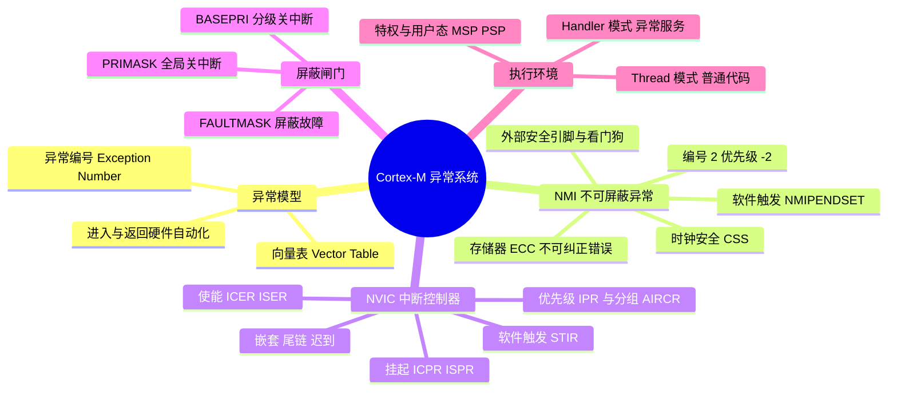

**图 0-1 解释**：这张心智图把整个知识域分成五块。上面三块（异常模型 / NMI / NVIC）是"事件从哪来、谁来裁决、怎么执行"；下面两块（屏蔽闸门 / 执行环境）是"软件如何控制中断的可见性、代码运行在什么样的特权与栈上"。理解这张图，就理解了 Cortex-M 中断体系的全部骨架。

**三条核心设计思路：**

1. **把调度做进硬件（Vectored + Nested）**
   - 传统 8051/AVR 只有一个中断入口，进中断后软件还要自己判断是哪个中断源（软件查询向量），响应慢且有抖动。
   - Cortex-M 把**向量表（Vector Table）** 直接放在内存里，硬件在异常发生时**自动读取向量地址并跳转**，无需软件查表。这叫 **Vectored（向量化）**。
   - 同时硬件自动比较优先级，允许高优先级中断**打断**正在执行的低优先级中断服务程序，这叫 **Nested（嵌套）**。
   - **设计目标：把中断延迟从"几十~上百周期 + 不确定性"压到"确定性 12 周期"。**

2. **把"现场保护"做进硬件（Stacking / Unstacking）**
   - 进入异常时硬件自动把 8 个寄存器压栈，退出时自动弹出，不需要写汇编 `PUSH/POP`。
   - **设计目标：让 C 语言函数可以直接当中断服务程序（ISR）写**，编译器无需 `__interrupt` 特殊关键字（对比 8051 的 `interrupt 1 using 1`）。

3. **用"负优先级 + 不可屏蔽"划出安全边界（NMI / HardFault）**
   - 软件会写错（误关中断、死循环、优先级配错），但**安全响应不能依赖软件的正确性**。
   - 因此硬件保留了一组**软件无法关闭**的异常：Reset、NMI、HardFault。它们的优先级用"负数"表示，永远高于所有可配置中断。
   - **设计目标：满足功能安全（ISO 26262 / IEC 61508）中"独立于软件的保护层"要求。**

### 0.3 深入原理（先建立三张底表）

**(1) Cortex-M 异常编号总表**

异常编号（Exception Number）是理解一切的基础：**向量表偏移 = 异常编号 × 4**。

| 异常编号 | 向量表偏移 | 名称 | 优先级（典型） | 是否可配置优先级 | 是否可屏蔽 |
|---|---|---|---|---|---|
| — | 0x00 | 初始 MSP 值 | — | — | — |
| 1 | 0x04 | **Reset** | -3（最高） | 否 | 否 |
| 2 | 0x08 | **NMI** | **-2** | 否 | **否** |
| 3 | 0x0C | **HardFault** | **-1** | 否 | 否（FAULTMASK 也挡不住 HardFault 的升级） |
| 4 | 0x10 | MemManage | 可配置 | 是（SHPR1） | 是（仅 HardFault 使能时生效） |
| 5 | 0x14 | BusFault | 可配置 | 是（SHPR1） | 是 |
| 6 | 0x18 | UsageFault | 可配置 | 是（SHPR1） | 是 |
| 7~10 | 0x1C~0x28 | 保留 | — | — | — |
| 11 | 0x2C | **SVCall** | 可配置 | 是（SHPR2） | 是 |
| 12 | 0x30 | DebugMonitor | 可配置 | 是（SHPR3 的对应字节） | 是 |
| 13 | 0x34 | 保留 | — | — | — |
| 14 | 0x38 | **PendSV** | 可配置 | 是（SHPR3） | 是 |
| 15 | 0x3C | **SysTick** | 可配置 | 是（SHPR3） | 是 |
| 16 | 0x40 | IRQ0（如 WWDG） | 可配置 | 是（IPR0） | 是 |
| 17 | 0x44 | IRQ1（如 PVD） | 可配置 | 是 | 是 |
| … | … | … | … | … | … |
| 16+N | 0x40+4N | IRQN | 可配置 | 是 | 是 |

> ⚠️ **关键认知**：在 Cortex-M 的语境里，"异常（Exception）"是**上位概念**，包含 Reset / NMI / Fault / SVC / PendSV / SysTick / 外设中断（IRQ）。"中断（Interrupt）"通常特指 IRQ0 及以上的外设中断。**NVIC 管理的是编号 ≥ 4 的那些"可配置优先级异常"；NMI 和 HardFault 不受 NVIC 的使能/屏蔽/优先级寄存器控制**。

**(2) 三个"执行状态"维度**

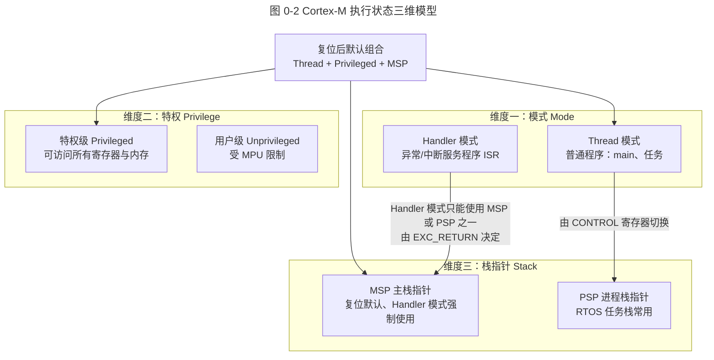

**图 0-2 解释**：Cortex-M 用三个正交维度描述 CPU 状态。复位后固定进入 **Thread + Privileged + MSP**。进入任何异常都会切到 **Handler 模式**，且**永远是特权级**（这是安全设计：ISR 不能被用户态代码限制）。返回时靠 `EXC_RETURN` 的值（存在 LR 里）自动恢复到正确的模式与栈指针。RTOS（含 AUTOSAR OS）正是利用"Thread/Handler 分离 + PSP/MSP 分离"实现任务与中断的栈隔离。

**(3) 三个"屏蔽闸门"寄存器**

这三条是软件能操控的"闸门"，**它们都挡不住 NMI**：

| 闸门 | 所在寄存器 | 置位指令 | 挡住什么 | 挡不住什么 |
|---|---|---|---|---|
| **PRIMASK** | `PRIMASK`（CPSR 的 I 位） | `CPSID i` / `__disable_irq()` | **所有**可配置优先级异常（IRQ、SysTick、PendSV、SVC…） | NMI、HardFault、Reset |
| **BASEPRI** | `BASEPRI` | `MSR BASEPRI, r0` | 优先级**数值 ≥ BASEPRI** 的异常（即"不够紧急"的） | 优先级数值 < BASEPRI 的（更紧急的）、NMI、HardFault |
| **FAULTMASK** | `FAULTMASK`（CPSR 的 F 位） | `CPSID f` | 除 NMI 外的**一切**（含 HardFault 抢占，把优先级抬到 -1） | **NMI**、Reset |

> 💡 **BASEPRI 的"数值越小越紧急"是 Cortex-M 优先级的核心约定**：优先级的**数值越小 = 优先级越高**。这与人的直觉相反，但在硬件上是刻意为之——比较器只需做无符号 `<=` 比较，且优先级可直接当"中断向量表索引"使用。

---

## 第 1 章 异常体系基础：Cortex-M 的"插队"规则

### 1.1 通俗易懂

假设你在写报告（主程序），期间会发生这些事：

- 手机响了 → 你要接（**中断**），接完继续写报告（**返回**）。
- 接电话时门铃又响了，如果门铃比电话更"急"，你会先说"稍等"去开门再回来（**嵌套**）。
- 接完电话挂断的一瞬间，发现微信已经等你很久了 → 你**不用重新坐下再站起来**，直接接着处理（**尾链 Tail-chaining**）。
- 你正在站起来去接电话的过程中（还没走到电话旁），老板突然叫你 → 你**立刻改道去老板那儿**，把电话挂起（**迟到 Late-arriving**）。

Cortex-M 把这四种行为全部用**硬件状态机**实现了，软件完全无感。

### 1.2 设计机制与设计思路

**核心机制：异常进入（Exception Entry）与异常返回（Exception Exit）全部由硬件完成。**

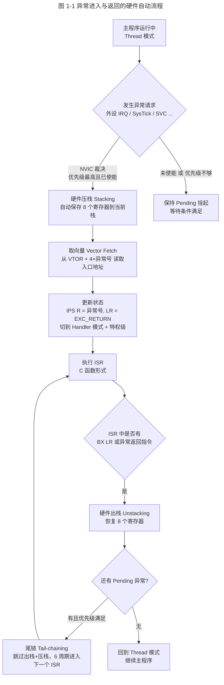

**图 1-1 解释**：注意图中**没有任何软件参与的"保存现场"步骤**。这是 Cortex-M 与传统 MCU 最大的差异：传统架构进中断要执行 `PUSH ACC / PUSH PSW / PUSH DPL...` 一串指令，中断延迟随编译器优化等级变化；Cortex-M 由硬件统一压 8 个寄存器，延迟**固定可预测**（这正是 AUTOSAR/ISO 26262 最看重的"确定性"）。

**设计思路提炼：**

| 设计决策 | 原因 | 收益 |
|---|---|---|
| 硬件压栈 8 个寄存器（而非全部） | 8 个刚好是 **AAPCS 调用者保存寄存器（Caller-saved）**：R0-R3、R12、LR、PC、xPSR | C 函数调用约定天然兼容，编译器无需额外保存，压栈量最小 |
| 向量表放内存（不是硬件固定地址） | 支持 Bootloader + APP 双区、支持 RAM 向量表动态重映射 | `VTOR` 寄存器可重定位，OTA 升级友好 |
| 用 `EXC_RETURN`（LR 的特殊值）表示返回目标 | 不需要额外的"返回指令"，普通 `BX LR` 就完成返回 | ISR 可以像普通函数一样被 C 编译器生成 |
| 8 字节栈对齐强制检查 | AAPCS 要求栈 8 字节对齐，未对齐会置位 `CCR.UNALIGN_TRP` / `STKALIGN` | 保证浮点与 64 位数据访问安全 |

### 1.3 深入原理：压栈帧与 EXC_RETURN

**(1) 硬件压栈的 8 个字（基本栈帧，Basic Frame）**

```
        高地址
        ┌──────────────┐
        │   xPSR       │  ← 含 APSR 标志位、IPSR 异常号、EPSR(Thumb 位)
        ├──────────────┤
        │   PC         │  ← 被打断指令的下一条（返回地址）
        ├──────────────┤
        │   LR (R14)   │
        ├──────────────┤
        │   R12        │
        ├──────────────┤
        │   R3         │
        ├──────────────┤
        │   R2         │
        ├──────────────┤
        │   R1         │
        ├──────────────┤
        │   R0         │  ← SP 指向这里（压栈后）
        └──────────────┘
        低地址
```

压栈顺序（从低地址到高地址写）：`R0, R1, R2, R3, R12, LR, PC, xPSR`，共 **32 字节**。

> 🔍 **为什么是这 8 个？** 因为 ARM AAPCS 规定 R0-R3、R12 是"调用者保存"（Caller-saved），R4-R11 是"被调用者保存"（Callee-saved）。ISR 是一个 C 函数，它自己会保存 R4-R11（如果需要）。所以硬件只需保存"调用者该保存"的那部分 —— **这是把硬件与编译器的调用约定对齐的经典设计**。

**(2) 带 FPU 的扩展栈帧（Cortex-M4F / M7）**

若使能了 FPU 且当前使用浮点（`CONTROL.FPCA = 1`）：

```
        ┌──────────────┐
        │   xPSR       │  基本帧 32 字节
        │   PC         │
        │   LR         │
        │   R12        │
        │   R3..R0     │
        ├──────────────┤
        │   S15        │  扩展帧
        │   ...        │  S0-S15（16 字）
        │   S0         │  + FPSCR（1 字）
        │   FPSCR      │  + 保留（1 字）
        │   Reserved   │  = 72 字节
        └──────────────┘
        总计 104 字节
```

而且 FPU 采用 **惰性压栈（Lazy Stacking）**：硬件先只压基本帧并标记，只有当 ISR 真正访问 FPU 时才补压 S0-S15。中断延迟从 104 字节的写操作降为 32 字节 —— **为的是让"不用 FPU 的中断"更快**。

**(3) `EXC_RETURN` 的位定义**

异常返回时，`LR` 中的值不是普通返回地址，而是一个"魔数"：

| EXC_RETURN 值 | 返回到 | 使用的栈 | 是否 FPU 扩展帧 |
|---|---|---|---|
| `0xFFFFFFF1` | Handler 模式（嵌套返回） | MSP | 否 |
| `0xFFFFFFF9` | Thread 模式 | MSP | 否 |
| `0xFFFFFFFD` | Thread 模式 | PSP | 否 |
| `0xFFFFFFE1` | Handler 模式 | MSP | 是 |
| `0xFFFFFFE9` | Thread 模式 | MSP | 是 |
| `0xFFFFFFED` | Thread 模式 | PSP | 是 |

> 💡 **RTOS 上下文切换的钥匙**：PendSV 处理程序里只要把 `LR` 改成 `0xFFFFFFFD`，返回时就会从 **PSP** 出栈 —— 这正是任务切换的硬件基础（详见第 3 章 PendSV 代码）。

---

## 第 2 章 NMI：不可拒绝的火警铃

### 2.1 通俗易懂

NMI（Non-Maskable Interrupt，不可屏蔽中断）是 Cortex-M 里**唯一一个"软件绝对关不掉"的普通异常**（Reset 也不算中断，它是重启）。

它有三个"特权"：

1. **关不掉**：`__disable_irq()`、`CPSID i`、`CPSID f`、改 `BASEPRI` —— 全都没用。
2. **优先级第二高**：仅次于 Reset，数值为 **-2**，可以打断包括 HardFault 在内的**一切**正在执行的代码。
3. **不能被自己嵌套**：如果 NMI 服务程序执行中又来一次 NMI，新的请求**只会挂起（Pending）一次**，等你处理完当前 NMI 返回后立刻再进一次，不会形成无限嵌套导致栈溢出。

**它存在的唯一理由：给"安全"留一条软件破坏不了的生命线。**

### 2.2 设计机制与设计思路（为什么必须要有一个"关不掉"的中断）

#### 2.2.1 问题的根源：软件的不可信性

考虑下面这段**看起来完全正常**的代码：

```c
/* 危险示例：这段代码会因为阻塞等待而长时间关闭中断 —— 现实中极其常见 */
void App_UpdateFlashBlock(uint32_t addr, const uint8_t *buf, uint32_t len)
{
    uint32_t primask = __get_PRIMASK();
    __disable_irq();                 /* ← 从这里开始，所有中断都被关掉 */

    for (uint32_t i = 0U; i < len; i++) {
        /* 假设 Flash 编程慢：此循环可能耗时 5~20 ms */
        FLASH->DR = buf[i];
        while ((FLASH->SR & FLASH_SR_BSY) != 0U) {
            /* 忙等 —— 这段时间内系统"失聪" */
        }
    }

    __set_PRIMASK(primask);          /* ← 恢复 */
}
```

在 `__disable_irq()` 到 `__set_PRIMASK()` 之间的 20 ms 里：

- 如果**外部电源跌落**，PVD 中断进不来；
- 如果**看门狗要溢出**，喂狗中断进不来；
- 如果**时钟源 HSE 突然失效**，CPU 继续用错误的时钟跑，系统算出来的时间、波特率、采样率全部错误 —— 而**没人通知你**。

功能安全标准（ISO 26262 Part 6、IEC 61508-2 附录）明确要求：**安全机制必须独立于被监控的软件**。如果安全响应通道本身可以被应用软件关掉，那它就不构成"独立保护层"。

**于是硬件提供了一条"旁路"：NMI。**

#### 2.2.2 设计模式：三段式 NMI（取证 → 降级 → 受控复位）

NMI 处理程序**绝不能像普通 ISR 那样"处理完就返回"**，因为触发 NMI 的事件通常意味着系统已经**不再可信**（时钟错了、存储坏了）。工业界通用模式是：

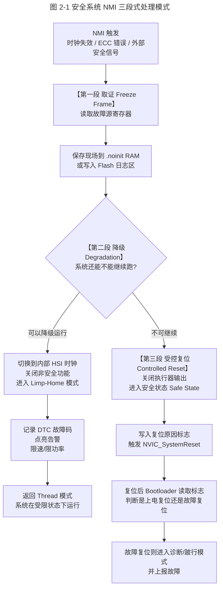

**图 2-1 解释**：这个图的关键在于 **"分段"**。第一段（取证）必须极快且绝不依赖任何可能已损坏的资源（只用 CPU 寄存器 + SRAM）；第二段（降级）是决策点，决定系统"带病生存"还是"体面退出"；第三段（复位）必须保证执行器进入安全态（Safe State）后才复位，否则复位瞬间 PWM 引脚可能保持最后一个电平，造成物理危险。

**这个模式为什么这么设计？（设计思路）**

| 设计点 | 理由 |
|---|---|
| 取证只写 SRAM，不写 Flash | NMI 可能由"Flash/时钟异常"引起，写 Flash 依赖时钟与总线，可能死锁 |
| 使用 `.noinit` 段保存故障码 | 复位后 RAM 内容保留，可用于诊断（`__attribute__((section(".noinit")))` + 不被启动代码清零） |
| 受控复位前先关执行器 | 复位不是原子的，GPIO 会保持最后状态数百 ns~数 ms，驱动大功率负载会出事故 |
| 降级模式（Limp-Home） | 汽车/工业要求"故障时仍能安全靠边停车"，而非直接失控 |

#### 2.2.3 设计思路：为什么用"负优先级"而不是"最高正优先级"

Cortex-M 用**有符号数**表达优先级：Reset = -3，NMI = -2，HardFault = -1，可配置异常 = 0 ~ 2^(N)-1（N 为实现位数，STM32 为 4 位，即 0~15）。

**为什么这么设计？**

1. **硬件的天然分界**：`IPR`（中断优先级寄存器）只有 8 位，只能表达 0~255。如果用"255 = 最高"来表达 NMI，那么 NMI 和普通中断就"混"在一个比较器里，无法做"绝对不能抢占"的保证。用负数的概念（硬件中以"优先级组" `PRIGROUP` 之外的固定层级实现）把系统异常划到一个**独立的、更高的比较层**，任何软件的 `IPR` 写入都触碰不到它。
2. **可配置性边界清晰**：`IPR`、`SHPR` 寄存器里**没有 NMI 和 HardFault 的字段** —— 想配也配不了。硬件上就"不存在"这个比特，从物理层面杜绝误配。
3. **故障升级（Escalation）规则的基石**：见下方 2.3.4。

### 2.3 深入原理

#### 2.3.1 NMI 的硬件属性断言

| 属性 | 值 | 依据 |
|---|---|---|
| 异常编号 | **2** | ARMv7-M ARM, Table B1-4 |
| 向量表偏移 | **0x08** | 2 × 4 |
| 优先级 | **-2（固定，不可写）** | `SHPR` 无对应字段 |
| 能否被 `PRIMASK` 屏蔽 | **否** | ARMv7-M ARM B1.5.4 |
| 能否被 `BASEPRI` 屏蔽 | **否** | 负优先级恒低于任何 `BASEPRI` 值 |
| 能否被 `FAULTMASK` 屏蔽 | **否** | `FAULTMASK` 只升到 -1 |
| 能否被其他异常抢占 | **否（除 Reset）** | 无更高优先级 |
| 能否抢占 HardFault | **能** | -2 < -1 |
| 能否自我嵌套 | **否（仅挂起一次）** | `ICSR.NMIPENDING` 是 1 位 |
| 是否有独立使能位 | **否（永远使能）** | `NVIC_ISER` 中无 NMI 位 |
| 是否可用软件触发 | **能**，写 `ICSR.NMIPENDSET = 1` | 用于自测 |

#### 2.3.2 NMI 的触发源（芯片级实现）

NMI 在内核里只是"一个输入信号"，**具体接什么由芯片厂商决定**。以常见器件为例：

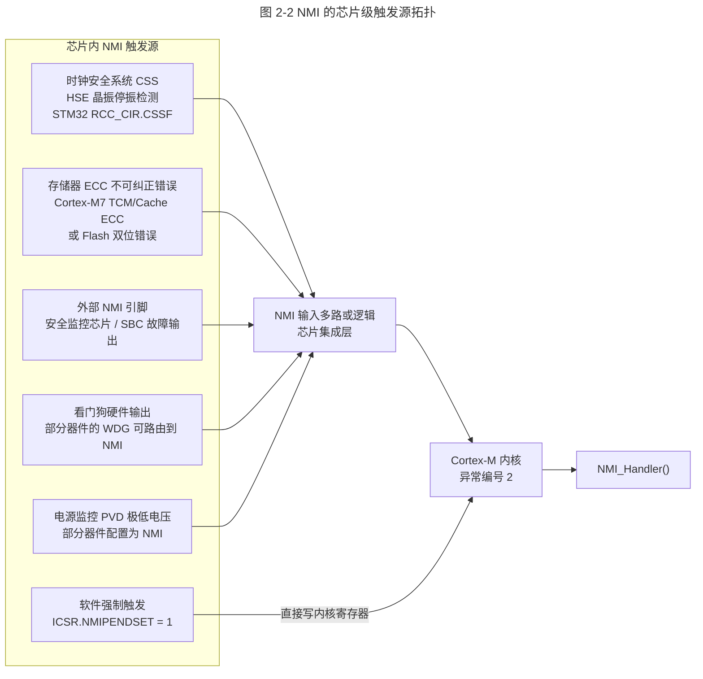

**图 2-2 解释**：图中 S1~S5 是芯片把各种"致命事件"汇聚到内核 `NMI` 输入引脚的通路（具体哪几路有效要看芯片参考手册的 `SYSCFG` / `RCC` / `EXTI` 章节）。S6 是唯一由软件直接控制的通路，常用于 **NMI 通路自检**（Functional Safety 要求：安全机制必须能被周期性验证，Proofline Test）。

> 📌 **工程要点**：由于 NMI 源是"或"逻辑汇聚的，**NMI_Handler 里必须逐个读取各源的标志位来判别真正原因**，读不到就是硬件设计缺陷。这也是图 2-1 "取证段"存在的原因。

#### 2.3.3 关键细节：NMI 的"不可屏蔽"到底意味着什么

**（a）"不可屏蔽"≠"立即执行"**

NMI 无法被"屏蔽"，但如果 CPU 处于**不可中断的原子操作**中，NMI 会**等待当前指令完成**后立刻响应。Cortex-M 的指令几乎都是原子的（除了 `LDM/STM` 多寄存器读写可能被打断后重启），所以最坏延迟 = 当前指令周期 + 12 周期。

**（b）"不可屏蔽"≠"可嵌套自身"**

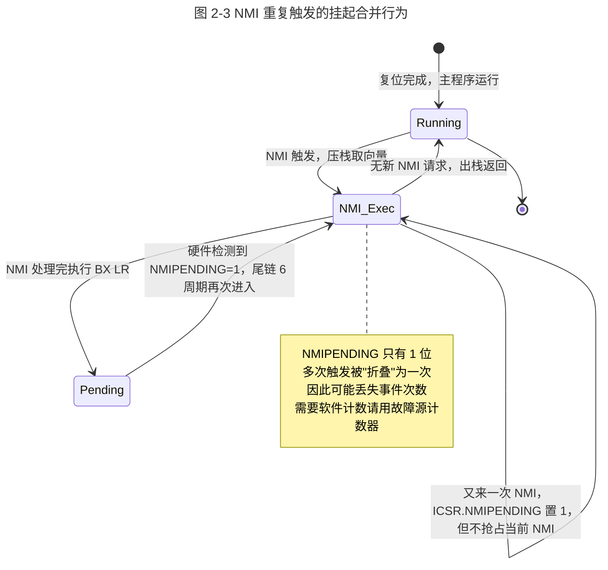

**图 2-3 解释**：这张状态图说明了一个**极易被忽视的坑**：`ICSR` 的 `NMIPENDING` 是**单个比特**，属于"电平/事件合并"语义。如果 NMI 由高频事件驱动（例如 ECC 连续出错），100 次触发在软件看来可能只有 2 次进入。**所以 NMI 处理里必须去读各个源自己的计数器/标志，不能靠进入次数统计。**

**（c）"不可屏蔽"≠"不会被故障升级"**

如果 NMI 处理程序内部又发生了总线错误、非法指令等故障，会升级为 **HardFault**；而 HardFault（-1）**低于** NMI（-2），无法抢占 NMI，于是触发 **Lockup（锁定）** —— CPU 停在一个死循环里，只有 Reset 能救。

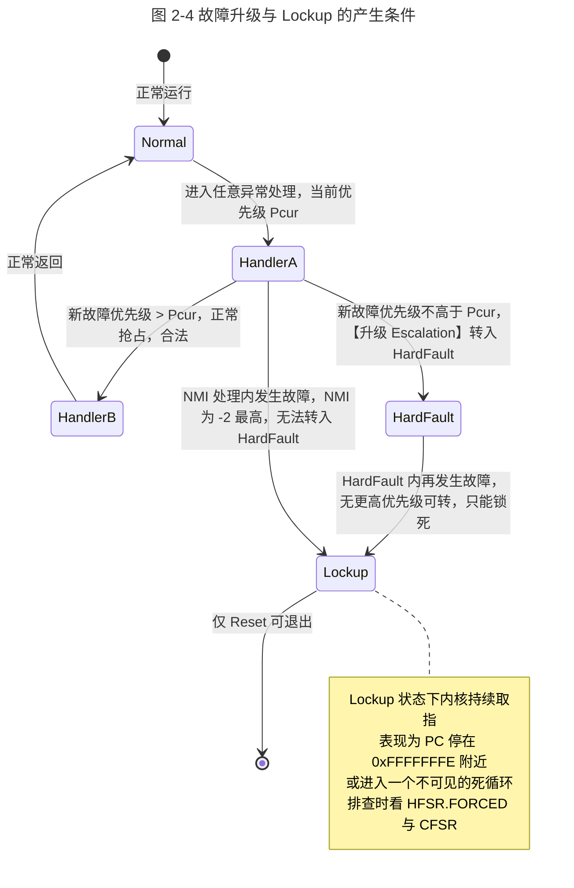

**图 2-4 解释**：这个图揭示了"负优先级"设计的**代价**：优先级越高，出错后能"接住"它的异常越少。NMI 是最高的普通异常，所以 **NMI_Handler 必须是全系统最健壮、最简短的代码**——不调用库函数、不做除法、不访问外设总线（可能已损坏）、不使用可能未初始化的全局变量。这一点与 AUTOSAR 中 `Os_IsrCategory1` 的约束精神一致。

#### 2.3.4 NMI 与 HardFault 的"优先级接力"关系

一个常见误解是"NMI 就是最严重的错误"。实际上分工不同：

| 维度 | NMI | HardFault |
|---|---|---|
| 语义 | **"外部世界的致命事件"**：时钟、电源、存储器、安全监控 | **"软件/总线自己出错了"**：非法访问、未对齐、除零、取指失败 |
| 触发者 | 通常是**外设/芯片级监控** | 通常是 **CPU 自身执行出错** |
| 优先级 | -2 | -1 |
| 能否被抢占 | 仅 Reset | 仅 Reset 与 NMI |
| 典型处理 | 安全状态迁移、降级、受控复位 | 现场取证、打印栈回溯、复位 |
| 归属 | 系统/安全架构 | 软件缺陷排查 |

#### 2.3.5 代码：完整的 NMI 处理程序（生产级）

```c
/**
 * @file    nmi_handler.c
 * @brief   Cortex-M NMI 不可屏蔽中断处理程序 —— 生产级实现
 * @note    约束（务必遵守）：
 *          1) 不使用 FPU / 除法 / 可变长循环（可能是耗时不可控）
 *          2) 只访问内核寄存器与 SRAM，不碰可能已损坏的外设总线
 *          3) 不调用 printf / malloc / 任何库函数
 *          4) 函数体保持在几百字节内，便于审计
 */

#include <stdint.h>
#include "stm32f4xx.h"          /* 具体器件头文件，按需替换 */

/* ============================================================
 * 一、.noinit 段：复位后不被启动代码清零的 RAM
 *    用于把 NMI 取证信息"跨越复位"传递给复位后的软件
 * ============================================================ */
typedef struct {
    uint32_t magic;             /* 魔数 0x4E4D4931 ('NMI1')，用于校验有效性 */
    uint32_t reset_reason;      /* 复位原因位图 */
    uint32_t cfsr;              /* 可配置故障状态寄存器 */
    uint32_t hfsr;              /* 硬故障状态寄存器 */
    uint32_t mmfar;             /* MemManage 故障地址 */
    uint32_t bfar;              /* BusFault 故障地址 */
    uint32_t stacked_pc;        /* 出错时的 PC */
    uint32_t stacked_lr;        /* 出错时的 LR */
    uint32_t nmi_source;        /* 本次 NMI 的具体来源（自定义枚举） */
    uint32_t nmi_count;         /* NMI 累计次数（跨复位保留） */
    uint32_t css_count;         /* 时钟失效次数 */
    uint32_t ecc_count;         /* ECC 错误次数 */
    uint32_t ext_count;         /* 外部 NMI 引脚次数 */
} NmiFreezeFrame_t;

/* 放在自定义段，链接脚本中标记为 NOLOAD 且不进 .bss 清零范围 */
__attribute__((section(".noinit"), used))
static NmiFreezeFrame_t g_nmi_ff;

#define NMI_FF_MAGIC   (0x4E4D4931UL)   /* 'NMI1' */

/* ============================================================
 * 二、NMI 触发源枚举
 * ============================================================ */
typedef enum {
    NMI_SRC_UNKNOWN = 0U,
    NMI_SRC_CSS,            /* 时钟安全系统：HSE 失效 */
    NMI_SRC_ECC,            /* 存储器不可纠正错误 */
    NMI_SRC_EXT_PIN,        /* 外部安全监控芯片拉低 NMI 引脚 */
    NMI_SRC_PVD,            /* 电源电压过低 */
    NMI_SRC_SOFTWARE,       /* 软件自检触发 */
} NmiSource_t;

/* ============================================================
 * 三、取证：识别 NMI 真正来源
 *    注意：这里只读寄存器，不等待任何外设握手
 * ============================================================ */
static NmiSource_t Nmi_IdentifySource(void)
{
    NmiSource_t src = NMI_SRC_UNKNOWN;

    /* --- 3.1 时钟安全系统 CSS ---
     * RCC_CIR.CSSF 置位表示 HSE 时钟失效（晶振停振/断线）
     * 这是汽车/工业最常见的 NMI 来源之一
     */
    if ((RCC->CIR & RCC_CIR_CSSF) != 0U) {
        src = NMI_SRC_CSS;
        g_nmi_ff.css_count++;
        /* 清标志：写 1 清除，防止复位后误判 */
        RCC->CIR |= RCC_CIR_CSSC;
    }

    /* --- 3.2 存储器 ECC 不可纠正错误（Cortex-M7 有，M3/M4 视器件） ---
     * 不同器件寄存器不同，此处以通用形式示意
     */
#if defined(FLASH_ECC_ENABLE)
    if ((FLASH->ECCR & FLASH_ECCR_ECCD) != 0U) {
        src = NMI_SRC_ECC;
        g_nmi_ff.ecc_count++;
        FLASH->ECCR |= FLASH_ECCR_ECCD;   /* 写 1 清除 */
    }
#endif

    /* --- 3.3 外部安全监控芯片（SBC / 看门狗芯片）通过 GPIO 拉低 --- */
    if ((GPIOC->IDR & GPIO_IDR_ID13) == 0U) {
        src = NMI_SRC_EXT_PIN;
        g_nmi_ff.ext_count++;
    }

    /* --- 3.4 电源跌落 --- */
    if ((PWR->CSR & PWR_CSR_PVDO) != 0U) {
        src = NMI_SRC_PVD;
    }

    /* --- 3.5 软件自检：ICSR.NMIPENDSET 触发时无硬件源标志 --- */
    if (src == NMI_SRC_UNKNOWN) {
        src = NMI_SRC_SOFTWARE;
    }

    return src;
}

/* ============================================================
 * 四、降级决策：判断系统能否"带病运行"
 * ============================================================ */
typedef enum {
    RECOVER_OK = 0,         /* 可继续运行，仅需记录 */
    RECOVER_DEGRADED,       /* 降级运行（Limp-Home） */
    RECOVER_FATAL,          /* 不可恢复，必须受控复位 */
} Recovery_t;

static Recovery_t Nmi_DecideRecovery(NmiSource_t src)
{
    switch (src) {
        case NMI_SRC_SOFTWARE:
            /* 自检触发：完全正常，立即返回即可 */
            return RECOVER_OK;

        case NMI_SRC_CSS:
            /* HSE 失效：内核已自动切到 HSI（内部 RC，精度差但可用）
             * 可以降级运行：CAN 通信改用 HSI，关闭高精度需求功能
             */
            return RECOVER_DEGRADED;

        case NMI_SRC_EXT_PIN:
            /* 外部监控芯片报警：说明外部电路异常（过压/过流/温度）
             * 必须立刻安全停机
             */
            return RECOVER_FATAL;

        case NMI_SRC_PVD:
            /* 电源跌落：来不及做任何复杂处理，直接受控复位 */
            return RECOVER_FATAL;

        case NMI_SRC_ECC:
        default:
            /* 存储器损坏：数据已不可信，必须复位并记录 */
            return RECOVER_FATAL;
    }
}

/* ============================================================
 * 五、安全状态：关闭所有危险执行器
 *    注意：此函数必须"幂等"且"无阻塞"
 * ============================================================ */
static void Nmi_EnterSafeState(void)
{
    /* 5.1 关闭 PWM 输出（电机/加热器等功率负载）—— 硬件级关断优先 */
    TIM1->BDTR &= ~TIM_BDTR_MOE;      /* 主输出使能清零，PWM 立即高阻 */
    TIM1->CCER  = 0U;

    /* 5.2 关闭继电器 / 高边驱动 */
    GPIOB->BSRR = (uint32_t)GPIO_BSRR_BR_0 | (uint32_t)GPIO_BSRR_BR_1;

    /* 5.3 关闭 CAN 发送，避免总线上发送错误帧 */
    CAN1->IER = 0U;
    CAN1->MCR |= CAN_MCR_INRQ;         /* 请求进入初始化模式 */

    /* 5.4 打开故障指示灯 */
    GPIOA->BSRR = GPIO_BSRR_BS_5;
}

/* ============================================================
 * 六、NMI 服务程序本体
 * ============================================================ */
void NMI_Handler(void)
{
    /* ---- 阶段 0：最小化取证，先保存"可能是最后一次可读"的状态 ---- */
    NmiSource_t src;
    uint32_t    cfsr = SCB->CFSR;
    uint32_t    hfsr = SCB->HFSR;

    /* 统计次数（跨复位累计，可用于判断是否"反复故障"） */
    g_nmi_ff.nmi_count++;

    /* 保存故障寄存器现场 */
    g_nmi_ff.cfsr  = cfsr;
    g_nmi_ff.hfsr  = hfsr;
    g_nmi_ff.mmfar = SCB->MMFAR;
    g_nmi_ff.bfar  = SCB->BFAR;

    /* ---- 阶段 1：识别来源 ---- */
    src = Nmi_IdentifySource();
    g_nmi_ff.nmi_source = (uint32_t)src;

    /* ---- 阶段 2：决定恢复策略 ---- */
    Recovery_t recovery = Nmi_DecideRecovery(src);

    /* ---- 阶段 3：执行动作 ---- */
    if (recovery == RECOVER_OK) {
        /* 自检通过：直接返回，什么都不做 */
        g_nmi_ff.magic = NMI_FF_MAGIC;
        return;
    }

    if (recovery == RECOVER_DEGRADED) {
        /* 降级：标记状态，返回 Thread 模式，由主循环接管降级逻辑 */
        g_nmi_ff.reset_reason = 0x01U;        /* bit0 = 曾发生时钟失效 */
        g_nmi_ff.magic        = NMI_FF_MAGIC;
        return;                               /* 注意：这里"返回"是合法的 */

    }

    /* RECOVER_FATAL：进入安全状态后受控复位 */
    Nmi_EnterSafeState();

    g_nmi_ff.reset_reason = 0x02U;            /* bit1 = 致命故障 */
    g_nmi_ff.magic        = NMI_FF_MAGIC;

    /* 6.1 给外设一点时间完成关断（约几微秒，用简单循环，
     *     不用 SysTick —— 时钟可能已经不可信）
     */
    for (volatile uint32_t i = 0U; i < 1000U; i++) {
        __NOP();
    }

    /* 6.2 受控复位：写 AIRCR.SYSRESETREQ
     *     注意必须先写 VECTKEY = 0x05FA，否则写入被忽略
     */
    NVIC_SystemReset();

    /* 6.3 理论上不会到这里；若到了说明复位失效，死等复位 */
    for (;;) {
        __NOP();
    }
}

/* ============================================================
 * 七、NMI 通路自检（功能安全 Proofline Test 要求）
 *    上电初始化时调用一次，验证 NMI 通路真的能工作
 * ============================================================ */
uint32_t Nmi_SelfTest(void)
{
    uint32_t before = g_nmi_ff.nmi_count;

    /* 软件触发一次 NMI */
    SCB->ICSR = SCB_ICSR_NMIPENDSET_Msk;

    /* 由于 NMI 极高优先级，此条指令后应立即进入 NMI_Handler 并返回 */
    __DSB();
    __ISB();

    /* 校验：次数应 +1，且来源判定为 SOFTWARE */
    if ((g_nmi_ff.nmi_count == (before + 1U)) &&
        (g_nmi_ff.nmi_source == (uint32_t)NMI_SRC_SOFTWARE)) {
        return 0U;      /* 通过 */
    }
    return 1U;          /* 失败：NMI 通路异常，必须禁止车辆/设备运行 */
}

/* ============================================================
 * 八、复位后读取取证信息（在 main 早期调用）
 * ============================================================ */
void Nmi_ReportAfterReset(void)
{
    if (g_nmi_ff.magic != NMI_FF_MAGIC) {
        /* 首次上电，初始化 */
        g_nmi_ff.magic = NMI_FF_MAGIC;
        g_nmi_ff.nmi_count = 0U;
        return;
    }

    /* 判断本次复位是否由 NMI 引起 */
    if ((__HAL_RCC_GET_FLAG(RCC_FLAG_SFTRST) != 0U) &&
        (g_nmi_ff.reset_reason != 0U)) {
        /* 是软件复位且此前记录过故障 → 进入诊断 / 跛行模式 */
        App_EnterLimpHomeMode(g_nmi_ff.reset_reason);
    }
}
```

> 📎 **代码要点注释**
> - **`NmiFreezeFrame_t` 放 `.noinit`**：这是"跨复位取证"的关键。配合链接脚本：
>   ```
>   .noinit (NOLOAD) :
>   {
>       . = ALIGN(4);
>       *(.noinit)
>       . = ALIGN(4);
>   } > RAM
>   ```
>   并在 `Reset_Handler` 的 `.bss` 清零逻辑中**不要**覆盖这一段。
> - **`NVIC_SystemReset()` 为什么安全**：它写 `AIRCR = VECTKEY | SYSRESETREQ`，由内核复位逻辑拉低整个芯片的复位信号。所有外设寄存器复位，GPIO 回到默认输入态（高阻），因此**执行器自然断电** —— 但仍建议先显式关断，因为某些外部驱动芯片有锁存。
> - **`Nmi_SelfTest()` 是功能安全的硬性要求**：ISO 26262-5 要求安全机制要有"诊断覆盖率"，且要在启动时/周期性做 proofline test 证明机制"活着"，而非"永久静默失效"。

#### 2.3.6 NMI 使用的 6 条铁律

| # | 铁律 | 原因 |
|---|---|---|
| 1 | **不调用任何库函数**（含 `printf`、`memcpy`、浮点） | 库函数可能访问总线/触发新故障 → Lockup |
| 2 | **不做长循环和忙等** | 时钟可能已失效，循环次数不可预测 |
| 3 | **不依赖 DMA / 中断完成** | NMI 期间其他中断全被压制 |
| 4 | **只用 SRAM 和内核寄存器** | 外设总线可能已锁死（AHB/APB 挂起） |
| 5 | **必须识别具体来源** | 多源"或"逻辑，不识别就无法正确降级 |
| 6 | **必须有超时兜底复位** | 万一降级失败，不能让系统"假活" |


---

## 第 3 章 NVIC：中断的分诊台与调度中枢

### 3.1 通俗易懂

NVIC 是 Cortex-M **内核内部**的一块硬件模块（地址固定在 `0xE000E100` 区域，属于"系统控制空间 SCS"），它负责 4 件事：

| NVIC 管什么 | 通俗类比 |
|---|---|
| **使能 / 除能（Enable）** | 门口保安：某些人（中断源）不许进 |
| **挂起 / 解挂（Pending）** | 排队号码牌：来了但还没轮到，先挂着 |
| **优先级裁决（Priority）** | 分诊护士：谁病得重谁先看，数值越小越重 |
| **嵌套 / 尾链 / 迟到（Nested / Tail-chain / Late-arrival）** | 医生之间的转诊 + 无缝衔接 + 插队 |

**它不管什么**（这一点常被误解）：

- **不管 NMI**：NMI 不走 NVIC 的使能/优先级寄存器。
- **不管 Reset**：复位是独立的。
- **不管压栈/出栈**：那是内核（CPU）干的活，NVIC 只负责"该唤醒哪个入口"。
- **不管外设内部标志**：外设自己产生 IRQ 请求信号，NVIC 只收这个信号。

### 3.2 设计机制与设计思路

#### 3.2.1 思路一：用"位图寄存器"管理 240 个中断

Cortex-M 最多支持 **240 个 IRQ**（编号 16~255）。若为每个中断做一个独立寄存器（使能、挂起各一个），需要 480 个寄存器，地址空间和译码逻辑巨大。

**NVIC 的做法：位图（Bitmap）。**

- `NVIC_ISER[0..7]`：8 个 32 位寄存器 = 256 位，每位对应一个 IRQ。写 1 使能，**写 0 无效**。
- `NVIC_ICER[0..7]`：写 1 除能，**写 0 无效**。
- `NVIC_ISPR[0..7]` / `NVIC_ICPR[0..7]`：挂起 / 解挂。
- `NVIC_IABR[0..7]`：只读，反映当前**激活（Active）**状态。

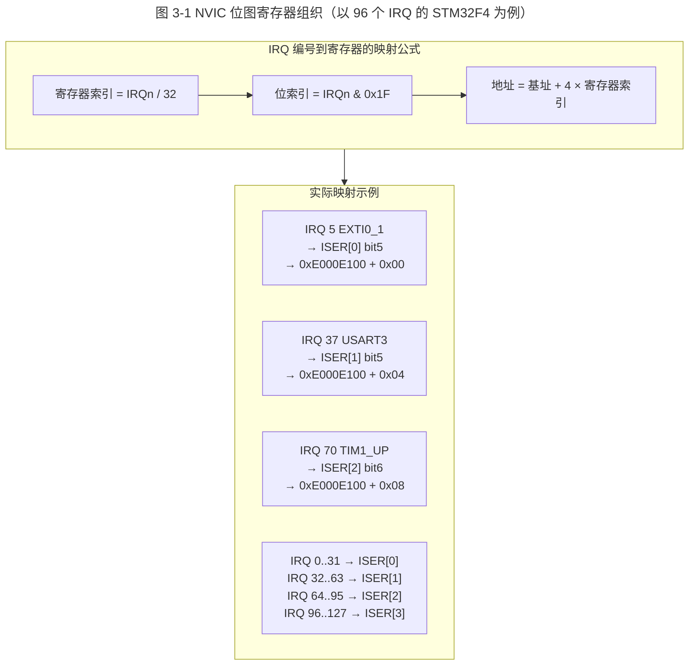

**图 3-1 解释**：位图设计的**收益**：240 个中断只占 8×4×5 = 160 字节，比分散寄存器省了几个数量级。**代价**：读-改-写需要软件自己保证原子性 —— 这就是为什么**不能用 `NVIC->ISER[0] |= (1<<5)` 这种写法**（`|=` 会被编译成"读 → 或 → 写"三条指令，如果中间被中断打断，又恰好有另一个 ISR 改了同一个寄存器，就会丢失修改）。

> ✅ **正确写法**（CMSIS 已封装为原子写）：
> ```c
> NVIC->ISER[0] = (1UL << 5);        /* 直接写 1，不要用 |= */
> NVIC_EnableIRQ(EXTI0_1_IRQn);      /* CMSIS 封装，内部即上式 */
> ```

#### 3.2.2 思路二：为什么要有"优先级分组（Priority Grouping）"

这是初学者最难理解、也最容易踩坑的点。

**问题背景**：Cortex-M 允许芯片厂商实现 **2~8 位**优先级位（`__NVIC_PRIO_BITS`），而不同厂商实现不同：

- STM32F1/F4：**4 位**（16 级）
- STM32H7 / NXP i.MX RT：**4 位**（16 级）
- TI Tiva / 某些 Cortex-M0+：**2~3 位**
- 有的甚至只有 2 位（4 级）

同时，**ARM 规范**定义了每个优先级可拆分为"抢占优先级（Preemption Priority）+ 子优先级（Subpriority）"两部分。软件架构希望**统一用"抢占级 + 子级"的抽象模型**，而不关心底层是几位。

**解决方案：`AIRCR.PRIGROUP` 三位字段定义"分界线在哪"。**

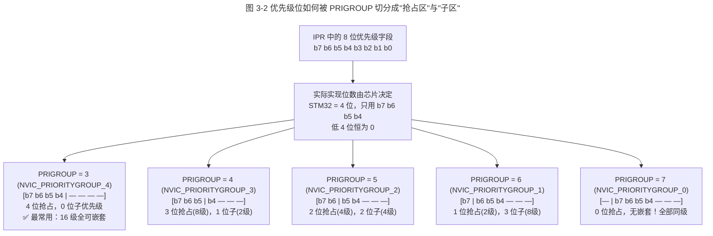

**图 3-2 解释**：这张图是全章最核心的一张。

- **抢占优先级（Group Priority）** 决定"**能不能打断**"。两个中断的抢占级不同，则高者的中断可以打断低者的 ISR（**嵌套**）。
- **子优先级（Subpriority）** 决定"**同时挂起时谁先执行**"，但**不能打断**。子级高的只能"排队排前面"，不能插队到正在执行的同级 ISR 里。
- 若 `PRIGROUP = 7`（0 位抢占），所有中断同级 → **完全没有嵌套**，等于退化成 8051 的"进中断后硬件关总中断"模式。某些极简 Cortex-M0 配置会这么做。

> ⚠️ **最重要的工程铁律**：`PRIGROUP` 是**全局配置**，一旦设定，所有中断的 `IPR` 值都按同一套规则解释。如果一个工程里 HAL 库配了 `NVIC_PRIORITYGROUP_4`，而 FreeRTOS/AUTOSAR OS 期望 `NVIC_PRIORITYGROUP_4`（FreeRTOS 要求全部 4 位都是抢占级，子级为 0），**两边必须一致**，否则优先级实际生效值与预期不符，会出"高优先级任务抢不过低优先级中断"这类灵异问题。

#### 3.2.3 思路三：为什么要有"尾链（Tail-chaining）"和"迟到（Late-arrival）"

这两个机制**纯粹是为了性能**，是"用硬件状态机消除软件开销"的典范。

| 机制 | 传统做法开销 | NVIC 做法开销 | 节省 |
|---|---|---|---|
| 连续处理两个中断 | 出栈(12) + 压栈(12) + 取向量 = ~30 周期 | **尾链 6 周期** | **约 80%** |
| 压栈途中来了更高优先级中断 | 先压完栈 → 取低优先级向量 → 发现不对 → 再压栈 | **迟到**：压栈继续但**改取高优先级向量**，一次搞定 | 一次完整异常进入 |

**设计思路本质：**

> **"中断是高频事件，任何固定开销乘以百万次就是灾难。"**
> 汽车 ECU 里 CAN 中断可能每秒几万次，如果每次多花 20 周期，@160MHz 就是 0.4% 的 CPU 白烧。硬件状态机把这部分固化，软件就"免费"获得性能。

### 3.3 深入原理

#### 3.3.1 NVIC 与 SCB 寄存器映射总表

NVIC 和 SCB（System Control Block）都位于**系统控制空间（SCS）**，基址 `0xE000E000`。

| 寄存器 | 地址 | 宽度 | 功能 |
|---|---|---|---|
| `NVIC_ISER[0..7]` | `0xE000E100` + 4n | 32 位 | 中断使能（写 1 有效） |
| `NVIC_ICER[0..7]` | `0xE000E180` + 4n | 32 位 | 中断除能（写 1 有效） |
| `NVIC_ISPR[0..7]` | `0xE000E200` + 4n | 32 位 | 中断挂起（写 1 有效） |
| `NVIC_ICPR[0..7]` | `0xE000E280` + 4n | 32 位 | 中断解挂（写 1 有效） |
| `NVIC_IABR[0..7]` | `0xE000E300` + 4n | 32 位 | 中断激活状态（只读） |
| `NVIC_IPR[0..59]` | `0xE000E400` + 4n | 8 位/中断 | 中断优先级（每字节一个中断） |
| `NVIC_STIR` | `0xE000EF00` | 32 位 | 软件触发中断（写 IRQn） |
| `SCB_ICSR` | `0xE000ED04` | 32 位 | 中断控制与状态（含 NMIPENDSET、PENDSVSET、VECTACTIVE） |
| `SCB_VTOR` | `0xE000ED08` | 32 位 | 向量表偏移 |
| `SCB_AIRCR` | `0xE000ED0C` | 32 位 | 应用中断与复位控制（PRIGROUP、SYSRESETREQ） |
| `SCB_SCR` | `0xE000ED10` | 32 位 | 系统控制（SLEEPONEXIT、SEVONPEND、SLEEPDEEP） |
| `SCB_CCR` | `0xE000ED14` | 32 位 | 配置控制（STKALIGN、UNALIGN_TRP、DIV_0_TRP、USGFAULTENA 等） |
| `SCB_SHPR1` | `0xE000ED18` | 32 位 | MemManage / BusFault / UsageFault 优先级 |
| `SCB_SHPR2` | `0xE000ED1C` | 32 位 | SVCall 优先级 |
| `SCB_SHPR3` | `0xE000ED20` | 32 位 | PendSV / SysTick 优先级 |
| `SCB_SHCSR` | `0xE000ED24` | 32 位 | 系统异常使能与激活状态 |
| `SCB_CFSR` | `0xE000ED28` | 32 位 | 可配置故障状态（MMFSR+ BFSR + UFSR） |
| `SCB_HFSR` | `0xE000ED2C` | 32 位 | 硬故障状态 |
| `SCB_MMFAR` | `0xE000ED34` | 32 位 | MemManage 出错地址 |
| `SCB_BFAR` | `0xE000ED38` | 32 位 | BusFault 出错地址 |

> 🔎 **注意 `NVIC_IPR` 的字节布局**：每个 IRQ 占一个字节，但**只有高位有效**。STM32 实现 4 位，则 `IPR[IRQn]` 的 `b7..b4` 有效，`b3..b0` 读回 0。CMSIS 的 `NVIC_SetPriority()` 已经做了 `(priority << (8 - __NVIC_PRIO_BITS))` 的移位，所以**用户代码里直接写 0~15 即可**。

#### 3.3.2 优先级裁决的完整规则

当多个中断同时满足条件时，NVIC 按**三级比较**决定谁先执行：

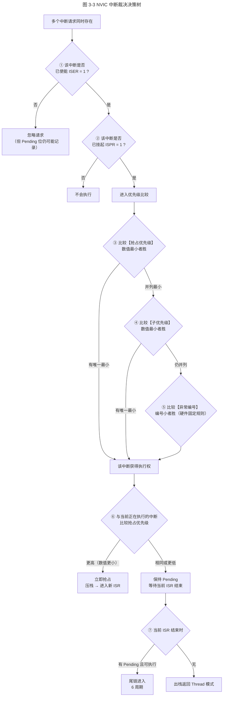

**图 3-3 解释**：注意 **⑥ 这一步**——"能不能抢占"**只看抢占优先级**，子优先级完全不参与抢占判断。这就是为什么"子优先级高的中断不能打断子优先级低的同级中断"。也注意 **⑤**：当所有比较都并列时，**异常编号小的先执行**（例如 EXTI0 的 IRQ6 优先于 EXTI1 的 IRQ7），这是硬件的确定性保证，因此系统行为**完全可复现**。

#### 3.3.3 嵌套、尾链、迟到 的时序细节

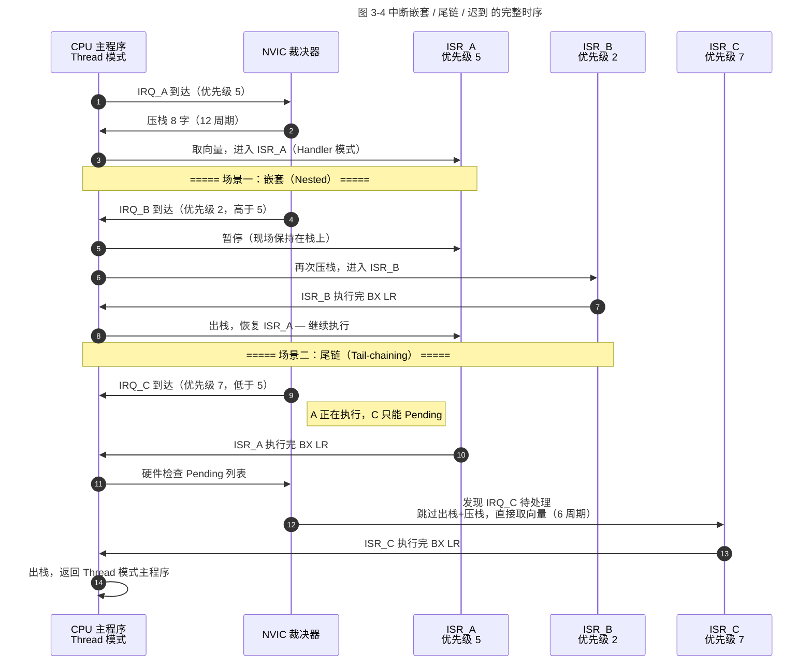

**图 3-4 解释**：

- **嵌套（步骤 4~7）**：B 打断 A 时，硬件**又压了一次栈**（栈上现在有两组 8 字）。这就是为什么 **ISR 嵌套层数直接消耗栈空间**——每层 32 字节（+FPU 72 字节）。AUTOSAR/RTOS 计算栈深度时必须按"最坏嵌套层数 × 32B"预留。
- **尾链（步骤 9~12）**：注意 **11 步"跳过出栈+压栈"**。硬件发现"刚要出栈就又有活干"，于是**取消出栈**，直接从栈上把刚才的上下文当作 C 的上下文继续用，只做一次向量取指。开销从 ~24 周期降到 **6 周期**。

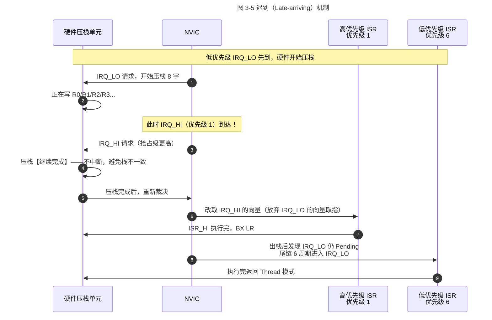

**图 3-5 解释**：迟到的本质是 **"压栈不可中断，但向量取指可以改道"**。因为压栈是硬件顺序写内存，中途打断会导致栈帧不完整；而向量取指只是一个读操作，随时可以换成更紧急的。**这是一个非常巧妙的"最小原子性"设计**：只对必须原子的部分加保护。

#### 3.3.4 中断延迟的精确构成

**中断延迟（Interrupt Latency）= 从请求信号有效到 ISR 第一条指令执行**。

| 阶段 | 周期数（零等待内存，Cortex-M3/M4） | 说明 |
|---|---|---|
| 检测请求 + 裁决 | 2 | NVIC 组合逻辑 |
| 压栈（8 字） | 12（可被总线等待周期拉长） | 若栈在慢速 RAM/有 ECC，会显著增加 |
| 取向量 | 与压栈重叠 | 流水线并行 |
| **合计（基本帧）** | **12** | ARM 官方标称值 |
| FPU 惰性压栈 | +0（首次不压） | 只有在 ISR 用 FPU 时才补压 72 字节 |
| 尾链 | **6** | |
| 迟到 | **12**（只用一次压栈） | 优于"两次进入" |

> ⚠️ **实践中的真实延迟**：ARM 的 12 周期是**理想值**。真实系统里：
> - 栈放在 SRAM 且开了 ECC → 每次写可能多 1~2 周期；
> - 有 AHB 总线竞争（DMA 在跑）→ 仲裁等待；
> - Flash 取指等待（`LATENCY` 配置不当）→ 取指停摆；
> - **代码在 Flash 且 Cache 未命中** → 增加数十周期。
>
> **所以功能安全的时间分析必须用实测值**（见第 6 章 DWT 测量法），而不是数据手册的 12 周期。

#### 3.3.5 低功耗与中断：WFI / WFE / SLEEPONEXIT 的关系

NVIC 也是低功耗唤醒的核心。理解这几位的组合非常重要：

| 机制 | 寄存器位 | 行为 | 典型用途 |
|---|---|---|---|
| **WFI**（Wait For Interrupt） | 指令 | 进入 Sleep/DeepSleep，**任何**使能的中断（即使被 `PRIMASK` 屏蔽）都会唤醒，但**只有未被屏蔽的才会执行** | 空闲时省电 |
| **WFE**（Wait For Event） | 指令 | 等待事件（`SEV` 或中断），事件标志可"记住"一次 | 多核同步、避免丢唤醒 |
| `SCR.SEVONPEND` | `SCB->SCR bit4` | 使能 `SEVONPEND` 后，**即使中断被屏蔽**，挂起事件也会产生唤醒事件 | 防止"关中断期间丢失唤醒信号"导致睡死 |
| `SCR.SLEEPONEXIT` | `SCB->SCR bit1` | ISR 返回时若无 Pending，直接进入 Sleep，不回到 Thread | 事件驱动系统：**没有任何任务时自动睡眠** |
| `SCR.SLEEPDEEP` | `SCB->SCR bit2` | 选择 DeepSleep（配合 `SCB->SCR` + PWR 寄存器进入 STOP/STANDBY） | 低功耗模式 |

> 🚨 **经典 Bug：睡死（丢失唤醒）**
> ```c
> __disable_irq();          /* 关中断保护临界区 */
> /* ... 处理某些共享数据 ... */
> if (nothing_to_do) {
>     __WFI();              /* ❌ 灾难：关着中断进 WFI，虽然会被唤醒但无法执行 ISR，
>                            *    且若唤醒事件在 WFI 之前就发生，则永久睡眠 */
> }
> __enable_irq();
> ```
> **正确做法**：开中断后再 WFI（存在极小的竞态窗口，用 `SEVONPEND` + `WFE` 兜底），或使用 AUTOSAR OS 提供的 `Os_GoToSleep()` / `ShutdownAllCores` 语义。

#### 3.3.6 软件触发中断：STIR 与 PendSV

**三种"软件触发中断"的方式**，用途各不相同：

| 方式 | 寄存器/指令 | 特点 | 典型用途 |
|---|---|---|---|
| `NVIC_STIR` | 写 `NVIC->STIR = IRQn` | 只能触发 **IRQ（编号 ≥16）**，且要求该 IRQ 已使能 | 外设自测、模拟中断 |
| `SCB->ICSR.PENDSVSET` | `SCB->ICSR = SCB_ICSR_PENDSVSET_Msk` | 触发 **PendSV（异常 14）** | **RTOS 上下文切换** |
| `SCB->ICSR.PENDSTSET` | 同上 | 触发 SysTick | 需要手动推进时基 |

**为什么 RTOS 上下文切换必须用 PendSV 而不能直接切？**

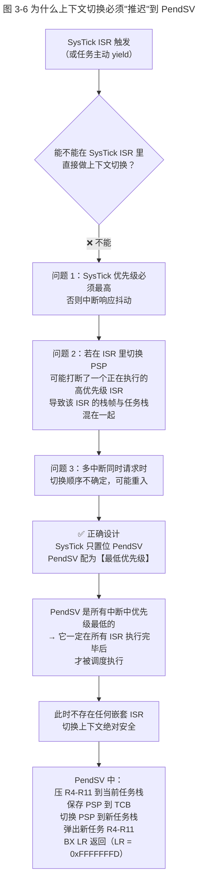

**图 3-6 解释**：这是嵌入式软件架构中**最经典的"延迟处理（Deferred Processing）"模式**。核心思想是**"把需要独占资源的操作，推迟到所有竞争者都退出后的时刻"**。同样的思想在 AUTOSAR 中体现为：

- ISR 只做"置事件/激活任务"，重活交给 Task（`ActivateTask`）；
- `PendSV` 相当于 AUTOSAR OS 的"调度点（Scheduling Point）"。

### 3.4 代码：NVIC 完整操作封装（生产级）

```c
/**
 * @file    nvic_port.c
 * @brief   Cortex-M NVIC 操作封装 —— 含优先级分组、原子使能、临界区、延迟测量
 * @note    适配 CMSIS-Core，STM32F1/F4/H7 通用（修改头文件即可）
 */

#include <stdint.h>
#include "stm32f4xx.h"

/* ============================================================
 * 一、优先级分组配置
 *    必须在系统初始化最早期调用一次，之后不再改变
 * ============================================================ */

/** @brief  设置优先级分组（抢占位 / 子优先级位的划分）
 *  @param  group  取值 NVIC_PRIORITYGROUP_0 ~ NVIC_PRIORITYGROUP_4
 *  @note   该函数会写 SCB->AIRCR，需要 VECTKEY = 0x05FA 解锁
 */
void Nvic_SetPriorityGrouping(uint32_t group)
{
    uint32_t reg_value;
    uint32_t priority_group;

    /* 1. 读出现有 AIRCR 值 */
    reg_value = SCB->AIRCR;

    /* 2. 清除 PRIGROUP 字段 [10:8]，同时清 VECTKEY，其余位保留 */
    reg_value &= ~((uint32_t)(SCB_AIRCR_VECTKEY_Msk | SCB_AIRCR_PRIGROUP_Msk));

    /* 3. 计算 PRIGROUP 编码
     *    CMSIS 的 NVIC_PRIORITYGROUP_x 与 PRIGROUP 值的关系：
     *    GROUP_0 → PRIGROUP=7 (0 位抢占)
     *    GROUP_1 → PRIGROUP=6 (1 位抢占)
     *    GROUP_2 → PRIGROUP=5 (2 位抢占)
     *    GROUP_3 → PRIGROUP=4 (3 位抢占)
     *    GROUP_4 → PRIGROUP=3 (4 位抢占)  ← STM32 最常用
     */
    priority_group = ((uint32_t)group >> SCB_AIRCR_PRIGROUP_Pos) & 0x07UL;

    /* 4. 组装并写入：VECTKEY(0x5FA) << 16 | PRIGROUP << 8 */
    reg_value |= ((uint32_t)0x5FAUL << SCB_AIRCR_VECTKEY_Pos) |
                 (priority_group << SCB_AIRCR_PRIGROUP_Pos);
    SCB->AIRCR = reg_value;

    /* 5. 保证写入生效（流水线同步） */
    __DSB();
    __ISB();
}

/* ============================================================
 * 二、单个中断的完整配置（原子、可重入安全）
 * ============================================================ */
typedef struct {
    IRQn_Type irqn;          /* 中断号 */
    uint8_t   preempt_prio;  /* 抢占优先级（数值越小越紧急） */
    uint8_t   sub_prio;      /* 子优先级（仅影响同时挂起时的顺序） */
    uint8_t   enable;        /* 1 = 使能 */
} NvicIrqConfig_t;

/**
 * @brief  配置并使能一个中断
 * @param  cfg  配置结构体指针
 * @retval 0 成功，1 参数非法
 */
uint32_t Nvic_ConfigIrq(const NvicIrqConfig_t *cfg)
{
    uint32_t prio;

    if (cfg == NULL) {
        return 1U;
    }
    /* 参数检查：中断号必须在合法范围 */
    if ((int32_t)cfg->irqn < 0) {
        /* 负数 IRQn 是内核异常（如 SysTick_IRQn = -1），走 SHPR 路径 */
        switch (cfg->irqn) {
            case SysTick_IRQn:
                NVIC_SetPriority(SysTick_IRQn, cfg->preempt_prio);
                break;
            case PendSV_IRQn:
                NVIC_SetPriority(PendSV_IRQn, cfg->preempt_prio);
                break;
            case SVCall_IRQn:
                NVIC_SetPriority(SVCall_IRQn, cfg->preempt_prio);
                break;
            default:
                return 1U;      /* HardFault/NMI 不可配优先级 */
        }
        return 0U;
    }

    /* 2.1 先除能，避免配置中途被触发（防御式编程） */
    NVIC_DisableIRQ(cfg->irqn);

    /* 2.2 清掉可能残留的挂起位（重要！否则使能后立刻进 ISR） */
    NVIC_ClearPendingIRQ(cfg->irqn);

    /* 2.3 计算合并优先级
     *     CMSIS 的 NVIC_SetPriority 要求传入"已经合并好的"优先级值，
     *     其内部会左移到 IPR 的高位。
     *
     *     合并规则由 PRIGROUP 决定，这里按"4 位抢占 + 0 位子"简化；
     *     通用做法是：prio = (preempt << SUB_BITS) | sub
     */
    prio = ((uint32_t)cfg->preempt_prio << 0U) | (uint32_t)cfg->sub_prio;

    /* 2.4 设置优先级 */
    NVIC_SetPriority(cfg->irqn, prio);

    /* 2.5 使能（原子写，勿用 |=） */
    if (cfg->enable != 0U) {
        NVIC_EnableIRQ(cfg->irqn);
    }

    return 0U;
}

/* ============================================================
 * 三、临界区（Critical Section）—— 三种粒度的正确选择
 * ============================================================ */

/* --- 3.1 全局关中断：最粗暴，屏蔽一切可配置异常 ---
 * 适用：极短的临界区（几条指令），必须保证绝对原子
 * 代价：所有中断延迟叠加，破坏实时性
 */
static inline uint32_t Critical_EnterAll(void)
{
    uint32_t primask = __get_PRIMASK();   /* 保存原状态，支持嵌套 */
    __disable_irq();                      /* CPSID i */
    __DSB();                              /* 保证之前的内存访问完成 */
    __ISB();
    return primask;
}

static inline void Critical_ExitAll(uint32_t primask)
{
    __DSB();
    __ISB();
    __set_PRIMASK(primask);               /* 恢复原状态，而不是盲目开中断 */
}

/* --- 3.2 分级关中断：只屏蔽"不够紧急"的中断 ---
 * 适用：临界区较长，且可以被高优先级紧急中断打断
 * 这是 AUTOSAR OS 的 SuspendOSInterrupts / ResumeOSInterrupts 的硬件基础
 */
static inline uint32_t Critical_EnterFrom(uint32_t basepri)
{
    uint32_t old = __get_BASEPRI();
    __set_BASEPRI_MAX(basepri);   /* 写 BASEPRI_MAX 只会"提高"屏蔽级别，不会降低 */
    __DSB();
    __ISB();
    return old;
}

static inline void Critical_ExitFrom(uint32_t old_basepri)
{
    __DSB();
    __ISB();
    __set_BASEPRI(old_basepri);
}

/* --- 3.3 使用示例 --- */
volatile uint32_t g_can_rx_count = 0U;
volatile uint32_t g_shared_buffer[64];

/** @brief 场景 A：极短计数递增 —— 用全局关中断即可 */
void Counter_Increment(void)
{
    uint32_t pm = Critical_EnterAll();
    g_can_rx_count++;              /* 读-改-写，必须原子 */
    Critical_ExitAll(pm);
}

/** @brief 场景 B：较长的共享缓冲区操作 —— 用分级关中断，
 *         只屏蔽优先级数值 >= 5 的中断，让 0~4 的紧急中断仍能响应
 */
#define OS_CRITICAL_BASEPRI   (5U << (8U - __NVIC_PRIO_BITS))

void Buffer_Update(const uint32_t *src, uint32_t len)
{
    uint32_t old = Critical_EnterFrom(OS_CRITICAL_BASEPRI);

    for (uint32_t i = 0U; i < len; i++) {
        g_shared_buffer[i] = src[i];
    }

    Critical_ExitFrom(old);
}

/* ============================================================
 * 四、软件触发中断（STIR）—— 用于自测
 * ============================================================ */
/**
 * @brief  通过 NVIC_STIR 软件触发一个外设中断
 * @param  irqn  必须是 >= 0 的 IRQn（不能是内核异常）
 * @note   要求：(1) 该 IRQ 已使能；(2) 建议优先级较低，避免打乱正常调度
 */
void Nvic_SoftwareTrigger(IRQn_Type irqn)
{
    if ((int32_t)irqn >= 0) {
        NVIC->STIR = ((uint32_t)irqn & 0x1FFUL);
        __DSB();
        __ISB();
    }
}

/* ============================================================
 * 五、向量表重定位（Bootloader + APP 双区架构）
 * ============================================================ */
/**
 * @brief  把向量表搬到指定地址（RAM 或 APP 区 Flash）
 * @param  vector_table_addr  必须是 128 字节对齐（VTOR 低 7 位为 0）
 * @note   典型场景：
 *         Bootloader @ 0x08000000, APP @ 0x08020000
 *         APP 启动时必须把 VTOR 设为 0x08020000，否则中断全跳到 Bootloader！
 */
void Nvic_RelocateVectorTable(uint32_t vector_table_addr)
{
    /* 5.1 校验对齐（ARM 要求 VTOR[6:0] = 0，即最少 128 字节对齐） */
    if ((vector_table_addr & 0x7FU) != 0U) {
        /* 对齐错误 —— 生产代码应进入错误处理 */
        return;
    }

    /* 5.2 写入 VTOR */
    SCB->VTOR = vector_table_addr;

    /* 5.3 同步流水线，确保后续异常立即使用新向量表 */
    __DSB();
    __ISB();
}

/* ============================================================
 * 六、中断延迟实测（用 DWT 周期计数器）
 * ============================================================ */
/**
 * @brief  测量从"触发中断"到"ISR 第一条指令"的真实延迟
 * @note   需要 Cortex-M3 以上（DWT 单元），并开启 TRCENA
 *         返回值单位为 CPU 周期
 */
volatile uint32_t g_irq_latency_cycles = 0U;
volatile uint32_t g_irq_trigger_cycle = 0U;

void Nvic_MeasureIrqLatency(IRQn_Type irqn)
{
    /* 6.1 开启 DWT 周期计数器 */
    CoreDebug->DEMCR |= CoreDebug_DEMCR_TRCENA_Msk;
    DWT->CYCCNT = 0U;
    DWT->CTRL  |= DWT_CTRL_CYCCNTENA_Msk;
    __DSB();
    __ISB();

    /* 6.2 记录触发时刻，然后软件触发中断 */
    g_irq_trigger_cycle = DWT->CYCCNT;
    NVIC->STIR = ((uint32_t)irqn & 0x1FFUL);
    __DSB();
    __ISB();

    /* 此刻若中断立即响应，则已进入 ISR；
     * 真正的测量点在 ISR 里，见下方 Dummy_Handler
     */
}

/** @brief 被测中断的服务程序：第一条语句即记录时间戳 */
void Dummy_IRQHandler(void)
{
    g_irq_latency_cycles = DWT->CYCCNT - g_irq_trigger_cycle;

    /* 清外设中断标志（此处为演示，用 NVIC 解挂代替） */
    NVIC_ClearPendingIRQ((IRQn_Type)DUMMY_IRQn);
}

/* ============================================================
 * 七、PendSV：RTOS 上下文切换（含 AUTOSAR OS 风格）
 * ============================================================ */
#if defined(__CC_ARM) || defined(__ARMCC_VERSION)
__asm void PendSV_Handler(void)
{
    IMPORT  Osp_PendSvHandler     /* 由 OS 或调度器实现 */
    LDR     R0, =Osp_PendSvHandler
    BX      R0
}
#elif defined(__GNUC__)
/* 完整版上下文切换，见下方 Nvic_PendSvSwitch */
#endif

/**
 * @brief  PendSV 上下文切换（GCC 内联汇编版本）
 * @note   PSP 指向当前任务栈；R4-R11 由软件保存（硬件只保存 R0-R3,R12,LR,PC,xPSR）
 */
__attribute__((naked)) void PendSV_Handler_Full(void)
{
    __asm volatile (
        /* ---- 7.1 保存：取当前 PSP，把 R4-R11 压栈 ---- */
        "   MRS     R0, PSP              \n"  /* R0 = 当前任务栈指针 */
        "   STMDB   R0!, {R4-R11}        \n"  /* 硬件未保存的 8 个寄存器 */
        "   LDR     R1, =g_current_tcb   \n"  /* 当前 TCB 指针的地址 */
        "   LDR     R1, [R1]             \n"  /* R1 = 当前 TCB */
        "   STR     R0, [R1]             \n"  /* TCB[0] = 保存的栈顶 */

        /* ---- 7.2 记录需要切换（由调度器决定下一个任务） ---- */
        "   PUSH    {LR}                 \n"  /* 保存 EXC_RETURN（含 FPU 标志） */
        "   BL      Sched_SwitchContext  \n"  /* 由调度器更新 g_current_tcb */
        "   POP     {LR}                 \n"

        /* ---- 7.3 恢复：取出新任务的栈顶，弹出 R4-R11 ---- */
        "   LDR     R1, =g_current_tcb   \n"
        "   LDR     R1, [R1]             \n"  /* R1 = 新任务 TCB */
        "   LDR     R0, [R1]             \n"  /* R0 = 新任务栈顶 */
        "   LDMIA   R0!, {R4-R11}        \n"  /* 恢复 R4-R11 */
        "   MSR     PSP, R0              \n"  /* 更新 PSP 到新任务 */
        "   DSB                          \n"
        "   ISB                          \n"

        /* ---- 7.4 返回：LR 已被硬件设成 0xFFFFFFFD，
         *          因此 BX LR 会让硬件从 PSP 出栈剩余的 8 个寄存器，
         *          并回到 Thread 模式 —— 这就是"任务切换"的完成动作
         * ---- */
        "   BX      LR                   \n"
        ::: "memory"
    );
}
```

---

## 第 4 章 NMI 与 NVIC 的协同关系与选型

### 4.1 通俗易懂

- **NVIC 是"民用调度系统"**：可以关、可以调优先级、可以排队，一切听软件指挥。
- **NMI 是"军用直通线"**：软件说什么都没用，硬件说了算。

它们**不是竞争关系，而是分层防御**：

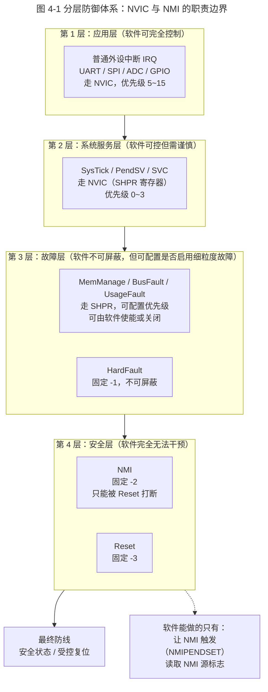

**图 4-1 解释**：这张图是**功能安全架构的核心视图**。从下往上看：层数越低（越靠近 L4），软件的干预能力越弱，但可靠性越高。ISO 26262 要求"安全机制应独立于被监控功能"，具体到 MCU 上就是——**任何可能被应用软件关闭的机制，都不能作为唯一的安全屏障**。所以时钟监控一定要接 NMI（而不是普通 IRQ），因为"应用软件卡在关中断状态"正是最常见的危险场景。

### 4.2 设计机制与设计思路

**设计模式：双通道冗余监控（Dual-Channel Monitoring）**

工控/汽车里典型做法是 **"同一事件，两条通道"**：

| 事件 | 主通道（NVIC） | 备份通道（NMI） | 冗余意义 |
|---|---|---|---|
| 时钟失效 | 外设产生 IRQ，进入 ISR 记录日志 | CSS 硬连 NMI | 若主通道被关中断挡住，NMI 仍能救命 |
| 看门狗超时 | 窗口看门狗早唤醒中断 WWDG | 独立外部看门狗芯片 → NMI 引脚 | 双重独立，避免共用时钟/共用电源 |
| 存储器错误 | ECC 可纠正错误 → IRQ（统计用） | ECC 不可纠正 → NMI（致命） | 分级响应：能纠就纠，不能纠就停 |
| 电源异常 | PVD 中断 → 保存数据 | PVD 极低阈值 → NMI/复位 | 分级：预警 vs 抢救 |

**为什么必须冗余？** 因为"共因失效（Common Cause Failure）"：如果两条通道共用同一时钟、同一电源、同一软件配置，那么一次干扰可能同时废掉两条。所以 NMI 通道的**物理独立性**（独立时钟源 LSI、独立电源域、独立外部芯片）才是它真正的价值所在。

### 4.3 深入原理：对比总表

| 维度 | NMI | NVIC（普通 IRQ） |
|---|---|---|
| **异常编号** | 2（固定） | 16 ~ 255（IRQ0 ~ IRQ239） |
| **优先级** | -2（固定，硬件写死） | 0 ~ (2^N - 1)，可配置 |
| **优先级寄存器** | 无（SHPR 中无字段） | `NVIC_IPR[]` |
| **使能控制** | 无（永远使能） | `NVIC_ISER / ICER` |
| **挂起控制** | 仅 `ICSR.NMIPENDSET`（软件置位） | `NVIC_ISPR / ICPR` + 外设请求 |
| **PRIMASK 能否屏蔽** | 否 | 是 |
| **BASEPRI 能否屏蔽** | 否 | 是（数值 ≥ BASEPRI 的） |
| **FAULTMASK 能否屏蔽** | 否 | 是 |
| **能否被抢占** | 仅被 Reset | 被任何更高优先级异常 |
| **能否嵌套自身** | 否（挂起合并为 1 次） | 否（同一 IRQ 不会自我嵌套，`IABR` 已激活） |
| **软件触发** | `SCB->ICSR = NMIPENDSET` | `NVIC->STIR = IRQn` |
| **来源数量** | 少（2~6 个芯片级源） | 多（最多 240 个） |
| **ISR 编写约束** | 极严格（禁库函数、禁长循环、禁外设等待） | 常规（可用 CMSIS/HAL，但建议短小） |
| **典型用途** | 时钟失效、ECC、外部安全监控、自检 | 外设数据处理、通信、定时、DMA 完成 |
| **失效后果** | Lockup（若 NMI 内再出错） | HardFault（若 ISR 内出错，可升级） |

### 4.4 选型决策流程

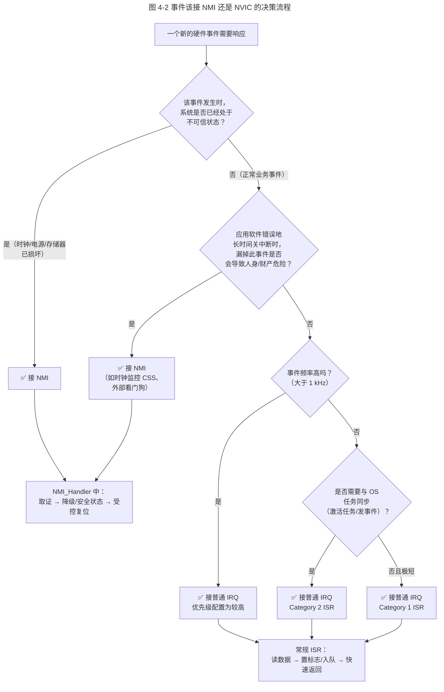

**图 4-2 解释**：决策的**第一问永远是"系统是否已不可信"**，因为 NMI 的 ISR 编写约束极严，绝不能用它处理常规业务。第二个关键判断是"**关中断造成的漏检是否危险**"——这正是 NMI 存在的根本理由。图中最后把两类事件的**处理模板**区分开了：NMI 是"**三段式安全状态机**"，普通 IRQ 是"**快进快出的数据搬运**"。

---

## 第 5 章 与 AUTOSAR OS 的映射关系

### 5.1 通俗易懂

AUTOSAR OS 本身**不实现中断控制器**——它直接使用 MCU 的 NVIC。OS 做的是**在 NVIC 之上加一层"语义约定"**：

| AUTOSAR 概念 | 映射到 Cortex-M 硬件 |
|---|---|
| `OsIsrCategory1`（一类中断） | 不通知 OS 的 ISR，**不调用任何 OS 服务**，硬件上就是一个普通 NVIC 中断，进入时不经 OS 的 ISR 包装 |
| `OsIsrCategory2`（二类中断） | OS 感知的 ISR，**可以调用 `ActivateTask` / `SetEvent` 等**，进入/退出时调用 OS 的 `Os_IsrEntry` / `Os_IsrExit` |
| `SuspendAllInterrupts` | 对应 `PRIMASK`（关闭所有可配置中断） |
| `ResumeAllInterrupts` | 恢复 `PRIMASK` |
| `SuspendOSInterrupts` | 对应 `BASEPRI`（只屏蔽 OS 管理的、优先级不高于某阈值的中断） |
| `IsrPriority` | 写入 `NVIC_IPR[IRQn]` 的值 |
| 任务（Task） | 运行在 Thread 模式（用 PSP） |
| `ShutdownOS` / `Os_GoToSleep` | `NVIC_SystemReset()` / `WFI` |
| 调度点（Scheduling Point） | 中断退出时的 `Os_IsrExit` 里触发 PendSV 或直接切换 |

### 5.2 设计机制与设计思路

**为什么 AUTOSAR 要区分 Category 1 和 Category 2？**

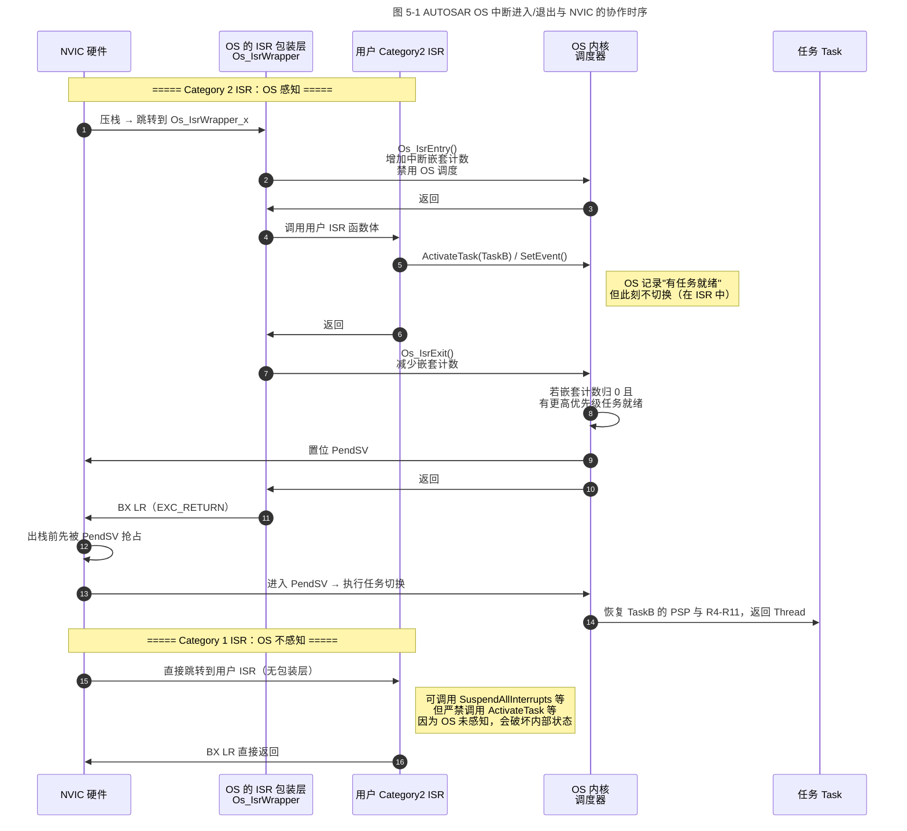

**图 5-1 解释**：这张图揭示了 AUTOSAR OS 最核心的两个机制：

1. **`Os_IsrEntry` / `Os_IsrExit` 是"进入/退出 OS 保护区"的语义标记**。在 ISR 内部 OS 不允许任务切换（因为切换会破坏 ISR 的栈帧），所以 ISR 只能"**记录就绪**"，把切换推迟到 `Os_IsrExit` 时通过 PendSV 完成。这就是 **"延迟调度（Deferred Scheduling）"** 模式。
2. **Category 1 的危险性**：它绕过 OS 包装层，如果里面调用了 `ActivateTask`，OS 的中断嵌套计数和就绪表就会与实际不一致，**导致调度器永久错乱**——这类 bug 极难定位（表现为"偶发任务不运行"）。

**为什么这么设计？**

| 类别 | 延迟 | 可用 OS 服务 | 适用场景 |
|---|---|---|---|
| Category 1 | **极低**（无包装层开销，~几条指令） | 仅 `SuspendAllInterrupts` 系列 | 极高频率/极高实时性需求，如电机换相、编码器捕获 |
| Category 2 | 稍高（包装层 + 可能的调度） | 全部 ISR 可用的 OS 服务 | 绝大多数业务中断 |

### 5.3 深入原理：AUTOSAR 对中断优先级的硬性约束

AUTOSAR OS 规范（SWS_OS）要求：

1. **所有 Category 2 ISR 的优先级必须高于任何 Task 的优先级概念**——因为 Task 运行在 Thread 模式，天然被任何 Handler 模式中断抢占，所以这条在 Cortex-M 上"自动满足"。
2. **OS 内部中断（即"系统计时器 / 调度中断"）的优先级必须高于所有用户 Category 2 ISR**。
   - 在 Cortex-M 上，如果使用 SysTick 做系统时基，则 **SysTick 优先级应设为最高（如 0）**；
   - 但 **PendSV 必须设为最低（如 15）**，因为它要在所有 ISR 结束后执行（见 3.3.6）。
3. **`Os_IsrEntry` 之前不允许发生任务切换**——硬件上通过"ISR 在 Handler 模式 + 硬件压栈"天然保证。

**典型 Cortex-M + AUTOSAR OS 优先级分配方案：**

| 优先级值（4 位，0 最高） | 用途 | 说明 |
|---|---|---|
| 0 | SysTick（OS 系统计时器） | 必须最高，保证时基精度 |
| 1 | 安全相关 ISR（Category 2） | 如碰撞信号、看门狗喂狗 |
| 2 | CAN/LIN 通信 ISR（Category 2） | 高实时通信 |
| 3~8 | 普通外设 ISR（Category 2） | ADC/DMA/Timer |
| 9~14 | 低优先级 ISR | 非实时任务触发 |
| **15** | **PendSV** | **必须最低，用于任务切换** |
| （不可配） | NMI = -2，HardFault = -1 | 硬件固定 |

> ⚠️ **绝对禁止**：把 PendSV 配成非最低优先级。若 PendSV 前面还有更低优先级的 ISR 未执行完，PendSV 会插进去做任务切换，而此时若那个低优先级 ISR 还在用 PSP（如果它嵌套很深），栈就会被破坏 → **随机死机**。

---

## 第 6 章 常见陷阱清单与调试验证方法

### 6.1 陷阱清单（附根因与修复）

| # | 陷阱 | 现象 | 根因 | 修复 |
|---|---|---|---|---|
| 1 | `NVIC->ISER[0] \|= (1<<n)` | 偶发中断使能丢失 | 读-改-写非原子，被 ISR 打断 | 改为 `NVIC->ISER[0] = (1<<n)` 或 `NVIC_EnableIRQ()` |
| 2 | 使能前未清 Pending | 使能后立刻进一次"幽灵中断" | `ISPR` 里残留上一次的标志 | `NVIC_ClearPendingIRQ()` 再 `NVIC_EnableIRQ()` |
| 3 | 优先级分组与 RTOS 不一致 | 任务切换异常/中断优先级错乱 | `AIRCR.PRIGROUP` 被库函数改写 | 全系统只在启动时配置一次，禁止运行中修改 |
| 4 | 中断内调用 `printf` | 卡死或输出乱码 | `printf` 阻塞、不可重入、可能用 malloc | ISR 里只置标志/入环形缓冲，主循环再输出 |
| 5 | 中断内做 Flash 擦写 | 系统假死几十 ms | Flash 编程期间总线停摆，取指失败 | 改为"请求-主循环执行"模式，或用 RAM 函数 + 双区切换 |
| 6 | 忘记 `__DSB/__ISB` | 配置看似生效实则未生效 | Cortex-M 有写缓冲与流水线 | 修改 `VTOR/AIRCR/优先级` 后加 `DSB+ISB` |
| 7 | 共享变量未 `volatile` | 优化后死循环 | 编译器把变量缓存到寄存器 | `volatile` + 必要时加内存屏障 |
| 8 | 全局变量在 ISR 与主循环间"读-改-写" | 计数丢数 | 非原子操作 | 临界区保护，或用原子指令 |
| 9 | `IPR` 写入值超出实现位数 | 优先级与预期不符 | 4 位实现时写了 0~255 | 只写 0~(`2^N - 1`)，用 CMSIS 移位 |
| 10 | NMI 里调用 HAL 函数 | Lockup | NMI 期间外设总线可能已损坏 | 遵守第 2 章 6 条铁律 |
| 11 | 中断嵌套过深 | 栈溢出、随机 HardFault | 每层 32B（+FPU 72B） | 限制嵌套层数，加大栈，用 MPU 加栈哨兵 |
| 12 | 关中断期间进 WFI | 睡死 | 见 3.3.5 | 开中断后再睡，或用 `SEVONPEND` |
| 13 | Bootloader 跳 APP 前未设 VTOR | APP 中断全跳回 Bootloader | `VTOR` 仍指向 0x08000000 | APP 启动第一件事：`SCB->VTOR = APP_BASE` |
| 14 | 忘记清外设中断标志 | 出中断后立刻又进来（中断风暴） | NVIC 的 Pending 清了，但外设标志还在 | 先清**外设**标志，再清 NVIC Pending |
| 15 | 在中断里 `NVIC_SystemReset()` 前未关执行器 | 复位瞬间执行器保持最后电平 | 复位非原子 | 先安全关断，再复位 |

### 6.2 中断风暴（Interrupt Storm）的排查流程

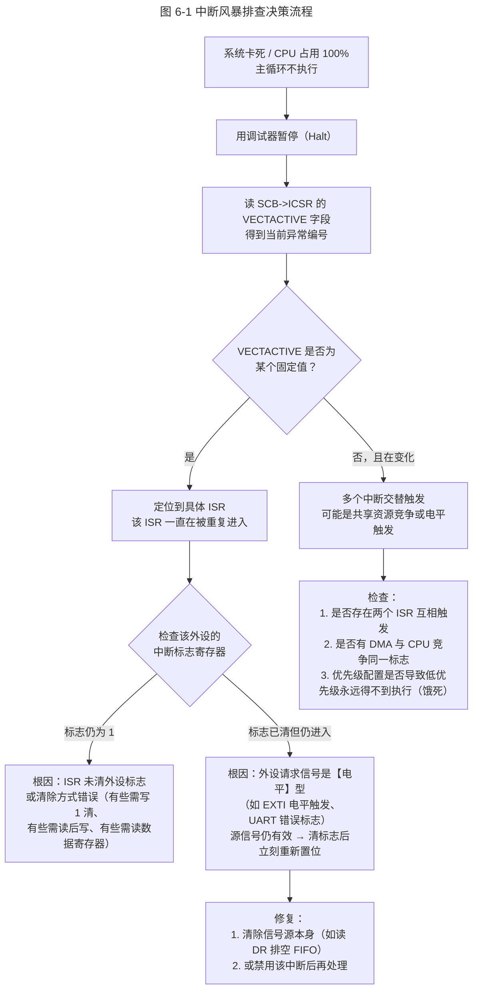

**图 6-1 解释**：关键是**第一步就读 `SCB->ICSR` 的 `VECTACTIVE`（bit8:0）**，它告诉你在 Halt 的那一刻 CPU 正在执行哪个异常（0 表示 Thread 模式）。这是最高效的定位手段，比逐个打断点快得多。第二步的"清标志方式"是最常见的坑：**STM32 的 EXTI 挂起寄存器是"写 1 清除"，而 USART 的某些标志是"读 SR 再读 DR 才清除"**，用错方式就等于没清。

### 6.3 关键调试技巧

```c
/**
 * @brief  故障现场解析：把 CFSR/HFSR 翻译成人话
 * @note   在 HardFault_Handler / NMI_Handler 中调用
 */
void Fault_Decode(uint32_t cfsr, uint32_t hfsr, uint32_t mmfar, uint32_t bfar)
{
    /* ---- HFSR：硬故障状态 ---- */
    if ((hfsr & SCB_HFSR_VECTTBL_Msk) != 0U) {
        /* 取向量时总线错误：通常意味着 VTOR 指向了非法地址
         * 或向量表被擦除（Flash 空白）
         */
        Trace_Log("HFSR: Vector table read error (check VTOR)\r\n");
    }
    if ((hfsr & SCB_HFSR_FORCED_Msk) != 0U) {
        /* 强制升级：某个可配置故障被升级为 HardFault
         * 必须结合 CFSR 才能知道真正原因
         */
        Trace_Log("HFSR: Escalated fault (see CFSR)\r\n");
    }

    /* ---- CFSR 低 8 位：MemManage（MPU 违规） ---- */
    if ((cfsr & 0x000000FFUL) != 0U) {
        if ((cfsr & SCB_CFSR_IACCVIOL_Msk) != 0U) {
            Trace_Log("MMFSR: Instruction access violation (MPU config error)\r\n");
        }
        if ((cfsr & SCB_CFSR_DACCVIOL_Msk) != 0U) {
            Trace_Log("MMFSR: Data access violation, addr = %08X\r\n", mmfar);
        }
        if ((cfsr & SCB_CFSR_MSTKERR_Msk) != 0U) {
            Trace_Log("MMFSR: Stacking error (stack pointer out of MPU region)\r\n");
        }
    }

    /* ---- CFSR 中 8 位：BusFault（总线错误） ---- */
    if ((cfsr & 0x0000FF00UL) != 0U) {
        if ((cfsr & SCB_CFSR_IBUSERR_Msk) != 0U) {
            Trace_Log("BFSR: Instruction bus error (jumped to invalid address)\r\n");
        }
        if ((cfsr & SCB_CFSR_PRECISERR_Msk) != 0U) {
            Trace_Log("BFSR: Precise data bus error, addr = %08X\r\n", bfar);
        }
        if ((cfsr & SCB_CFSR_IMPRECISERR_Msk) != 0U) {
            Trace_Log("BFSR: Imprecise bus error (write buffer, addr unknown)\r\n");
        }
        if ((cfsr & SCB_CFSR_STKERR_Msk) != 0U) {
            Trace_Log("BFSR: Stacking error on bus\r\n");
        }
    }

    /* ---- CFSR 高 16 位：UsageFault（用法错误） ---- */
    if ((cfsr & 0xFFFF0000UL) != 0U) {
        if ((cfsr & SCB_CFSR_DIVBYZERO_Msk) != 0U) {
            Trace_Log("UFSR: Divide by zero\r\n");
        }
        if ((cfsr & SCB_CFSR_UNALIGNED_Msk) != 0U) {
            Trace_Log("UFSR: Unaligned access\r\n");
        }
        if ((cfsr & SCB_CFSR_INVSTATE_Msk) != 0U) {
            Trace_Log("UFSR: Invalid state (EPSR.T = 0, trying to run ARM code)\r\n");
        }
        if ((cfsr & SCB_CFSR_INVPC_Msk) != 0U) {
            Trace_Log("UFSR: Invalid PC load (bad EXC_RETURN value)\r\n");
        }
    }
}

/**
 * @brief  从异常栈帧中提取出错地址
 * @note   Handler 模式下，若使用了 FPU 惰性压栈，
 *         栈帧里还会有一个"附加"的 32 位填充，需要小心解析
 */
typedef struct {
    uint32_t r0;
    uint32_t r1;
    uint32_t r2;
    uint32_t r3;
    uint32_t r12;
    uint32_t lr;
    uint32_t pc;      /* ← 出错指令地址 */
    uint32_t xpsr;
} ExceptionStackFrame_t;

/* 注意：naked 函数中直接用 SP 时，须先判断当时是否使用 MSP/PSP，
 *       这里采用 CMSIS 的 __get_MSP()/__get_PSP() 与 EXC_RETURN 判断
 */
void HardFault_Handler_C(uint32_t *sp)
{
    ExceptionStackFrame_t *frame = (ExceptionStackFrame_t *)sp;

    Fault_Decode(SCB->CFSR, SCB->HFSR, SCB->MMFAR, SCB->BFAR);
    Trace_Log("Fault PC = %08X, LR = %08X, xPSR = %08X\r\n",
              frame->pc, frame->lr, frame->xpsr);

    /* 清故障标志，避免复位前反复进入 */
    SCB->CFSR = SCB->CFSR;
    SCB->HFSR = SCB->HFSR;

    /* 生产环境：进入安全状态 + 受控复位 */
    for (;;) {
        __NOP();
    }
}
```

> 📎 **`HardFault_Handler` 用汇编获取正确栈指针的原因**：HardFault 可能发生在使用 MSP 或 PSP 时，C 函数无法直接知道原 SP。标准写法如下：

```asm
; ---- hardfault_entry.s（GCC 语法） ----
    .syntax unified
    .thumb
    .global HardFault_Handler
    .type   HardFault_Handler, %function
HardFault_Handler:
    ; 1. 判断 EXC_RETURN 的 bit2，确定进入异常前用的是 MSP 还是 PSP
    TST     LR, #4
    ITE     EQ
    MRSEQ   R0, MSP          ; bit2 = 0 → 使用的是 MSP
    MRSNE   R0, PSP          ; bit2 = 1 → 使用的是 PSP
    ; 2. R0 即异常栈帧指针，直接传给 C 函数
    B       HardFault_Handler_C
    .size   HardFault_Handler, .-HardFault_Handler
```

### 6.4 验证清单（单元/集成测试项）

| 测试项 | 方法 | 通过标准 |
|---|---|---|
| NMI 通路可用 | 调 `Nmi_SelfTest()` | 返回 0，且 `NMI_Handler` 确实进入过一次 |
| NMI 不可屏蔽 | 在 `__disable_irq()` 保护区内触发 `NMIPENDSET` | NMI 仍然立即执行 |
| NVIC 优先级生效 | 同时软件触发两个不同优先级 IRQ | 高优先级先执行，且能嵌套低优先级 |
| 尾链生效 | 连续触发两个中断，用 DWT 测量间隔 | 第二个中断进入开销 ≤ 10 周期 |
| 临界区不丢中断 | 关中断期间触发 IRQ，开中断后检查 | IRQ 在开中断后立即执行（不丢失） |
| 向量表重定位 | 从 Bootloader 跳 APP 后触发中断 | 进入 APP 的 ISR 而非 Bootloader |
| 栈溢出保护 | 用 MPU 设置栈哨兵区，或填 `0xDEADBEEF` 后检查 | 无栈越界 |
| 优先级反转检查 | 用 Trace 工具观察 ISR 执行顺序 | 符合设计表 |

---

## 第 7 章 完整可运行示例工程骨架

### 7.1 工程结构

```
project/
├── startup/
│   └── startup_stm32f4xx.s      # 向量表 + Reset_Handler（含 NMI_Handler 弱符号）
├── link/
│   └── stm32f407.ld             # 链接脚本（含 .noinit 段定义）
├── bsp/
│   ├── nvic_port.c              # NVIC 封装（第 3 章代码）
│   ├── nmi_handler.c            # NMI 处理（第 2 章代码）
│   └── fault_handler.c          # 故障诊断（第 6 章代码）
├── os/
│   ├── os_isr_wrapper.c         # Category 1/2 包装层
│   └── os_pendsv.c              # 上下文切换
└── app/
    └── main.c                   # 初始化顺序
```

### 7.2 启动顺序（务必按此顺序）

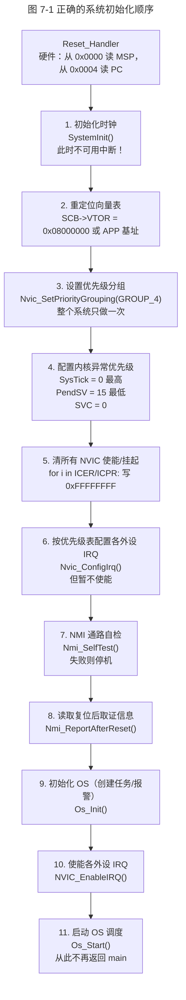

**图 7-1 解释**：这个顺序有三处**绝不能颠倒**：

- **步骤 2 必须在步骤 10 之前**：向量表没重定位就使能中断 → 中断跳到错误地址 → HardFault。
- **步骤 3 必须在步骤 4/6 之前**：优先级分组决定了 `IPR` 值的解释方式，先写 `IPR` 再改分组会导致所有优先级被"重新解释"，实际生效值与预期不符。
- **步骤 7（NMI 自检）在使能任何中断之前**：因为 NMI 自检会执行一次真实的 NMI，此时系统应当是"干净"的，避免误判来源。

### 7.3 关键配置文件片段

**链接脚本中的 `.noinit` 段（GCC）：**

```ld
/* 放在 RAM 区域，NOLOAD 表示不生成初始化数据，
 * 且启动代码的 .bss 清零逻辑不应覆盖它
 */
.noinit (NOLOAD) :
{
    . = ALIGN(4);
    __noinit_start = .;
    *(.noinit)
    *(.noinit*)
    . = ALIGN(4);
    __noinit_end = .;
} > RAM
```

**启动代码中跳过 `.noinit` 的 `.bss` 清零（示意）：**

```asm
/* 只清 __bss_start 到 __bss_end，不含 .noinit */
    LDR     R0, =__bss_start
    LDR     R1, =__bss_end
    MOVS    R2, #0
ClearBss:
    CMP     R0, R1
    BCS     ClearBssDone
    STR     R2, [R0], #4
    B       ClearBss
ClearBssDone:
```

### 7.4 一页速查表

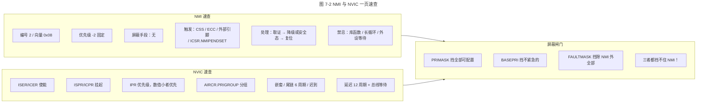

**图 7-2 解释**：可以把这张图当作日常开发的"口袋卡"。工作中 90% 的问题都落在三处：**优先级分组配错（V4）**、**清标志方式错导致中断风暴（V1/V2）**、**NMI 里写了不该写的代码（N6）**。

---

## 附录 A：术语速查

| 术语 | 全称 | 含义 |
|---|---|---|
| NMI | Non-Maskable Interrupt | 不可屏蔽中断，异常编号 2，优先级 -2 |
| NVIC | Nested Vectored Interrupt Controller | 嵌套向量中断控制器，内核内置 |
| SCS | System Control Space | 系统控制空间，基址 `0xE000E000` |
| SCB | System Control Block | 系统控制块，属 SCS 一部分 |
| ISR | Interrupt Service Routine | 中断服务程序 |
| VTOR | Vector Table Offset Register | 向量表偏移寄存器 |
| AIRCR | Application Interrupt and Reset Control Register | 应用中断与复位控制寄存器 |
| PRIGROUP | Priority Grouping | 优先级分组，划分抢占位与子优先级位 |
| IPSR | Interrupt Program Status Register | 记录当前异常编号（xPSR 低 9 位） |
| EXC_RETURN | Exception Return | LR 中的魔数，指示返回模式与栈 |
| FPCA | Floating Point Context Active | CONTROL 寄存器位，指示是否使用 FPU |
| Lockup | — | 不可恢复的 CPU 锁死状态，仅 Reset 可退出 |
| Proofline Test | — | 安全机制自检，证明机制"活着" |

## 附录 B：参考资料

1. ARM, *ARMv7-M Architecture Reference Manual* (ARM DDI 0403), Chapter B1 (Exceptions), B3 (NVIC), B5 (System Control)
2. ARM, *Cortex-M4 Devices Generic User Guide* (ARM DUI 0553A), Chapter 4 (NVIC), Chapter 4.4 (SCB)
3. Joseph Yiu, *The Definitive Guide to ARM Cortex-M3 and Cortex-M4 Processors*, 3rd Edition
4. AUTOSAR, *Specification of Operating System* (SWS_OS), R4.x
5. ISO 26262-5:2018, *Product development at the hardware level* — Annex D (Safety mechanisms)
6. STMicroelectronics, *STM32F407 Reference Manual* (RM0090), Chapter 10 (Interrupts and events), Chapter 6 (RCC, CSS)

---

> 📝 **文档说明**：本文档为独立技术分析，基于 ARM 架构规范、AUTOSAR 规范与嵌入式通用原理撰写，不依赖本知识库中其他文档作为基准。代码示例以 STM32F4（Cortex-M4）为目标，移植到其他 Cortex-M 器件时只需替换器件头文件与具体外设寄存器名。
